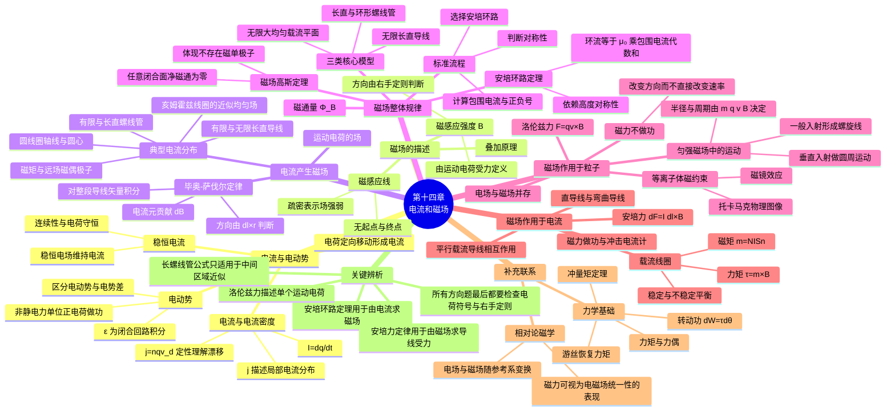

> [!abstract]+ 本章主线
> **电流 → 电流产生磁场 → 计算磁场 → 磁场作用于运动电荷 → 磁场作用于载流导线与线圈 → 磁力矩、磁力做功与电流计。**
>
> 本笔记以大学物理 PPT 为主线，结合《工程物理学（第三版）》补充。课件例题保留原题意，并放在对应知识点下。

## 章节思维导图



## 目录
- [[#第十四章总览|第十四章总览]]
- [[#14.1 电流【公式定量｜漂移定性了解】|14.1 电流]]
- [[#14.2 电动势【定量掌握】|14.2 电动势]]
- [[#14.4 磁力【导线受力定量｜磁现象定性】|14.4 磁力]]
- [[#14.5 磁场【定性理解 + 定义会用】|14.5 磁场]]
- [[#14.6 运动电荷的场【磁场定量｜电场定性补充】|14.6 运动电荷的场]]
- [[#14.7 毕奥–萨伐尔定律【定量掌握】|14.7 毕奥–萨伐尔定律]]
- [[#14.8 磁场的高斯定理与安培环路定理【定量掌握】|14.8 磁场的高斯定理与安培环路定理]]
- [[#14.9 洛伦兹力【定量掌握】|14.9 洛伦兹力]]
- [[#14.10 安培定律【定量掌握】|14.10 安培定律]]
- [[#14.11 相对论磁学【教材补充｜定性掌握】|14.11 相对论磁学]]
- [[#14.12 均匀磁场对载流线圈的作用【定量掌握｜磁力做功自学】|14.12 均匀磁场对载流线圈的作用]]
- [[#14.13 等离子体的磁约束【教材补充｜定性理解】|14.13 等离子体的磁约束]]
- [[#专项补充：把力学基础真正推导出来|专项补充与概念辨析]]
- [[#全章复习与自检|公式速查与整章自检]]

> [!info]+ PPT 中明确标出的“了解 / 自学”范围
> **本笔记正文内：**
> - **§14.1 电流密度与漂移速度的关系：PPT 标注“定性了解”。**理解漂移速度的物理意义和 $\vec j=nq\vec v_d$ 的关系即可。
> - **§14.12 磁力做功：PPT 标注“自行学习”。**它不是“课堂一般了解”的同义标记，因此在正文中单独标为自学内容。
>
> **课件总览中另有标注、但不属于本笔记正文的内容：**第 18 章 §18.2、§18.3、§18.6，以及第 15 章 §15.10，均标注为“一般了解”。
>
> 除上述项目外，PPT 没有把本笔记中的其他 Ch14 小节标为“一般了解”，因此不再自行降低掌握要求。

> [!check]+ 教材与 PPT 核查后补充、修正的内容
> - **PPT 非编号内容：**安培的历史定义、亥姆霍兹线圈、安培环路定理随堂填空。
> - **教材补充：**地球磁场的等效环形电流、§14.11 电磁场变换关系、§14.13 等离子体的磁约束。
> - **符号修正：**无限大载流平面的面电流密度统一记为 $i$（单位 $\mathrm{A/m}$），与体电流密度 $j$（单位 $\mathrm{A/m^2}$）区分。
> - **方向修正：**运动电荷产生的电场对 $q>0$ 沿径矢方向，对 $q<0$ 与径矢方向相反。
> - **例题核查：**13 道有编号的 PPT 例题均已覆盖；本次补入的是此前遗漏的非编号课件内容和教材补充。

## 第十四章总览

### 一、使用说明：来源与掌握层级
-   **【PPT核心｜定量掌握】**：PPT
    明确讲授的公式、推导和计算题，应会判断适用条件、列式并计算。
-   **【PPT核心｜定性理解】**：掌握物理图像、方向关系和结论；不把复杂推导当作主要计算目标。
-   **【教材补充｜定性掌握】**：教材有、PPT
    未单独讲授或未展开的内容；理解物理意义、适用条件和结论即可，除非老师另有要求。
-   **【PPT标注"定性了解"/"自行学习"】**：按课件原标记处理，文中会单独指出。
-   **【定量公式 +
    定性机制】**：公式需要会用，但其背后的复杂推导只要求解释思路。

> **注意：** 章节编号说明
> 你上传的课件中存在编号不一致：一份课件将毕奥--萨伐尔定律列为
> §14.7，另一份课件又将磁场高斯定理与安培环路定理标为
> §14.7。为便于与教材及我们此前的复习衔接，本笔记采用统一编号：§14.7
> 毕奥--萨伐尔定律、§14.8 磁场高斯定理与安培环路定理、§14.9
> 洛伦兹力、§14.10 安培定律、§14.11 相对论磁学、§14.12
> 均匀磁场对载流线圈的作用；§14.13 等离子体的磁约束作为教材补充单列。
>
> **注：** §14.3 的处理 你此前明确提出本次整理不需要 §14.3 RC
> 电路，因此本版不展开该节；其余本次上传 PPT
> 涉及的第十四章内容均纳入。PPT
> 同一文件中的第十五章、第十八章内容不属于本章整理范围。

### 二、各节掌握层级总表

| 小节 | 内容 | 来源 | 建议掌握层级 |
|---|---|---|---|
| §14.1 | 电流、电流密度、稳恒电流、稳恒电场 | PPT | 电流与电流密度公式【定量】；漂移速度关系【定性了解】；理解连续性方程 |
| §14.2 | 电动势、非静电力、电势差区别 | PPT | 定义与积分表达式【定量】；物理意义与电势差区别【定性 + 公式】 |
| §14.4 | 磁力、载流导线间相互作用 | PPT + 教材 | 磁相互作用图像【定性】；平行长直导线受力关系【定量】 |
| §14.5 | 磁场、磁感应强度、磁感应线 | PPT | 定义、单位、方向和磁感应线性质【理解并会用定义】 |
| §14.6 | 运动电荷产生的磁场 | PPT + 教材 | 低速运动电荷磁场公式与方向【定量】；相对论修正电场【教材补充，定性理解为主】 |
| §14.7 | 毕奥–萨伐尔定律、典型电流分布的磁场 | PPT | 定量掌握；PPT 例题 1–3 在对应小节中 |
| §14.8 | 磁通量、磁场高斯定理、安培环路定理 | PPT + 教材 | 磁通量与高斯定理意义【理解】；对称电流分布的安培环路计算【定量】 |
| §14.9 | 洛伦兹力、磁场中带电粒子运动 | PPT + 教材 | 洛伦兹力大小、方向、磁场不做功【定量 + 定性】；教材扩展应用【定性理解为主】 |
| §14.10 | 安培力、平行载流导线、弯曲导线受力 | PPT | 定量掌握；PPT 例题 5、6、9、10 在对应小节中 |
| §14.11 | 相对论磁学 | 教材，PPT 未单独展开 | 【教材补充｜定性掌握】理解电场与磁场的相对论联系 |
| §14.12 | 载流线圈、磁力做功、电流计 | PPT + 教材 | 线圈力矩和电流计【定量】；磁力做功按 PPT 标注【自行学习】 |
| §14.13 | 等离子体的磁约束 | 教材补充，PPT 未单独讲授 | 【定性理解】掌握螺旋运动、磁镜效应和托卡马克的物理图像 |

---

### 四、全章物理主线

> 主线： **电流 → 稳恒电流 → 电动势 → 磁力与磁场 → 磁感应强度 →
> 运动电荷的场 → 洛伦兹力 → 毕奥--萨伐尔定律 → 典型载流导线的磁场 →
> 圆线圈 → 磁矩 → 长直螺线管 → 磁通量与安培环路定理 → 安培力**

> **核心思路：** 全章物理主线

这一章最重要的不是背一堆公式，而是先记住两个问题：

**问题 1：电流是什么？**

电荷发生**定向移动**，就形成电流。 所以：

$$
\boxed{\text{电荷定向移动}\rightarrow \text{电流}}
$$

**问题 2：电流和运动电荷会产生什么？**

运动电荷会产生**磁场（magnetic field）**。
而磁场又会对运动电荷产生**洛伦兹力（Lorentz force）**。
所以最核心的一条链是：

$$
\boxed{
\text{电流}
\rightarrow
\text{磁场}
\rightarrow
\text{磁力}
}
$$

其中：

- **电流（electric current）**：描述电荷怎么流
- **磁场（magnetic field）**：描述运动电荷或电流在空间产生的磁作用
- **磁感应强度（magnetic flux density）** $B$：描述磁场强弱和方向
- **洛伦兹力（Lorentz force）**：描述磁场对运动电荷的作用

而毕奥--萨伐尔定律解决的是：

> **已知电流长什么样，怎么求它产生的磁场？**

---


## 14.1 电流【公式定量｜漂移定性了解】

> **来源/掌握层级：PPT 核心。**
> 电流、电流密度及其通量公式需要会用；漂移速度关系在 PPT
> 中明确标注"定性了解"；稳恒电流与稳恒电场重点理解连续性方程的物理意义。

### 一、电流（Electric Current）

**1. 什么叫电流？**

电荷的定向移动形成电流。

产生电流需要两个基本条件：

1.  存在可以移动的带电粒子，即**载流子（charge carriers）**
2.  存在电场，使载流子产生定向运动

载流子可以是：

-   自由电子
-   离子
-   电子---空穴对
-   带净电荷的宏观粒子

### 二、传导电流与运流电流

教材和 PPT 将电流按载流子运动所在的环境区分为两类。

**传导电流（Conduction Current）**

自由电子、空穴或离子在**导体内部**定向移动形成的电流。

例如：

-   金属导线中的自由电子定向运动
-   半导体中的电子、空穴运动
-   电解液中的离子运动

**运流电流（Convection Current）**

电子、离子或带电宏观物体在**空间中定向运动**形成的电流。

例如：

-   阴极射线管中的电子束
-   带电圆盘旋转形成的电流

因此：

$$
\boxed{
\text{传导电流：载流子在介质内部运动}
}
$$

$$
\boxed{
\text{运流电流：带电粒子/带电体在空间中运动}
}
$$

这两个概念的共同本质都是：

> **带电粒子的定向运动形成电流。**

教材和 PPT
都强调：载流子平时还会进行无规则热运动，但加上电场以后，会叠加一个定向运动。载流子平时还会进行无规则热运动，但加上电场以后，会叠加一个定向运动。

**2. 电流强度 $I$**

电流强度描述：

> **单位时间内通过某一截面的电荷量。**

定义：

$$
\boxed{
I=\frac{dq}{dt}
}
$$

如果在时间 $\Delta t$ 内通过截面的电荷量为 $\Delta q$：

$$
I=\frac{\Delta q}{\Delta t}
$$

单位：

$$
\boxed{\mathrm{A}\;(\text{安培})}
$$

**电流方向**

规定：

> **正电荷运动的方向为电流方向。**

所以金属导线里电子实际上向一个方向运动时，**电子运动方向和约定电流方向相反**。

这是非常容易错的一点。

### 三、电流密度（Current Density）

只知道一个导线里有多大的 $I$，还不够。

因为电流在截面上可能分布得不均匀。

例如：

-   粗细均匀的导线
-   粗细变化的导线
-   半球形接地电极
-   同轴电缆

它们的电流分布都可能不同。

因此引入：

$$
\boxed{\vec j=\text{电流密度（current density）}}
$$

**1. 电流密度的定义**

在导体内部某一点取一个很小的面元 $dS$。

如果这个面元的法线方向和电流方向夹角为 $\theta$，则：

$$
dI=j\,dS\cos\theta
$$

因此：

$$
\boxed{
dI=\vec j\cdot d\vec S
}
$$

这里：

$$
d\vec S=\vec n\,dS
$$

所以：

$$
\boxed{
I=\int_S\vec j\cdot d\vec S
}
$$

这句话非常重要：

> **电流 $I$ 是电流密度 $\vec j$ 穿过截面的通量。**

**2. 电流密度的方向**

$\vec j$ 的方向规定为：

> **正电荷载流子的运动方向。**

所以：

$$
\boxed{\vec j\parallel\text{电流方向}}
$$

单位：

$$
\boxed{\mathrm{A/m^2}}
$$

**3. 电流线（Current Lines）**

为了形象表示电流密度的空间分布，可以画电流线。

特点：

1.  电流线某点的切线方向就是 $\vec j$ 的方向
2.  电流线越密，表示 $j$ 越大
3.  电流线不能相交

可以类比电场线：

> **电流线描述的是 $\vec j$ 的空间分布。**

### 四、电流密度与漂移速度（Drift Velocity）【PPT：定性了解】

> [!note] 掌握要求
> 理解漂移速度的物理意义，知道电流密度与载流子数密度、电荷量和漂移速度的关系；PPT 将本小节明确标为“定性了解”。

载流子在导体中并不是整齐地向前跑。

它们同时存在：

-   无规则热运动
-   电场造成的定向运动

这种定向运动的平均速度叫：

$$
\boxed{\text{漂移速度 }v_d\;(\text{drift velocity})}
$$

如果载流子数密度为 $n$，载流子电荷为 $q$：

$$
\boxed{
\vec j=nq\vec v_d
}
$$

对于正电荷载流子，$\vec j$ 和 $\vec v_d$ 同向。

对于金属中的电子：

-   $q<0$
-   电子漂移方向与约定电流方向相反

PPT 给出的典型数量级：

$$
v_d\approx10^{-5}\,\mathrm{m/s}
$$

而电子热运动速率大约为：

$$
10^5\,\mathrm{m/s}
$$

这说明：

> **电流的"定向速度"其实非常小，但它仍然可以形成稳定电流。**

### 五、稳恒电流（Steady Current）

**1. 什么叫稳恒电流？**

如果导体中各点的电流密度矢量 $\vec j$ 不随时间变化，就叫：

$$
\boxed{\text{稳恒电流（steady current）}}
$$

即：

$$
\boxed{
\frac{\partial\vec j}{\partial t}=0
}
$$

**2. 为什么稳恒电流不会让某个地方越积越多电荷？**

电荷守恒对应**电荷连续性方程（continuity equation）**：

$$
\boxed{
\oint_S\vec j\cdot d\vec S
=
-\frac{dq}{dt}
}
$$

稳恒情况下，空间中某个区域的电荷分布不再变化：

$$
\frac{dq}{dt}=0
$$

因此：

$$
\boxed{
\oint_S\vec j\cdot d\vec S=0
}
$$

物理上就是：

> **一个闭合曲面中，流出去多少电荷，就必须有多少电荷流进来。**

所以不会不断积累。

### 六、稳恒电场（Steady Electric Field）

稳恒电流中，导体内部的电荷分布不随时间改变，因此相应的电场也不随时间改变。

这叫：

$$
\boxed{\text{稳恒电场（steady electric field）}}
$$

**1. 它和静电场有什么区别？**

这是一个很容易混的地方。

**静电平衡**

导体达到静电平衡：

$$
\boxed{E=0}
$$

所以：

-   导体是等势体
-   没有电流

即：

$$
I=0
$$

**稳恒电流**

导体中存在持续电流：

$$
\boxed{E\neq0}
$$

也就是说：

> **"电场不随时间变化"不等于"电场等于零"。**

稳恒电流中的导体内部可以存在一个稳定的非零电场。

---

## 14.2 电动势【定量掌握】

> **来源/掌握层级：PPT 核心｜定量掌握。**
> 会使用电动势定义和非静电性场积分表达式；必须能解释电动势与电势差的区别。

### 一、电动势（Electromotive Force, EMF）

现在出现一个问题：

> 如果电阻一直消耗能量，导体中的电荷为什么还能一直运动？

因为电路中存在**电源（source）**。

**1. 电源到底干了什么？**

在电源外部，正电荷通常受到静电力作用，从高电势向低电势运动。

但是如果要让电流持续，就必须把正电荷：

$$
\text{低电势端}
\rightarrow
\text{高电势端}
$$

这件事单靠静电力做不到。

因此电源内部必须存在一种**非静电力（non-electrostatic force）**。

它负责把正电荷从负极送回正极。

教材指出，维持电流所需的非静电力可以由不同机制提供，例如：

-   化学过程
-   载流子在不同物质界面上的扩散
-   随时间变化的磁场产生的感生电场（涡旋电场）

所以"非静电力"并不只意味着某一种具体的力，而是泛指能够驱动正电荷逆静电力方向运动、维持闭合电流的非静电作用。

所以可以把电源理解成：

> **不断把"掉下去"的电荷重新搬回"高处"。**

### 二、电动势 $\varepsilon$ 的定义

电动势描述的是：

> **电源内部非静电力把单位正电荷从负极移动到正极所做的功。**

定义：

$$
\boxed{
\varepsilon=\frac{A}{q}
}
$$

其中：

-   $A$：非静电力所做的功
-   $q$：被移动的正电荷量

单位：

$$
\boxed{\mathrm V\;(\text{伏特})}
$$

按照教材约定：

> **电动势的方向取为从电源负极经电源内部指向正极。**

电源的本质作用是：

$$
\boxed{
\text{把其他形式的能量转化为电能}
}
$$

例如化学能、机械能、光能、热能、核能等都可以通过不同类型的电源转化为电能。

**2. 用非静电性电场表示**

假设非静电力可以等效成一个非静电性电场：

$$
\vec F_K=q\vec E_K
$$

那么电源内部：

$$
A=\int_A^B\vec F_K\cdot d\vec l
$$

所以：

$$
\boxed{
\varepsilon
=
\int_A^B\vec E_K\cdot d\vec l
}
$$

如果整个闭合回路都存在非静电力，则：

$$
\boxed{
\varepsilon
=
\oint_L\vec E_K\cdot d\vec l
}
$$

### 三、电动势与电势差的区别

虽然二者单位都是伏特，但本质不同。

                 电势差（Potential Difference）   电动势（EMF）
  -------------- -------------------------------- --------------------------
  对应的力       静电力                           非静电力
  力的性质       保守力                           非保守力
  主要发生位置   静电场中                         电源内部/非静电力存在处
  本质           单位正电荷的电势能变化           非静电力对单位正电荷做功

一句话：

$$
\boxed{
\text{电势差：静电力做功}
}
$$

$$
\boxed{
\text{电动势：非静电力做功}
}
$$

---

## 14.4 磁力【导线受力定量｜磁现象定性】

> **来源/掌握层级：PPT + 教材。**
> 磁相互作用的形成机制以定性理解为主；平行长直载流导线之间的力及方向关系按定量公式掌握。

### 一、奥斯特实验与磁相互作用

现在电流部分已经建立起来了。

接下来进入本章最核心的另一条线：

$$
\boxed{
\text{运动电荷/电流}
\rightarrow
\text{磁场}
}
$$

磁场是运动电荷之间相互作用的媒介。

PPT 用奥斯特实验引出：

> 通电导线附近的小磁针会发生偏转。

这说明：

$$
\boxed{
\text{电流会产生磁场}
}
$$

而磁场又会作用于运动电荷。

因此：

$$
\boxed{
\text{电流}\rightarrow\text{磁场}\rightarrow\text{磁力}
}
$$

在本章讨论的**稳恒电流（steady current）** 情况下，电流产生的是不随时间变化的**稳恒磁场（steady magnetic field）** 。
 
### 二、平行载流导线之间的磁力

教材进一步给出了电流之间相互作用的定量关系。

设两根相距 $b$ 的无限长平行直导线中分别有电流 $I_1$ 和 $I_2$。

实验表明：

-   两根电流**同向** → 相互吸引
-   两根电流**反向** → 相互排斥

单位长度上的磁力满足：

$$
\boxed{
\frac{F_m}{l}
=
\frac{\mu_0 I_1 I_2}{2\pi b}
}
$$

其中：

-   $F_m/l$：单位长度上的磁相互作用力
-   $I_1,I_2$：两根导线中的电流
-   $b$：两导线之间的距离
-   $\mu_0$：真空磁导率

教材也先用比例系数写成：

$$
\frac{F_m}{l}
\propto
\frac{I_1I_2}{b}
$$

然后引入真空磁导率：

$$
\boxed{
\mu_0=4\pi\times10^{-7}\ \mathrm{N/A^2}
}
$$

因此可以把这条规律理解成：

> **一根电流产生磁场，另一根电流处在这个磁场中，于是受到安培力。**

也就是说，平行电流之间的"直接相互作用"实际上仍然可以拆成：

$$
\boxed{
I_1\rightarrow B_1\rightarrow I_2\text{受到磁力}
}
$$

### 三、课件中的安培定义（历史定义）【PPT 非编号｜定性识记】

课件还给出了传统的安培定义：在真空中，两根相距 $1\,\mathrm m$ 的无限长平行细直导线通有相等电流；若每米导线所受磁力为 $2\times10^{-7}\,\mathrm N$，则导线中的电流定义为 $1\,\mathrm A$。

> [!note] 现行 SI 的区别
> 这是课件沿用的**历史定义**。现代 SI 自 2019 年起通过固定基本电荷 $e$ 的数值定义安培；复习本课程时保留这一定义，是为了识别教材和 PPT 的表述，不应把它误认为现行 SI 的正式定义。

这也正好把"电流产生磁场"和后面的"安培力"连接起来。

---

## 14.5 磁场【定性理解 + 定义会用】

> **来源/掌握层级：PPT 核心。**
> 掌握磁感应强度的定义、单位、方向约定，以及磁感应线的闭合性和右手螺旋关系。

### 一、基本磁现象

教材和 PPT 先从几个基本磁现象认识磁场。

**磁性（Magnetism）**

具有吸引铁、镍、钴等物质的性质。

**磁极（Magnetic Pole）**

磁体通常有：

-   北极 $N$
-   南极 $S$

规律：

$$
\boxed{
\text{同名磁极相斥，异名磁极相吸}
}
$$

教材指出，磁极之间的作用力满足平方反比关系。

同时，至今没有发现能够单独存在的**磁单极子（magnetic monopole）**。

因此磁现象最终可以统一理解为：

$$
\boxed{
\text{运动电荷之间的相互作用}
}
$$

而这种相互作用通过磁场传递。

### 二、磁场的基本性质

与电场不同：

$$
\boxed{
\text{磁场对静止电荷没有作用}
}
$$

磁场的基本作用对象是：

$$
\boxed{
\text{运动电荷（或电流）}
}
$$

因此：

$$
\boxed{
\text{运动电荷/电流}\rightarrow\text{产生磁场}
}
$$

$$
\boxed{
\text{运动电荷/电流}\leftarrow\text{受到磁场作用}
}
$$

### 三、磁感应强度（Magnetic Flux Density）$\vec B$

为了描述磁场，需要一个物理量：

$$
\boxed{\vec B}
$$

叫做：

**磁感应强度（magnetic flux density）**

**1. 为什么用运动电荷来定义 $B$？**

在磁场中放一个运动的检验电荷 $q$。

实验发现：

-   当速度方向改变时，磁力方向也随之改变
-   存在一个特殊方向，使磁力为零
-   当速度垂直于磁场时，磁力最大

因此规定：

> **使运动电荷所受磁力为零的那个方向，就是磁感应强度 $\vec B$ 的方向。**

对于正试探电荷，在 $\vec v\perp\vec B$ 时：

$$
\boxed{
\vec B\parallel \vec F_M\times\vec v
}
$$

因此也可以利用磁力方向和速度方向来确定 $\vec B$ 的方向。

**2. $B$ 的大小**

当：

$$
\vec v\perp\vec B
$$

磁力最大：

$$
F_M=qvB
$$

因此：

$$
\boxed{
B=\frac{F_M}{qv}
}
$$

单位：

$$
\boxed{\mathrm T\;(\text{特斯拉})}
$$

并且：

$$
1\,\mathrm T
=
1\,\mathrm{\frac{N}{A\cdot m}}
$$

PPT 还给出：

$$
\boxed{
1\,\mathrm T=10^4\,\mathrm G
}
$$

其中 G 是高斯（Gauss）。

> **注：** 关于 $B$ 与 $H$ 本章用 **磁感应强度（Magnetic Flux Density）$B$** 描述磁场的基本强度特征。教材提到"磁场强度（magnetic field strength）"这一名称用于另一个辅助量 $H$，本章当前 PPT 不展开 $H$ 的计算，因此做题时不要把 $B$ 和 $H$ 混用。

### 四、磁场的叠加原理（Superposition Principle）

教材明确指出，磁场同样服从叠加原理。

如果空间中有多个运动电荷或多段电流，那么某点的总磁场等于各个源单独产生的磁场的**矢量和**：

$$
\boxed{
\vec B
=
\sum_i\vec B_i
}
$$

如果源是连续分布的电流，则写成积分：

$$
\boxed{
\vec B=\int d\vec B
}
$$

这就是后面毕奥--萨伐尔定律能够工作的根本原因。

### 五、磁感应线（Magnetic Field Lines）

为了形象描述磁场，可以画磁感应线。

定义：

> 磁感应线上任一点的切线方向，就是该点磁场 $\vec B$ 的方向。

**磁感应线的三个重要特点**

**① 磁感应线是闭合曲线**

磁场是涡旋场。

$$
\boxed{\text{磁感应线没有起点和终点}}
$$

**② 与电流方向满足右手螺旋关系**

右手握住载流导线：

-   拇指指向电流方向
-   四指弯曲方向就是磁感应线方向

**③ 磁感应线越密，磁场越强**

所以可以定性判断：

$$
\boxed{
\text{磁感应线越密}\Rightarrow B越大
}
$$

---

## 14.6 运动电荷的场【磁场定量｜电场定性补充】

> **来源/掌握层级：PPT + 教材。**
> 运动电荷产生磁场的低速公式与方向【定量掌握】；教材中带有相对论修正的运动电荷电场公式属于补充内容【定性理解为主】。

### 一、运动电荷产生的磁场【定量掌握】

当点电荷 $q$ 以速度 $\vec v$ 运动，且 $v\ll c$ 时，它在场点 $P$
产生的磁场为：

$$
\boxed{
\vec B=
\frac{\mu_0}{4\pi}
\frac{q\,\vec v\times\hat r}{r^2}
}
$$

其中 $\vec r$ 从运动电荷指向场点，$\hat r$ 是其单位向量。因此：

-   $\vec B$ 垂直于 $\vec v$ 与 $\vec r$ 所在平面，方向由右手定则判断；
-   磁场大小为
    $\displaystyle B=\frac{\mu_0}{4\pi}\frac{|q|v\sin\theta}{r^2}$；
-   若 $q<0$，磁场方向与 $\vec v\times\hat r$ 相反；
-   连续运动电荷形成电流后，对各电荷产生的磁场叠加，就得到下一节的毕奥--萨伐尔定律。

### 二、运动电荷产生的电场【教材补充｜定性理解】

教材这一节的标题实际上是"运动电荷的场"，因此除了磁场，还讨论了**匀速运动电荷产生的电场**。

设电荷 $q$ 以恒定速度 $v$ 运动，场点 $P$ 与电荷当前位置的距离为
$r$，并设：

$$
\theta=\angle(\vec v,\vec r)
$$

教材指出，运动电荷相对于静止电荷出现了一个特殊的方向，因此它产生的电场不再具有静止点电荷那样的球对称性，而具有**轴对称性**。

电场方向与电荷符号有关：当 $q>0$ 时，电场沿从电荷当前位置指向场点的径矢方向；当 $q<0$ 时，电场方向与该径矢方向相反。

教材给出的电场强度大小为：

$$
\boxed{
E=
\frac{1}{4\pi\varepsilon_0}
\frac{|q|}{r^2}
\frac{1-v^2/c^2}
{\left(1-(v^2/c^2)\sin^2\theta\right)^{3/2}}
}
$$

其中：

$$
c=\frac{1}{\sqrt{\varepsilon_0\mu_0}}
$$

是光在真空中的速度。

当：

$$
v\ll c
$$

时，上式近似退化为普通库仑场：

$$
\boxed{
E\approx
\frac{1}{4\pi\varepsilon_0}
\frac{|q|}{r^2}
}
$$

此时可以理解成：

> **电荷虽然在运动，但在低速情况下，它的电场近似就是一个"跟着电荷一起运动的库仑场"。**

而教材特别强调：

> **运动电荷的电场和磁场都随电荷一起运动，因此空间中固定一点的场一般会随时间变化。**

---


## 14.7 毕奥--萨伐尔定律【定量掌握】

> **来源/掌握层级：PPT 核心｜定量掌握。**
> 会从电流元出发，利用对称性与积分求有限直导线、圆线圈轴线和螺线管磁场。

### 一、毕奥--萨伐尔定律（Biot--Savart Law）

现在终于进入：

> **如何计算电流产生的磁场？**

这就是毕奥--萨伐尔定律。

**1. 核心思想**

不要一次计算整根复杂导线。

而是：

> **把电流分成很多很小的电流元 $I\,d\vec l$。**

每一个电流元都会在空间产生一个很小的磁场：

$$
d\vec B
$$

最后把所有电流元产生的磁场叠加起来。

**2. 毕奥--萨伐尔定律**

PPT 给出的核心公式：

$$
\boxed{
d\vec B
=
\frac{\mu_0}{4\pi}
\frac{I\,d\vec l\times\vec r}{r^3}
}
$$

也可以写成：

$$
\boxed{
d\vec B
=
\frac{\mu_0}{4\pi}
\frac{I\,d\vec l\times\hat r}{r^2}
}
$$

其中：

-   $I$：电流
-   $d\vec l$：电流元
-   $\vec r$：从电流元指向场点 $P$ 的位矢
-   $r$：电流元到场点 $P$ 的距离
-   $\hat r$：$\vec r$ 的单位向量
-   $\mu_0$：真空磁导率

PPT 中：

$$
\frac{\mu_0}{4\pi}=10^{-7}\,\mathrm{T\cdot m/A}
$$

### 二、公式的物理含义

公式：

$$
dB\propto\frac{I\,dl\sin\theta}{r^2}
$$

所以：

**电流越大**

$$
I\uparrow\Rightarrow dB\uparrow
$$

**电流元越长**

$$
dl\uparrow\Rightarrow dB\uparrow
$$

**离场点越远**

$$
r\uparrow\Rightarrow dB\downarrow
$$

**$d\vec l$ 与 $\vec r$ 平行**

$$
\theta=0
$$

则：

$$
dB=0
$$

### 三、磁场方向的判断

由叉乘：

$$
d\vec B\parallel d\vec l\times\vec r
$$

所以方向用右手定则判断。

做题时建议固定成：

> **先找电流方向 $d\vec l$ → 再找从电流元指向 $P$ 的 $\vec r$ → 用右手定则判断 $d\vec B$。**

### 四、任意载流导线的磁场

把整根导线上的所有电流元叠加：

$$
\boxed{
\vec B
=
\int d\vec B
}
$$

因此：

$$
\boxed{
\vec B
=
\frac{\mu_0}{4\pi}
\int
\frac{I\,d\vec l\times\hat r}{r^2}
}
$$

这就是用毕奥--萨伐尔定律求磁场的基本套路。

> [!example]- 例题 1｜有限长直导线的磁场
> **来源**：稳恒磁场课件，幻灯片 10--12
>
> **题目**
>
> 设长为 $L$ 的载流直导线 $MN$，电流为 $I$，求距离导线为 $a$ 的场点 $P$
> 处的磁感应强度。
>
> ![[images/Ch14/Ch14-例题1-有限长直导线.png|720]]
> *PPT 原题截图：有限长直导线与场点的几何关系*
>
> 这是毕奥--萨伐尔定律最经典的应用。
>
> **第一步：取电流元**
>
> 取导线上的一个小电流元：
>
> $$
> I\,d\vec l
> $$
>
> 它在 $P$ 点产生：
>
> $$
> dB
> =
> \frac{\mu_0}{4\pi}
> \frac{I\,dl\sin\theta}{r^2}
> $$
>
> **第二步：利用几何关系**
>
> PPT 中通过几何关系把：
>
> $$
> r,\quad l,\quad dl
> $$
>
> 全部换成角度 $\theta$ 的函数。
>
> 最终得到：
>
> $$
> dB
> =
> \frac{\mu_0 I}{4\pi a}
> \sin\theta\,d\theta
> $$
>
> 于是积分：
>
> $$
> B
> =
> \frac{\mu_0 I}{4\pi a}
> \int_{\theta_1}^{\theta_2}
> \sin\theta\,d\theta
> $$
>
> 得到 PPT 形式：
>
> $$
> \boxed{
> B=
> \frac{\mu_0 I}{4\pi a}
> (\cos\theta_1-\cos\theta_2)
> }
> $$
>
> 注意：这里的 $\theta_1,\theta_2$ 必须按照 PPT
> 图中的角度定义来判断，不能看到"角度"就直接套某一个三角函数。
>
> **无限长直导线**
>
> 当：
>
> $$
> L\gg a
> $$
>
> 两端可以看成延伸到无穷远。
>
> PPT 中对应极限得到：
>
> $$
> \boxed{
> B=\frac{\mu_0 I}{2\pi a}
> }
> $$
>
> 这是必须记住的经典公式。
>
> 方向：
>
> 围绕直导线呈同心圆，用右手定则判断。
>
> **半无限长直导线**
>
> 从有限长导线的公式直接取一个端点到无穷远，可以得到：
>
> $$
> \boxed{
> B=\frac{\mu_0 I}{4\pi a}
> }
> $$
>
> 所以：
>
> $$
> \boxed{
> \text{半无限长直导线}
> \Rightarrow
> B=
> \frac12
> \left(
> \frac{\mu_0 I}{2\pi a}
> \right)
> }
> $$

### 五、无限长直导线为什么特别重要？

因为它是后面很多题的基础模型。

一定要建立这个图像：

``` text

             ↺

          ↺     ↺

        ↺    I    ↺

          ↺     ↺

             ↺

      磁感应线是围绕导线的同心圆
```

距离导线为 $r$：

$$
\boxed{
B(r)=\frac{\mu_0I}{2\pi r}
}
$$

所以：

$$
\boxed{B\propto\frac1r}
$$

离导线越远，磁场越弱。

> [!example]- 例题 2｜载流圆线圈轴线上的磁场
> **来源**：稳恒磁场课件，幻灯片 13--17
>
> **题目**
>
> 设圆形线圈半径为 $R$，通电流 $I$，求轴线上距离圆心 $O$ 为 $x$ 的点 $P$
> 处的磁感应强度。
>
> ![[images/Ch14/Ch14-例题2-圆线圈轴线.png|720]]
> *PPT 原题截图：圆线圈及其轴线上场点*
>
> 这是毕奥--萨伐尔定律的另一个经典应用。
>
> **第一步：取一个电流元**
>
> 取圆线圈上的：
>
> $$
> I\,d\vec l
> $$
>
> 在 $P$ 点产生：
>
> $$
> d\vec B
> $$
>
> 其大小：
>
> $$
> dB
> =
> \frac{\mu_0}{4\pi}
> \frac{I\,dl}{r^2}
> $$
>
> 因为：
>
> $$
> d\vec l\perp\vec r
> $$
>
> 所以：
>
> $$
> \sin\theta=1
> $$
>
> **第二步：把 $dB$ 分解**
>
> 把 $dB$ 分成两个分量：
>
> $$
> dB_\parallel
> $$
>
> 和
>
> $$
> dB_\perp
> $$
>
> 其中：
>
> -   $dB_\parallel$：沿 $OP$ 轴线方向
> -   $dB_\perp$：垂直于 $OP$ 轴线
>
> **第三步：利用对称性**
>
> 圆线圈上总能找到关于轴线对称的两个电流元。
>
> 它们产生的：
>
> $$
> dB_\perp
> $$
>
> 方向相反，所以相互抵消。
>
> 而：
>
> $$
> dB_\parallel
> $$
>
> 方向相同，所以相互加强。
>
> 因此：
>
> $$
> \boxed{
> B=\int dB_\parallel
> }
> $$
>
> **第四步：求轴向分量**
>
> 由几何关系：
>
> $$
> r=\sqrt{R^2+x^2}
> $$
>
> PPT 中：
>
> $$
> \cos\theta=\frac{R}{r}
> =
> \frac{R}{\sqrt{R^2+x^2}}
> $$
>
> 所以：
>
> $$
> dB_\parallel=dB\cos\theta
> $$
>
> 代入：
>
> $$
> dB=
> \frac{\mu_0 I\,dl}{4\pi r^2}
> $$
>
> 得到：
>
> $$
> dB_\parallel
> =
> \frac{\mu_0 I R}{4\pi(R^2+x^2)^{3/2}}\,dl
> $$
>
> 对整个圆积分：
>
> $$
> \int dl=2\pi R
> $$
>
> 最终：
>
> $$
> \boxed{
> B(x)
> =
> \frac{\mu_0 I R^2}
> {2(R^2+x^2)^{3/2}}
> }
> $$
>
> 方向沿 $OP$ 轴线。
>
> 具体正负方向用右手螺旋定则判断。

### 六、圆线圈的两个特殊位置

**1. 圆心 $O$**

当：

$$
x=0
$$

得到：

$$
\boxed{
B(0)=\frac{\mu_0I}{2R}
}
$$

如果是密绕 $N$ 匝：

$$
\boxed{
B(0)=\frac{\mu_0NI}{2R}
}
$$

**2. 远离圆线圈**

如果：

$$
x\gg R
$$

则：

$$
R^2+x^2\approx x^2
$$

因此：

$$
(R^2+x^2)^{3/2}\approx x^3
$$

所以：

$$
\boxed{
B\approx\frac{\mu_0IR^2}{2x^3}
}
$$

令：

$$
S=\pi R^2
$$

则：

$$
\boxed{
B\approx\frac{\mu_0IS}{2\pi x^3}
}
$$

### 七、教材例题：用等效环形电流估算地球磁场【教材补充｜定量应用】

**来源：**《工程物理学（第三版）》第 345 页，非 PPT 编号例题。

教材把地球磁场近似看成由一个环形电流产生。设等效圆电流半径
$R=5.00\times10^6\,\mathrm m$，地磁极处到圆心的距离
$r_0=6.370\times10^6\,\mathrm m$，该处磁场大小
$B=1.0\times10^{-4}\,\mathrm T$。

圆线圈轴线上距离圆心 $r_0$ 处的磁场为

$$
B=\frac{\mu_0}{2}\frac{IR^2}{(R^2+r_0^2)^{3/2}}
$$

反解等效电流：

$$
I=\frac{2B(R^2+r_0^2)^{3/2}}{\mu_0R^2}
$$

代入数据得到

$$
\boxed{I\approx3.38\times10^9\,\mathrm A}
$$

> [!note] 模型含义
> 这道题练习把圆线圈轴线磁场公式反向使用，并用数量级估算理解地球磁场。这里的“等效环形电流”是简化模型，不表示地球内部真的存在一根理想圆形导线。

### 八、载流线圈的磁矩（Magnetic Moment）

为了描述载流线圈整体的磁性质，引入：

$$
\boxed{\vec m=NIS\,\vec n}
$$

其中：

-   $N$：线圈匝数
-   $I$：电流
-   $S$：线圈面积
-   $\vec n$：线圈面的法向单位向量

所以：

$$
\boxed{
m=NIS
}
$$

方向：

> 与电流环绕方向满足右手螺旋关系。

**磁偶极子（Magnetic Dipole）**

如果场点到线圈的距离远大于线圈尺寸：

$$
x\gg R
$$

那么这个载流线圈可以近似看成：

$$
\boxed{\text{磁偶极子}}
$$

在轴线上：

$$
\boxed{
B=
\frac{\mu_0m}{2\pi x^3}
}
$$

这里的思想和电偶极子有一定类比。

> [!example]- 例题 3｜载流直螺线管轴线上的磁场
> **来源**：稳恒磁场课件，幻灯片 18--21
>
> **题目**
>
> 计算载流直螺线管内轴线上 $P$ 点的磁感应强度。
>
> ![[images/Ch14/Ch14-例题3-直螺线管轴线.png|720]]
> *PPT 原题截图：直螺线管轴线磁场的积分变量*
>
> 这一题是前面圆线圈磁场的进一步应用。
>
> **第一步：把螺线管看成很多圆线圈**
>
> 假设螺线管单位长度上的匝数为：
>
> $$
> n
> $$
>
> 取轴线上一小段：
>
> $$
> dl
> $$
>
> 这一小段中大约有：
>
> $$
> n\,dl
> $$
>
> 匝圆线圈。
>
> 每一匝电流都是 $I$。
>
> 所以这一小段对 $P$ 点的磁场可以用圆线圈公式叠加。
>
> **第二步：写出这一小段产生的 $dB$**
>
> 单个圆线圈轴线上：
>
> $$
> B=
> \frac{\mu_0IR^2}
> {2(R^2+l^2)^{3/2}}
> $$
>
> 而这一小段有：
>
> $$
> n\,dl
> $$
>
> 匝。
>
> 因此：
>
> $$
> dB
> =
> \frac{\mu_0 nIR^2}
> {2(R^2+l^2)^{3/2}}\,dl
> $$
>
> PPT 中指出：
>
> 各圆电流在 $P$ 处产生的 $dB$ 方向相同。
>
> 所以可以直接进行标量积分。
>
> **这里最容易混的 $\beta$ 到底是什么？**
>
> 这是长直螺线管最重要的几何量。
>
> PPT 定义：
>
> **$\beta$ 是从 $P$ 点指向所选电流元 $dl$ 的位矢
> $\vec r$，与螺线管轴线之间的夹角。**
>
> 即：
>
> $$
> \boxed{
> \beta=\angle(\vec r,\text{螺线管轴线})
> }
> $$
>
> 注意：
>
> $$
> \boxed{
> \beta\neq\angle(d\vec l,\text{轴线})
> }
> $$
>
> 它不是"电流元和轴线的夹角"。
>
> 而是：
>
> **P 点 → 电流元的连线 $\vec r$ 与轴线的夹角。**
>
> **1. 为什么要引入 $\beta$？**
>
> 因为原来的变量是：
>
> $$
> l
> $$
>
> 但直接对 $l$ 积分比较麻烦。
>
> 通过几何关系：
>
> $$
> \boxed{
> l=R\cot\beta
> }
> $$
>
> 因此：
>
> $$
> dl=-R\csc^2\beta\,d\beta
> $$
>
> 同时：
>
> $$
> R^2+l^2
> =
> R^2\csc^2\beta
> $$
>
> 把这些关系代入 $dB$。
>
> **把 $dB$ 化成 $\beta$ 的形式**
>
> 原式：
>
> $$
> dB
> =
> \frac{\mu_0 nIR^2}
> {2(R^2+l^2)^{3/2}}\,dl
> $$
>
> 代入：
>
> $$
> l=R\cot\beta
> $$
>
> 以及：
>
> $$
> dl=-R\csc^2\beta\,d\beta
> $$
>
> 最终得到 PPT 中的：
>
> $$
> \boxed{
> dB
> =
> -\frac{\mu_0nI}{2}
> \sin\beta\,d\beta
> }
> $$
>
> **整个有限长螺线管的磁场**
>
> 对整个螺线管积分：
>
> $$
> B=\int dB
> $$
>
> 所以：
>
> $$
> B
> =
> -\frac{\mu_0nI}{2}
> \int_{\beta_1}^{\beta_2}
> \sin\beta\,d\beta
> $$
>
> 得到：
>
> $$
> \boxed{
> B=
> \frac{\mu_0nI}{2}
> (\cos\beta_2-\cos\beta_1)
> }
> $$
>
> 这就是有限长直螺线管轴线上 $P$ 点的磁场。
>
> **为什么长直螺线管内部是 $B=\mu_0nI$？**
>
> 这是之前最容易产生疑问的地方。
>
> 首先：
>
> $$
> \boxed{
> B=\mu_0nI
> }
> $$
>
> 不是任何螺线管内部任何位置都严格成立。
>
> 它是：
>
> **长直螺线管 $L\gg R$，且 $P$ 位于中间区域、远离两端时的近似结果。**
>
> **1. P 点在中间**
>
> 如果 $P$ 在螺线管中间：
>
> **左端**
>
> 从 $P$ 指向左端的方向，几乎就是轴线负方向。
>
> 所以：
>
> $$
> \boxed{\beta_1\rightarrow\pi}
> $$
>
> **右端**
>
> 从 $P$ 指向右端的方向，几乎就是轴线正方向。
>
> 所以：
>
> $$
> \boxed{\beta_2\rightarrow0}
> $$
>
> 于是：
>
> $$
> B
> =
> \frac{\mu_0nI}{2}
> (\cos0-\cos\pi)
> $$
>
> $$
> =
> \frac{\mu_0nI}{2}(1-(-1))
> $$
>
> 因此：
>
> $$
> \boxed{
> B=\mu_0nI
> }
> $$
>
> **螺线管端点为什么是 $\mu_0nI/2$？**
>
> 如果 $P$ 恰好在长螺线管的一个端点附近：
>
> 一个方向的端点对应：
>
> $$
> \beta=\frac{\pi}{2}
> $$
>
> 另一个方向延伸到无穷远：
>
> $$
> \beta\rightarrow0
> $$
>
> 因此：
>
> $$
> B
> =
> \frac{\mu_0nI}{2}
> (\cos0-\cos\frac{\pi}{2})
> $$
>
> 所以：
>
> $$
> \boxed{
> B=\frac12\mu_0nI
> }
> $$
>
> 因此长直螺线管轴线上的典型结果：
>
> $$
> \boxed{
> \begin{cases}
> B\approx\mu_0nI,
> & \text{中间区域}\\[4pt]
> B\approx\dfrac12\mu_0nI,
> & \text{端点附近}
> \end{cases}
> }
> $$

### 九、长直螺线管的物理图像

可以把它理解成：

> 每一匝圆线圈都产生一个沿轴线方向的磁场。

大量线圈叠加以后：

-   管内各匝产生的磁场方向大致相同
-   管内磁场相互加强
-   管外不同部分的磁场大量抵消

所以长直螺线管形成：

$$
\boxed{
\text{管内强、管外弱}
}
$$

中间区域近似：

$$
\boxed{
B=\mu_0nI
}
$$

并且方向沿螺线管轴线。

### 十、亥姆霍兹线圈：轴向磁场近似均匀【PPT 非编号｜定量 + 定性】

亥姆霍兹线圈（Helmholtz coils）由两个相同的圆形线圈组成：每个线圈半径为 $R$、匝数为 $N$、电流为 $I$，两线圈共轴，中心间距也取 $R$，且电流方向相同。

单个 $N$ 匝圆线圈轴线上、距线圈中心 $x$ 处的磁场为

$$
B_1(x)=\frac{\mu_0NIR^2}{2(R^2+x^2)^{3/2}}
$$

两线圈的磁场同向叠加。以两线圈中心的中点为 $x=0$，中点到每个线圈中心的距离为 $R/2$，因此

$$
\begin{aligned}
B(0)
&=2\frac{\mu_0NIR^2}{2\left(R^2+(R/2)^2\right)^{3/2}}\\
&=\boxed{\frac{\mu_0NI}{R}\left(\frac45\right)^{3/2}}
\end{aligned}
$$

课件还比较了中点两侧 $x=\pm R/4$ 处的磁场，发现轴线上这一区域的磁场大小变化很小，因此能够获得**近似均匀磁场**。

> [!tip] 判断关键
> 这不是一条新定律，而是圆线圈轴向磁场公式的叠加。两个线圈的中心间距取为 $R$，是使中间区域磁场较均匀的关键设置。

---

## 14.8 磁场的高斯定理与安培环路定理【定量掌握】

> **来源/掌握层级：PPT + 教材。**
> 磁通量、高斯定理的意义需要理解；在高对称电流分布中选择安培环路并计算磁场属于【定量掌握】。

$$
\boxed{
\text{磁场高斯定理}
\rightarrow
\text{安培环路定理}
\rightarrow
\text{无限长直导线/螺线管/环形螺线管}
}
$$

并进一步区分：

$$
\boxed{
\text{安培环路定理}
\neq
\text{安培力（安培定律）}
}
$$

其中"安培力/安培定律"是**磁场对载流导线的作用**，而"安培环路定理"是**利用电流求磁场**的工具，两者不要混在一起。

> **核心思路：** 从局部积分到整体定理

前面我们一直在解决：

> **一根给定形状的电流，会在空间产生什么磁场？**

最直接的方法是：

$$
\boxed{
d\vec B=
\frac{\mu_0}{4\pi}
\frac{I\,d\vec l\times\hat r}{r^2}
}
$$

然后：

$$
\boxed{
\vec B=\int d\vec B
}
$$

这就是毕奥--萨伐尔定律（Biot--Savart Law）。

但是有些问题中，如果每次都用毕奥--萨伐尔定律积分，会非常麻烦。

于是教材继续介绍两个描述磁场整体性质的重要定理：

$$
\boxed{\text{磁场的高斯定理}}
$$

和

$$
\boxed{\text{安培环路定理}}
$$

可以先粗略理解成：

-   **高斯定理**：看磁场穿过一个闭合面的总量
-   **安培环路定理**：看磁场沿一个闭合回路"绕了一圈"总共积累多少

二者研究的是完全不同的东西。

### 一、磁通量（Magnetic Flux）

**1. 为什么引入磁通量？**

前面我们用磁感应强度 $\vec B$ 描述某一点的磁场。

现在如果给我们一个面积 $S$，我们可能会问：

> **有多少磁场"穿过"这个面？**

于是引入：

$$
\boxed{\text{磁通量（magnetic flux）}}
$$

记作：

$$
\boxed{\Phi_B}
$$

**2. 均匀磁场中的磁通量**

如果一个面积为 $S$ 的平面放在均匀磁场中，并且：

$$
\theta=\angle(\vec B,\vec n)
$$

其中 $\vec n$ 是面的法线方向。

则：

$$
\boxed{
\Phi_B=BS\cos\theta
}
$$

这里真正参与磁通量的是：

$$
B\cos\theta
$$

也就是磁场沿面积法线方向的分量。

**3. 一般情况**

如果磁场大小、方向或者面积元都可能变化，就把面积分成很多小面元：

$$
d\vec S=\vec n\,dS
$$

则：

$$
d\Phi_B=\vec B\cdot d\vec S
$$

所以：

$$
\boxed{
\Phi_B=\int_S\vec B\cdot d\vec S
}
$$

单位：

$$
\boxed{\mathrm{Wb}\;(\text{韦伯})}
$$

### 二、磁场的高斯定理（Gauss's Law for Magnetism）

这是 14-8 的第一个核心内容。

教材给出的结论是：

$$
\boxed{
\oint_S\vec B\cdot d\vec S=0
}
$$

这就是：

**磁场的高斯定理（Gauss's Law for Magnetism）**

**1. 这个式子到底在说什么？**

注意它是：

$$
\boxed{
\oint_S
}
$$

是**闭合曲面积分**。

也就是说，我们选一个完全封闭的曲面，例如球面：

``` text

          ↗ B

       ↗       ↖

     ↗    S      ↖

     ↘           ↙

       ↘       ↙

          ↘
```

把整个闭合面上的磁通量全部加起来：

$$
\oint_S\vec B\cdot d\vec S
$$

结果永远是：

$$
\boxed{0}
$$

### 三、为什么磁场的总磁通量是 0？

最重要的物理图像是：

> **磁感应线是闭合曲线。**

前面我们已经学过：

$$
\boxed{
\text{磁感应线没有真正的起点和终点}
}
$$

所以一条磁感应线如果穿进一个封闭面，那么最终一定还要穿出去。

因此：

-   穿进去的磁通量
-   和穿出来的磁通量

相互抵消。

于是：

$$
\boxed{
\oint_S\vec B\cdot d\vec S=0
}
$$

**2. 与电场高斯定理对比**

这两个非常容易混。

**电场**

电场线可以从正电荷发出，在负电荷终止。

所以：

$$
\boxed{
\oint_S\vec E\cdot d\vec S
=
\frac{q_{\mathrm{in}}}{\varepsilon_0}
}
$$

**磁场**

磁感应线是闭合的，目前没有发现磁单极子。

所以：

$$
\boxed{
\oint_S\vec B\cdot d\vec S=0
}
$$

一句话记忆：

$$
\boxed{
\text{电场可以有源，磁场没有源}
}
$$

### 四、磁场高斯定理最主要的用途

这里要特别注意：

> **磁场高斯定理通常不是用来直接求简单载流导线的 $B$ 的。**

它更主要用于理解磁场的整体性质。

例如：

-   磁感应线为什么是闭合曲线
-   为什么磁场没有"磁荷源"
-   为什么一个闭合面的总磁通量为零

所以看到：

$$
\oint_S\vec B\cdot d\vec S=0
$$

首先想到：

> **闭合曲面 + 磁通量 + 磁感应线闭合**

而不是马上拿来算 $B$。

### 五、为什么还需要安培环路定理？

现在有了高斯定理，我们知道磁场的一个整体性质。

但我们仍然需要解决：

> **有没有一种方法，可以利用电流的对称性直接求 $B$？**

有。

这就是：

$$
\boxed{
\text{安培环路定理（Ampère's Law）}
}
$$

它是本章最重要的计算工具之一。

### 六、安培环路定理（Ampère's Law）

教材给出的基本形式：

$$
\boxed{
\oint_L\vec B\cdot d\vec l
=
\mu_0\sum I_i
}
$$

其中：

-   $L$：所选闭合回路，叫**安培环路（Amperian loop）**
-   $d\vec l$：沿环路方向的线元
-   $\sum I_i$：环路所围面积内的电流代数和

### 七、这个公式到底是什么意思？

不要一上来背积分。

先看：

$$
\vec B\cdot d\vec l
$$

它表示：

> **磁场在环路切线方向上的分量。**

所以：

$$
\oint_L\vec B\cdot d\vec l
$$

就是：

> **沿着整个闭合回路走一圈，把磁场沿着回路方向的分量全部加起来。**

右边：

$$
\mu_0\sum I_i
$$

则告诉我们：

> **这个环路所包围的电流决定了这个磁场环流的大小。**

所以可以把安培环路定理理解成：

$$
\boxed{
\text{磁场绕一圈的总“环流”}
\leftrightarrow
\text{环路所包围的电流}
}
$$

### 八、"包围的电流"到底是什么意思？

这是做安培环路题时最容易出错的地方。

关键不是：

> "我眼睛看起来包住了多少导线？"

而是：

> **所选闭合环路所张成的曲面上，有哪些电流穿过这个面？**

也就是：

$$
\boxed{
\sum I_i
=
\text{穿过安培环路所张成曲面的电流代数和}
}
$$

如果电流方向与规定的正方向符合右手定则：

$$
+I
$$

反向：

$$
-I
$$

### 九、安培环路定理中的正负号

先规定安培环路的积分方向。

然后用右手定则确定：

> **与环路积分方向对应的曲面法线方向。**

如果电流沿法线方向穿过曲面：

$$
+I
$$

如果反方向穿过：

$$
-I
$$

所以：

$$
\boxed{
\sum I_i
=
I_1+I_2-I_3+\cdots
}
$$

### 十、为什么安培环路定理特别适合"对称问题"？

这是理解这个定理的关键。

假设磁场很复杂：

$$
B=B(\text{位置})
$$

直接积分可能很麻烦。

但是如果问题具有高度对称性，我们可以找到一个特殊的闭合回路，使得：

$$
\boxed{B=\text{常量}}
$$

而且：

$$
\vec B\parallel d\vec l
$$

那么：

$$
\vec B\cdot d\vec l
=
B\,dl
$$

于是：

$$
\oint_L\vec B\cdot d\vec l
=
B\oint_Ldl
$$

如果环路长度是 $2\pi r$：

$$
\boxed{
\oint_L\vec B\cdot d\vec l
=
B(2\pi r)
}
$$

这时候计算会非常简单。

所以：

$$
\boxed{
\text{安培环路定理的核心不是“会积分”，而是“会选环路”}
}
$$

### 十一、安培环路定理的第一个典型应用：无限长直导线

虽然前面已经用毕奥--萨伐尔定律推导过：

$$
B=\frac{\mu_0I}{2\pi r}
$$

现在可以用安培环路定理重新得到它。

**第一步：判断对称性**

无限长直导线具有圆柱对称性。

所以距离导线相同的点：

$$
B
$$

大小相同。

磁场方向沿着以导线为中心的圆周切线方向。

因此选一个半径为 $r$ 的圆形安培环路。

**第二步：写安培环路定理**

$$
\oint_L\vec B\cdot d\vec l
=
\mu_0I
$$

由于：

$$
\vec B\parallel d\vec l
$$

并且整个圆周上：

$$
B=\text{常量}
$$

所以：

$$
B\oint_Ldl=\mu_0I
$$

而：

$$
\oint_Ldl=2\pi r
$$

因此：

$$
B(2\pi r)=\mu_0I
$$

得到：

$$
\boxed{
B=\frac{\mu_0I}{2\pi r}
}
$$

### 十二、用安培环路定理做题的标准套路

以后看到高度对称的电流分布，可以固定按这四步：

**Step 1：判断对称性**

问：

> $B$ 在哪里大小相同？

**Step 2：选安培环路**

让：

$$
\boxed{
B\parallel d\vec l
}
$$

并且尽量让：

$$
B=\text{常量}
$$

**Step 3：判断包围的电流**

算：

$$
\boxed{
I_{\mathrm{enc}}
}
$$

**Step 4：套公式**

$$
\boxed{
B\,L=\mu_0I_{\mathrm{enc}}
}
$$

如果环路是半径 $r$ 的圆：

$$
\boxed{
B(2\pi r)=\mu_0I_{\mathrm{enc}}
}
$$

> [!example]- 例：均匀载流圆柱导体内部的磁场
>
> 教材给出的应用是：
>
> > 半径为 $R$ 的无限长均匀载流圆柱导线，总电流为
> > $I$，求导线内外磁场分布。
>
> 这里特别值得掌握，因为它展示了：
>
> $$
> \boxed{
> r<R
> }
> $$
>
> 和：
>
> $$
> \boxed{
> r>R
> }
> $$
>
> 两种情况。
>
> **情况 1：导线外部 $r>R$**
>
> 整个电流都被安培环路包围：
>
> $$
> I_{\mathrm{enc}}=I
> $$
>
> 所以：
>
> $$
> B(2\pi r)=\mu_0I
> $$
>
> 得到：
>
> $$
> \boxed{
> B=
> \frac{\mu_0I}{2\pi r},
> \qquad r>R
> }
> $$
>
> **情况 2：导线内部 $r<R$**
>
> 此时安培环路只包围了半径 $r$ 内的一部分电流。
>
> 假设电流密度均匀：
>
> $$
> j=\frac{I}{\pi R^2}
> $$
>
> 半径 $r$ 内的电流：
>
> $$
> I_{\mathrm{enc}}
> =
> j\pi r^2
> $$
>
> 所以：
>
> $$
> I_{\mathrm{enc}}
> =
> \frac{I}{\pi R^2}\pi r^2
> =
> I\frac{r^2}{R^2}
> $$
>
> 代入安培环路定理：
>
> $$
> B(2\pi r)
> =
> \mu_0I\frac{r^2}{R^2}
> $$
>
> 得到：
>
> $$
> \boxed{
> B=
> \frac{\mu_0Ir}{2\pi R^2},
> \qquad r<R
> }
> $$
>
> **最终结果**
>
> $$
> \boxed{
> B(r)=
> \begin{cases}
> \dfrac{\mu_0Ir}{2\pi R^2},&r<R\\[6pt]
> \dfrac{\mu_0I}{2\pi r},&r>R
> \end{cases}
> }
> $$
>
> 注意：
>
> > **内部不能直接套无限长直导线公式。**
>
> 因为内部安培环路只包围了部分电流。
>
### 十三、长直螺线管为什么可以直接得到 $B=\mu_0nI$？

这也是安培环路定理最经典的应用之一。

前面我们已经用毕奥--萨伐尔定律推导过：

$$
\boxed{
B=\mu_0nI
}
$$

现在可以理解为什么这个结果特别简单。

对于足够长的螺线管：

-   管内磁场近似均匀
-   管外磁场近似为零
-   管内磁场方向沿螺线管轴线

因此选一个矩形安培环路：

``` text

       a────────────b

       │            │

       │   管 内     │

       │            │

       d────────────c
```

其中：

-   $ab$ 在螺线管内部
-   $cd$ 在螺线管外部

**外部边的贡献**

长直螺线管外部：

$$
B\approx0
$$

所以：

$$
\int_{cd}\vec B\cdot d\vec l\approx0
$$

**两条竖边的贡献**

竖边与磁场方向垂直：

$$
\vec B\perp d\vec l
$$

所以：

$$
\vec B\cdot d\vec l=0
$$

**只有内部那条边有贡献**

因此：

$$
\oint_L\vec B\cdot d\vec l
=
Bab
$$

安培环路所包围的电流为：

$$
I_{\mathrm{enc}}=n\,l\,I
$$

于是：

$$
Bl=\mu_0n l I
$$

得到：

$$
\boxed{
B=\mu_0nI
}
$$

这说明：

> **$B=\mu_0nI$ 不是"长螺线管公式凭空背出来的"，而是对称性 +
> 安培环路定理的结果。**

### 十四、环形螺线管（Toroid）

这是前面最容易混的一类题。

环形螺线管可以想象成：

> **把长直螺线管弯成一个圆环。**

设：

-   总匝数：$N$
-   电流：$I$
-   圆环中心到安培环路的距离：$r$

**1. 为什么磁场沿圆周方向？**

由于环形螺线管具有圆周对称性。

因此磁场：

$$
\boxed{
\vec B\text{ 沿圆周切线方向}
}
$$

并且在同一个半径 $r$ 上：

$$
\boxed{
B=\text{常量}
}
$$

所以选择半径 $r$ 的圆形安培环路：

$$
\boxed{
\oint_L\vec B\cdot d\vec l
=
B(2\pi r)
}
$$

### 十五、环形螺线管到底"包围了多少电流"？

这是你之前问过的重点。

关键是：

> **安培环路包围的不是"看起来有多少半圈导线"，而是看所选安培环路张成的曲面上有多少电流穿过。**

对于位于环形螺线管内部的圆形安培环路：

$$
r_{\mathrm{inner}}<r<r_{\mathrm{outer}}
$$

所选曲面会被每一匝电流穿过一次。

因此：

$$
\boxed{
I_{\mathrm{enc}}=NI
}
$$

不是：

$$
\frac12NI
$$

也不是：

$$
NI\times\text{某个“看起来包住的比例”}
$$

**最重要的理解**

不要想：

> "这一根线圈是不是只有一半在圆里面？"

而应该想：

> **"我给这个圆找一个张成的曲面，这个曲面被多少电流穿过？"**

对于环形螺线管内部的安培环路：

$$
\boxed{
\text{每一匝贡献一次 }I
}
$$

所以：

$$
I_{\mathrm{enc}}=NI
$$

### 十六、环形螺线管内部的磁场

安培环路定理：

$$
B(2\pi r)=\mu_0NI
$$

因此：

$$
\boxed{
B=
\frac{\mu_0NI}{2\pi r}
}
$$

这就是环形螺线管内部磁场。

如果定义单位长度匝数：

$$
n=\frac{N}{2\pi R}
$$

当环形螺线管很"细"，即：

$$
R\gg d
$$

时：

$$
r\approx R
$$

所以：

$$
B
\approx
\frac{\mu_0NI}{2\pi R}
=
\mu_0nI
$$

因此可以看到：

> **环形螺线管在横截面很小、平均半径很大的情况下，也可以近似看成局部的长直螺线管。**

### 十七、环形螺线管外部为什么 $B=0$？

如果安培环路在环形螺线管外：

$$
r>r_{\mathrm{outer}}
$$

此时所选曲面上穿过的电流代数和为：

$$
I_{\mathrm{enc}}=0
$$

因此：

$$
B(2\pi r)=0
$$

得到：

$$
\boxed{
B=0
}
$$

同理，在环形螺线管中间的空洞区域：

$$
r<r_{\mathrm{inner}}
$$

也有：

$$
I_{\mathrm{enc}}=0
$$

所以：

$$
\boxed{
B=0
}
$$

### 十八、环形螺线管的最终结论

$$
\boxed{
B(r)=
\begin{cases}
0,&r<r_{\mathrm{inner}}\\[4pt]
\dfrac{\mu_0NI}{2\pi r},
&r_{\mathrm{inner}}<r<r_{\mathrm{outer}}\\[8pt]
0,&r>r_{\mathrm{outer}}
\end{cases}
}
$$

所以磁场主要集中在环形螺线管的管内。

### 十九、无限大均匀载流平面

教材还利用安培环路定理讨论无限大均匀载流平面。

设平面上的面电流密度为：

$$
\boxed{i}
$$

这里的 $i$ 表示单位长度上通过的电流，即**面电流密度**，单位为
$\mathrm{A/m}$。它与体电流密度 $j$（单位 $\mathrm{A/m^2}$）不是同一个量。

**1. 先判断对称性**

无限大均匀载流平面具有很强的对称性。

因此：

-   平面两侧的磁场大小相等
-   两侧方向相反
-   磁场方向平行于平面

所以：

$$
\boxed{
B_{\text{上}}=B_{\text{下}}
}
$$

但方向相反。

**2. 选矩形安培环路**

让矩形的一半在平面一侧，另一半在另一侧。

两条垂直于平面的边：

$$
\vec B\perp d\vec l
$$

所以贡献为零。

两条平行于平面的边：

$$
\vec B\parallel d\vec l
$$

因此：

$$
\oint_L\vec B\cdot d\vec l
=
Bl+Bl
=
2Bl
$$

**3. 环路包围的电流**

如果矩形边长为 $l$，面电流密度为 $i$：

$$
I_{\mathrm{enc}}=il
$$

代入安培环路定理：

$$
2Bl=\mu_0il
$$

得到：

$$
\boxed{
B=\frac{\mu_0i}{2}
}
$$

两侧方向相反。

### 二十、到这里，三个最重要的安培环路模型

  电流分布         选什么安培环路   磁场
  ---------------- ---------------- ------------------------------------------
  无限长直导线     圆               $\displaystyle B=\frac{\mu_0I}{2\pi r}$
  长直螺线管       矩形             $\displaystyle B=\mu_0nI$
  环形螺线管       同心圆           $\displaystyle B=\frac{\mu_0NI}{2\pi r}$
  无限大载流平面   矩形             $\displaystyle B=\frac{\mu_0i}{2}$

真正需要记住的不是"见到题就套表"。

而是：

$$
\boxed{
\text{先找对称性}
\rightarrow
\text{再选安培环路}
\rightarrow
\text{判断 }I_{\mathrm{enc}}
\rightarrow
\text{最后积分}
}
$$

---

### 二十一、PPT 随堂填空：安培环路定理中的代数电流【PPT 非编号｜定量判号】

课件第 72 页的填空题检查的是对“包围电流”的真正理解：

$$
\boxed{\oint_L\vec B\cdot d\vec l=\mu_0 I_{\mathrm{enc}}}
$$

其中 $I_{\mathrm{enc}}$ 是穿过所选安培环路张成曲面的**代数电流和**，不是把附近所有电流的大小直接相加。

- 电流是否计入，取决于它是否穿过所选曲面；位于环路外、没有穿过曲面的电流不计入。
- 先按环路绕行方向用右手定则确定曲面的正法线，再给每个穿面电流赋正、负号。
- 课件图是三维关系的二维投影，不能只凭图上“在圈内还是圈外”判断符号。

> [!tip] 标准判号顺序
> **定环路方向 → 定正法线 → 找穿面电流 → 求代数和。**同一条稳恒电流若与两个环路的链接方向不同，环流符号也可能不同。

> [!example]- PPT 例题 1（磁通量课件）：无限长直导线旁矩形线框的磁通量
>
> **PPT 原题意：** 无限长直导线通有电流
> $I$，旁边平行放置一个矩形线框。线框靠近导线的一边距离为 $d$，线框宽度为
> $a$，与导线平行的边长为 $b$，求穿过线框的磁通量。
>
> ![[images/Ch14/Ch14-PPT例题1-矩形线框磁通量.png|720]]
> *PPT 原题截图：无限长直导线旁的矩形线框*
>
> **解题思路：** 先求导线产生的磁场，再取与导线距离为 $r$、宽度为 $b$
> 的窄条面积元。
>
> 无限长直导线的磁场为
>
> $$
> B(r)=\frac{\mu_0 I}{2\pi r}
> $$
>
> 窄条面积元为 $dS=b\,dr$，因此磁通量微元大小为
>
> $$
> d\Phi_B=B(r)dS=\frac{\mu_0 I b}{2\pi r}\,dr
> $$
>
> 从 $r=d$ 积分到 $r=d+a$：
>
> $$
> \begin{aligned}
> |\Phi_B|&=\int_d^{d+a}\frac{\mu_0 I b}{2\pi r}\,dr\\
> &=\boxed{\frac{\mu_0 I b}{2\pi}\ln\frac{d+a}{d}}
> \end{aligned}
> $$
>
> 这里给出的是磁通量大小；若题目要求有符号磁通量，需要按所选面法线方向判断正负。
>
> [!example]- PPT 例题 2（磁通量/安培环路课件）：均匀带电无限长圆筒转动产生的磁场
>
> **PPT 原题意：** 半径为 $R$ 的无限长非导体圆筒均匀带电，电荷面密度为
> $\sigma$。圆筒从静止开始以恒定角加速度 $\alpha$ 绕轴转动，求时刻 $t$
> 圆筒内距轴线 $r$ 处的磁感应强度大小。
>
> ![[images/Ch14/Ch14-PPT例题2-旋转带电圆筒.png|720]]
> *PPT 原题截图：旋转带电圆筒及所选安培环路*
>
> **第一步：求角速度。** 圆筒从静止开始匀角加速转动：
>
> $$
> \omega=\alpha t
> $$
>
> 圆筒表面电荷的切向速度为 $v=R\omega$。面电流密度（单位长度上的电流）为
>
> $$
> K=\sigma v=\sigma R\omega
> $$
>
> **第二步：等效为长直螺线管。**
> 对无限长均匀带电圆筒，旋转形成的表面电流等效于螺线管的面电流，因此内部磁场大小为
>
> $$
> B=\mu_0K
> $$
>
> 代入 $\omega=\alpha t$：
>
> $$
> \boxed{B=\mu_0\sigma R\alpha t}
> $$
>
> 结果与圆筒内部的 $r$
> 无关，说明理想模型下内部磁场均匀。方向由电荷符号和旋转方向按右手定则确定。
>
> [!example]- PPT 例题 3：无限长圆柱导体偏心挖空腔后的磁场
>
> **PPT 原题意：** 半径为 $R$ 的无限长圆柱导体中，电流密度均匀为
> $\vec j$，在距主轴 $O$ 为 $d$ 的位置挖去一个圆柱形空腔，求空腔内的磁场。
>
> ![[images/Ch14/Ch14-PPT例题3-偏心圆柱空腔.png|720]]
> *PPT 原题截图：偏心圆柱空腔的几何关系*
>
> **关键方法：叠加法。** 把实际分布看成：
>
> 1.  一个完整、均匀载流的大圆柱；
> 2.  再叠加一个电流密度为 $-\vec j$ 的小圆柱，抵消空腔部分的电流。
>
> 均匀载流圆柱内部的磁场可写成与轴线位置矢量成正比的形式：
>
> $$
> \vec B=\frac{\mu_0}{2}\,\vec j\times\vec r
> $$
>
> 把大圆柱与"负电流密度小圆柱"的磁场相加，位置矢量之差就是两轴之间的位移
> $\vec d$，得到
>
> $$
> \boxed{\vec B_{\text{空腔}}=\frac{\mu_0}{2}\,\vec j\times\vec d}
> $$
>
> 所以磁场大小为
>
> $$
> \boxed{B=\frac{\mu_0 j d}{2}}
> $$
>
> 空腔内磁场是匀强磁场，方向垂直于两轴连线；课件图示坐标下方向为 $+y$
> 方向。
>
> [!example]- PPT 例题 4：无限大均匀面电流的磁场
>
> **PPT 原题意：** 无限大平面上均匀分布面电流，面电流密度为
> $i$（即垂直于电流方向的单位长度上通过的电流），求平面两侧磁场大小。
>
> ![[images/Ch14/Ch14-PPT例题4-无限大面电流.png|720]]
> *PPT 原题截图：无限大均匀面电流与矩形安培环路*
>
> 取跨过电流面的矩形安培环路，令平行于磁场的两段长度均为
> $l$。两段贡献相加，另外两段因与磁场垂直而不贡献：
>
> $$
> \oint\vec B\cdot d\vec l=2Bl=\mu_0 i l
> $$
>
> 因此
>
> $$
> \boxed{B=\frac{\mu_0 i}{2}}
> $$
>
> 平面两侧磁场大小相同、方向相反，方向用右手定则判断。
>
> ---


## 14.9 洛伦兹力【定量掌握】

> **来源/掌握层级：PPT + 教材。**
> 洛伦兹力公式、方向、磁力不做功及基本粒子轨道【定量掌握】；教材中平行运动电荷、相对论联系等扩展应用【定性理解为主】。

### 一、基本公式与三种典型情况

这是磁场对运动电荷最核心的公式。

$$
\boxed{
\vec F_B=q\vec v\times\vec B
}
$$

大小：

$$
\boxed{
F_B=|q|vB\sin\theta
}
$$

其中 $\theta$ 是：

> **速度 $\vec v$ 与磁感应强度 $\vec B$ 之间的夹角。**

**1. 三种最重要情况**

**情况 A：$\vec v\parallel\vec B$**

$$
\theta=0
$$

所以：

$$
F_B=0
$$

**情况 B：$\vec v\perp\vec B$**

$$
\theta=\frac{\pi}{2}
$$

所以：

$$
F_B=|q|vB
$$

磁力最大。

**情况 C：一般情况**

$$
F_B=|q|vB\sin\theta
$$

只取速度的垂直分量产生磁力：

$$
v_\perp=v\sin\theta
$$

所以：

$$
F_B=|q|v_\perp B
$$

### 二、洛伦兹力的方向

对于正电荷：

$$
\boxed{
\vec F=q(\vec v\times\vec B)
}
$$

方向遵循右手定则。

注意：

> **负电荷的受力方向与 $\vec v\times\vec B$ 相反。**

最稳妥的做题方法：

1.  先判断 $\vec v$
2.  再判断 $\vec B$
3.  用右手定则判断 $\vec v\times\vec B$
4.  最后看 $q$ 是正还是负

### 三、磁场对运动电荷不做功

这是洛伦兹力非常重要的性质。

因为：

$$
\vec F_B\perp\vec v
$$

所以磁力做功：

$$
W_B=\int\vec F_B\cdot d\vec r=0
$$

因此：

$$
\boxed{W_B=0}
$$

也就是说：

> **磁场只能改变运动方向，不能直接改变带电粒子的速率和动能。**

### 四、带电粒子在匀强磁场中的运动

**1. 当 $\vec v\perp\vec B$**

磁力始终垂直于速度。

因此磁力充当向心力：

$$
|q|vB=\frac{mv^2}{r}
$$

得到：

$$
\boxed{
r=\frac{mv}{|q|B}
}
$$

**2. 周期**

圆周运动周期：

$$
T=\frac{2\pi r}{v}
$$

代入上式：

$$
\boxed{
T=\frac{2\pi m}{|q|B}
}
$$

所以：

$$
\boxed{
\omega=\frac{|q|B}{m}
}
$$

特别注意：

> 在非相对论情况下，周期与速度大小无关。

**3. 当速度不垂直于磁场**

把速度分解：

$$
\vec v=\vec v_\parallel+\vec v_\perp
$$

其中：

-   $v_\parallel$：沿磁场方向
-   $v_\perp$：垂直磁场方向

其中：

$$
v_\parallel
$$

不受磁力影响，保持匀速直线运动。

而：

$$
v_\perp
$$

产生圆周运动。

所以最终运动轨迹是：

$$
\boxed{\text{螺旋线}}
$$

### 五、电场与磁场同时存在

电荷同时受到电场力和磁力。

总洛伦兹力：

$$
\boxed{
\vec F
=
q\vec E
+
q\vec v\times\vec B
}
$$

也可以写成：

$$
\boxed{
\vec F=q(\vec E+\vec v\times\vec B)
}
$$

其中：

-   $q\vec E$：电场力
-   $q\vec v\times\vec B$：磁力

> [!example]- 教材应用：带电粒子平行于无限长直导线运动【教材补充｜定量应用】
>
> 这是教材 14-9 中的重要推导。
>
> 设：
>
> -   无限长直导线电流为 $I$
> -   带电粒子电荷为 $q$
> -   粒子速度为 $v$
> -   粒子与导线距离为 $b$
> -   粒子速度方向与导线平行
>
> 导线在粒子位置产生：
>
> $$
> B=
> \frac{\mu_0I}{2\pi b}
> $$
>
> 由于：
>
> $$
> \vec v\perp\vec B
> $$
>
> 所以：
>
> $$
> F_B=|q|vB
> $$
>
> 得到：
>
> $$
> \boxed{
> F_B=
> \frac{\mu_0|q|vI}{2\pi b}
> }
> $$
>
> 方向根据：
>
> $$
> \vec F=q\vec v\times\vec B
> $$
>
> 判断。
>
### 六、两个同号电荷平行运动

教材进一步讨论两个带同号电荷：

$$
q_1,\quad q_2
$$

以相同速度：

$$
v
$$

沿同一方向平行运动。

每一个运动电荷都会产生磁场，因此两个电荷之间除了电场力，还会存在磁力。

在低速：

$$
v\ll c
$$

情况下，教材得到：

$$
\boxed{
\frac{F_m}{F_e}
=
\frac{v^2}{c^2}
}
$$

这里：

$$
c=\frac1{\sqrt{\varepsilon_0\mu_0}}
$$

并且：

$$
c\approx3\times10^8\ \mathrm{m/s}
$$

所以：

$$
\boxed{
\frac{F_m}{F_e}
=
\frac{v^2}{c^2}
}
$$

说明通常低速运动时：

$$
F_m\ll F_e
$$

即磁力相对于电力很小。

> 这一部分的相对论延伸在教材 §14.11"相对论磁学"中展开。该节未在本次 PPT
> 中单独讲授，详见文末【教材补充｜定性掌握】部分。

---

## 14.10 安培定律【定量掌握】

> **来源/掌握层级：PPT 核心｜定量掌握。**
> 会用电流元安培力公式，处理直导线、弯曲导线和两根载流导线之间的作用力。

### 一、磁场对载流导线的作用

现在再换一个角度。

前面洛伦兹力研究的是：

$$
\boxed{
\text{磁场}\rightarrow\text{单个运动电荷}
}
$$

但现实中我们经常遇到的是：

> **一根通电导线放在磁场里会受到多大的力？**

这就是安培定律（安培力定律）的内容。

### 二、从单个电子推到整段导线

假设一段载流导线中存在大量传导电子。

每个电子都受到洛伦兹力：

$$
d\vec F=q\vec v\times\vec B
$$

把这一小段中的所有电子受到的磁力加起来，就得到导线受到的总磁力。

最终教材给出的电流元形式：

$$
\boxed{
d\vec F=I\,d\vec l\times\vec B
}
$$

这就是安培定律的微元形式。

### 三、安培力的大小

如果电流元 $d\vec l$ 与磁场 $\vec B$ 的夹角为 $\theta$：

$$
\boxed{
dF=IB\,dl\sin\theta
}
$$

对于一段处于均匀磁场中的直导线：

$$
\boxed{
F=IBL\sin\theta
}
$$

其中：

-   $I$：电流
-   $B$：磁感应强度
-   $L$：导线长度
-   $\theta$：导线电流方向与磁场方向的夹角

### 四、安培力的三个特殊情况

**情况 1：导线与磁场平行**

$$
\theta=0
$$

所以：

$$
\boxed{
F=0
}
$$

**情况 2：导线与磁场垂直**

$$
\theta=\frac{\pi}{2}
$$

所以：

$$
\boxed{
F=IBL
}
$$

磁力最大。

**情况 3：一般情况**

$$
\boxed{
F=IBL\sin\theta
}
$$

### 五、安培力方向

安培力：

$$
\boxed{
d\vec F=I\,d\vec l\times\vec B
}
$$

所以方向由：

$$
d\vec l\times\vec B
$$

决定。

可以记成：

> **四指沿电流方向，磁场方向与手掌关系确定力方向。**

但考试最稳妥的方式仍然是：

$$
\boxed{
\text{直接用叉乘判断}
}
$$

并且这里的 $d\vec l$ 方向：

> **就是约定电流方向，即正电荷运动方向。**

### 六、安培力与洛伦兹力的关系

这两个公式不要混。

**洛伦兹力**

研究：

$$
\boxed{
\text{一个运动电荷}
}
$$

公式：

$$
\boxed{
\vec F=q\vec v\times\vec B
}
$$

**安培力**

研究：

$$
\boxed{
\text{一段载流导线}
}
$$

公式：

$$
\boxed{
d\vec F=I\,d\vec l\times\vec B
}
$$

所以：

$$
\boxed{
\text{安培力本质上是大量运动电荷所受洛伦兹力的宏观表现}
}
$$

### 七、为什么弯曲导线不能直接套 $F=IBL\sin\theta$？

这个非常重要。

公式：

$$
F=IBL\sin\theta
$$

直接适用于：

> **均匀磁场中的直导线段。**

如果导线是弯的：

$$
\boxed{
d\vec F=I\,d\vec l\times\vec B
}
$$

必须对整个导线积分：

$$
\boxed{
\vec F
=
I\int d\vec l\times\vec B
}
$$

所以做题时：

-   直导线 → 可以考虑 $F=IBL\sin\theta$
-   弯曲导线 → 优先从 $d\vec F$ 出发

### 八、如果磁场均匀，可以进一步简化

对于均匀磁场：

$$
\vec B=\text{常量}
$$

因此：

$$
\vec F
=
I\int d\vec l\times\vec B
$$

因为 $\vec B$ 可以提出来：

$$
\vec F
=
I
\left(
\int d\vec l
\right)
\times\vec B
$$

而：

$$
\int d\vec l
$$

等于从导线起点指向终点的位移矢量：

$$
\vec L=\vec r_2-\vec r_1
$$

所以：

$$
\boxed{
\vec F=I\vec L\times\vec B
}
$$

这意味着：

> **在均匀磁场中，一段任意形状的载流导线所受总安培力，可以只由它的"首尾位移"决定。**

对于闭合载流线圈：

$$
\oint d\vec l=0
$$

因此在均匀磁场中：

$$
\boxed{
\vec F_{\mathrm{total}}=0
}
$$

但注意：

$$
\boxed{
\text{总力为0}\neq\text{总力矩为0}
}
$$

线圈仍然可能受到力矩而发生转动。

---

> [!example]- PPT 例题 5：匀强磁场中一段长直导线所受的安培力
>
> **PPT 原题意：** 长度为 $l$、通有电流 $I$ 的直导线置于磁感应强度为 $B$
> 的匀强磁场中，导线与磁场夹角为 $\theta$，求安培力。
>
> ![[images/Ch14/Ch14-PPT例题5-直导线安培力.png|720]]
> *PPT 原题截图：匀强磁场中的载流直导线*
>
> 直导线各处磁场相同，且各小段受力方向一致，因此
>
> $$
> \boxed{F=BIl\sin\theta}
> $$
>
> 方向由 $d\vec F=I\,d\vec l\times\vec B$ 和右手定则判断。特殊情况：平行时
> $F=0$，垂直时 $F=BIl$。
>
> [!example]- PPT 例题 6：半圆弯曲导线与两端直线段的总安培力
>
> **PPT 原题意：** 一根弯曲导线通有电流 $I$，中间弯曲部分为半径 $R$
> 的半圆，两端直线部分长度均为
> $l$，整根导线位于与匀强磁场垂直的平面内，求总安培力。
>
> ![[images/Ch14/Ch14-PPT例题6-半圆导线安培力.png|720]]
> *PPT 原题截图：半圆弯曲导线与两端直线段*
>
> 这里不必逐段积分后再相加。因为磁场均匀：
>
> $$
> \vec F=I\int d\vec l\times\vec B
> =I\left(\int d\vec l\right)\times\vec B
> =I\vec L\times\vec B
> $$
>
> 其中 $\vec L$ 是导线起点指向终点的位移矢量。按 PPT 图形，首尾位移大小为
> $2(l+R)$，且垂直于磁场，所以总力大小为
>
> $$
> \boxed{F=2BI(l+R)}
> $$
>
> 总力方向按电流首尾方向与 $\vec B$ 的叉乘判断。**易错点：**
> 对弯曲导线不能直接把曲线长度代入
> $F=BIl\sin\theta$；在匀强磁场中应使用首尾位移矢量。
>
> [!example]- PPT 例题 9：无限长直导线对矩形载流线框的作用力
>
> **PPT 原题意：** 无限长直导线 $AB$ 通有电流 $I_1$，旁边共面放置矩形线框
> $CDEF$，通有电流 $I_2$。与长直导线平行的两边长度为 $b$，近边距长直导线为
> $d$，矩形宽度为 $a$。求各边受力和线框所受合力。
>
> ![[images/Ch14/Ch14-PPT例题9-矩形线框受力.png|720]]
> *PPT 原题截图：无限长直导线旁的矩形载流线框*
>
> 距长直导线为 $r$ 处的磁场：
>
> $$
> B(r)=\frac{\mu_0 I_1}{2\pi r}
> $$
>
> 近边 $CD$ 上磁场可视为常量，因此
>
> $$
> \boxed{F_{CD}=\frac{\mu_0 I_1I_2b}{2\pi d}}
> $$
>
> 远边 $EF$ 与导线距离为 $d+a$：
>
> $$
> \boxed{F_{EF}=\frac{\mu_0 I_1I_2b}{2\pi(d+a)}}
> $$
>
> 两条横边上各点的磁场大小随位置变化，需要对电流元积分。沿每条横边取电流元，积分可得
>
> $$
> F_{CF}=F_{DE}=\frac{\mu_0 I_1I_2}{2\pi}\ln\frac{d+a}{d}
> $$
>
> 其中 $F_{CF}$ 的方向垂直于 $CF$ 向上，$F_{DE}$ 的方向垂直于 $DE$
> 向下；两者大小相同、方向相反，合计抵消。
>
> 按 PPT 图示方向，线框所受合力为近边与远边受力之差，方向指向长直导线：
>
> $$
> \begin{aligned}
> F&=F_{CD}-F_{EF}\\
> &=\frac{\mu_0 I_1I_2b}{2\pi}\left(\frac1d-\frac1{d+a}\right)\\
> &=\boxed{\frac{\mu_0 I_1I_2ab}{2\pi d(d+a)}}
> \end{aligned}
> $$
>
> 若题目中的电流方向与 PPT
> 图示不同，力的方向应重新判断，但受力大小的计算方法不变。
>
> [!example]- PPT 例题 10：无限长直导线对圆形载流线圈的作用力
>
> **PPT 原题意：** 无限长直导线通有电流 $I_1$，旁边共面放置半径为 $R$
> 的圆形线圈，线圈通有电流 $I_2$，圆心到直导线的距离为 $L$（要求
> $L>R$），求长直导线对圆线圈的合力。
>
> ![[images/Ch14/Ch14-PPT例题10-圆线圈受力.png|720]]
> *PPT 原题截图：无限长直导线旁的圆形载流线圈*
>
> 直导线产生的磁场大小随到导线距离变化：
>
> $$
> B(r)=\frac{\mu_0I_1}{2\pi r}
> $$
>
> 在圆周上取电流元 $I_2d\vec l$，用
>
> $$
> d\vec F=I_2d\vec l\times\vec B
> $$
>
> 先判断每个电流元所受力的方向，再利用圆周对称性：垂直于导线---圆心连线方向的分量相互抵消，只保留沿连线方向的分量并对圆周积分。按
> PPT 图示的电流方向，合力大小为
>
> 按 PPT 图示的 $x$ 轴正方向，合力的带符号表达式为
>
> $$
> \boxed{F_x=\mu_0 I_1I_2\left(1-\frac{L}{\sqrt{L^2-R^2}}\right)}
> $$
>
> 因为 $L>R$，所以 $L/\sqrt{L^2-R^2}>1$，从而
> $F_x<0$：合力指向无限长直导线，为吸引力。若只写力的大小，则
>
> $$
> \boxed{F=\mu_0 I_1I_2\left(\frac{L}{\sqrt{L^2-R^2}}-1\right)}
> $$
>
> 若线圈电流反向，合力方向反向。此题的关键不是背最终式，而是知道：**由于圆周各点的磁场大小不同，不能把整个圆线圈当成处于匀强磁场中；必须取电流元并积分。**
>
> ---
## 14.11 相对论磁学【教材补充｜定性掌握】

> **来源/掌握层级：教材补充｜定性掌握。** 本次 PPT
> 未单独讲授本节；教材给出了相对论解释与场的变换。按本次复习要求，重点理解物理图像，不把完整的相对论变换推导作为常规计算题。

### 一、本节想解释什么？

前面我们把电场和磁场分开学习：静止电荷产生电场，运动电荷还会产生磁场。相对论磁学进一步指出：**电场和磁场并不是完全独立的两种相互作用；不同惯性参考系中的观察者，对同一电磁场可能会分别描述出不同的电场、磁场分量。**

### 二、以载流导线为例理解

-   在实验室参考系中，金属导线整体可以近似电中性，但导线中存在定向运动的电子，因此电流产生磁场。
-   换到随电子一起运动的参考系后，正离子晶格和电子的相对运动状态改变；相对论的长度收缩会影响不同电荷分布的线密度。
-   在这个参考系中，原本电中性的导线可能表现出净电荷密度，因而出现电场和电力。
-   两个参考系对电磁作用的描述不同，但对同一物理过程的预测必须一致。

### 三、应掌握到什么程度？

**需要理解：**
1.  磁作用可以从相对论角度理解为电磁相互作用在不同参考系中的表现。
2.  电场和磁场会随参考系变换而相互联系。
3.  相对论效应在速度远小于光速时通常很小；当速度接近光速时，不能再忽略。

**本版不要求作为主线定量计算：** 完整的电场、磁场洛伦兹变换推导不作为主线要求；下面保留教材公式与低速近似关系备查。若老师在课堂或作业中明确指定，再按指定范围深入推导。

### 四、教材中的电磁场变换关系【教材补充｜公式备查】

设参考系 $S'$ 相对 $S$ 沿速度 $\vec v$ 运动。按教材采用的参考系约定，将场分解为平行和垂直于 $\vec v$ 的分量：

$$
\boxed{\vec E'_{\parallel}=\vec E_{\parallel}},\qquad
\boxed{\vec B'_{\parallel}=\vec B_{\parallel}}
$$

$$
\boxed{\vec E'_{\perp}=\gamma\left(\vec E_{\perp}+\vec v\times\vec B\right)}
$$

$$
\boxed{\vec B'_{\perp}=\gamma\left(\vec B_{\perp}-\frac{1}{c^2}\vec v\times\vec E\right)}
$$

其中

$$
\boxed{\gamma=\frac{1}{\sqrt{1-v^2/c^2}}}
$$

当 $v\ll c$ 时，$\gamma\approx1$，得到低速近似：

$$
\boxed{\vec E'\approx\vec E+\vec v\times\vec B}
$$

$$
\boxed{\vec B'\approx\vec B-\frac{1}{c^2}\vec v\times\vec E}
$$

这些关系说明同一个电磁场在不同惯性参考系中的电场、磁场分量可以不同。使用时必须遵循教材对 $S$、$S'$ 和相对速度 $\vec v$ 的定义；若交换参考系或改变相对速度方向，公式中的符号也要相应调整。

> [!note] 教材例题的物理图像
> - **运动的带电直线：**低速近似下，线电荷的电场仍近似为 $E\approx|\lambda|/(2\pi\varepsilon_0r)$；运动形成电流 $I\approx\lambda v$，相应磁场大小为 $B\approx\mu_0|\lambda|v/(2\pi r)$。
> - **相对于载流导线运动的观察者：**导线参考系中导线可近似电中性、主要表现为磁场；换到相对运动参考系后可出现电场分量。
>
> 这些公式和图像继续按**教材补充、定性掌握**处理，不自动列为 PPT 必考计算内容。

---

## 14.12 均匀磁场对载流线圈的作用【定量掌握｜磁力做功自学】

> **来源/掌握层级：PPT 核心 + 教材补充。**
> 线圈力矩与磁矩公式【定量掌握】；磁力做功在 PPT中明确标为"自行学习"，应理解推导与符号；磁电式电流计和冲击电流计的比例关系及基本推导【定量掌握】。

### 一、载流线圈的磁矩与力矩

对面积为 $S$、通有电流 $I$ 的平面线圈，定义磁矩（magnetic dipole moment）：

$$
\boxed{\vec m=NIS\,\hat n}
$$

其中 $N$ 为匝数，$\hat n$ 是按右手螺旋定则确定的线圈正法线方向。

均匀磁场对线圈的力矩矢量为

$$
\boxed{\vec M=\vec m\times\vec B}
$$

力矩大小为

$$
\boxed{M=NIBS\sin\varphi}
$$

$\varphi$是线圈法线（磁矩方向）与磁场的夹角。如果使用线圈平面与磁场的夹角
$\theta$，则 $\varphi=90^\circ-\theta$，因此也可以写成

$$
\boxed{M=NIBS\cos\theta}
$$

**易错点：**
正弦还是余弦取决于题目给的是"法线与磁场的夹角"还是"线圈平面与磁场的夹角"。

#### 1. 力矩的特殊情况与平衡（PPT 第 69---70 页）
-   当 $\varphi=\pi/2$ 时，$M=NIBS$，力矩最大。
-   当 $\varphi=0$
    时，$M=0$，磁矩与磁场同向，属于稳定平衡：稍微偏离后，磁力矩倾向于把线圈转回去。
-   当 $\varphi=\pi$
    时，$M=0$，但磁矩与磁场反向，属于不稳定平衡：稍微偏离后，磁力矩会使偏离继续增大。
-   在**匀强磁场**中，闭合载流线圈所受合力为零，但合力矩可以不为零；在**非匀强磁场**中，线圈的合力和合力矩都可能不为零。

> [!example]- PPT 例题 7：证明圆形线圈的力矩大小为 $BIS$
>
> **PPT 原题：** 半径为 $R$ 的圆形线圈通有电流
> $I$，置于匀强磁场中，磁场方向与线圈平面平行，证明线圈所受对 $z$
> 轴的力矩大小为 $BIS$。
>
> ![[images/Ch14/Ch14-PPT例题7-圆线圈力矩.png|720]]
> *PPT 原题截图：圆形载流线圈在匀强磁场中的力矩*
>
> 取圆周上的电流元 $I\,dl$。电流元受安培力
>
> $$
> dF=IB\,dl\sin\left(\frac\pi2+\theta\right)
> =IB\,dl\cos\theta
> $$
>
> 由圆弧关系 $dl=R\,d\theta$，且图中相应力臂为
> $R\cos\theta$，所以微小力矩为
>
> $$
> dM=R\cos\theta\cdot IBR\cos\theta\,d\theta
> =IBR^2\cos^2\theta\,d\theta
> $$
>
> 对右半圆积分：
>
> $$
> \begin{aligned}
> M_1&=IBR^2\int_{-\pi/2}^{\pi/2}\cos^2\theta\,d\theta\\
> &=\frac{\pi}{2}IBR^2
> \end{aligned}
> $$
>
> 左半圆产生同方向的力矩，大小相同，因此
>
> $$
> M=2M_1=\pi IBR^2
> $$
>
> 因为圆面积 $S=\pi R^2$，故
>
> $$
> \boxed{M=BIS}
> $$
>
> 若线圈有 $N$ 匝，则
>
> $$
> \boxed{M=NBIS}
> $$
>
### 二、磁力做功【PPT：自行学习｜理解公式】

#### 1. 滑动导线

在 PPT 的滑动导线模型中，长度为 $l$ 的导线通有电流
$I$，在磁场中移动微小距离 $dx$。磁力大小为 $F=BIl$，扫过面积为
$dS=l\,dx$，当磁场垂直于扫过面积时，磁通量变化量大小为
$|d\Phi|=B l\,dx$。

所以功的大小满足

$$
|dA|=Fdx=IBl\,dx=I|d\Phi|
$$

按统一的有符号磁通量约定，可写为

$$
\boxed{dA=I\,d\Phi}
$$

对恒定电流积分：

$$
\boxed{A=I(\Phi_2-\Phi_1)=I\Delta\Phi}
$$

#### 2. 载流线圈在匀强磁场中转动

单匝线圈的磁通量为

$$
\Phi=BS\cos\varphi
$$

其中 $\varphi$
是线圈法线与磁场的夹角。对沿实际转动方向带符号的力矩，微小功满足
$dA=M_{\varphi}\,d\varphi$，而磁通量微分为
$d\Phi=-BS\sin\varphi\,d\varphi$。保持力矩方向与磁通量变化的符号约定一致，可得

$$
\boxed{dA=I\,d\Phi}
$$

因此恒定电流下

$$
\boxed{A=I(\Phi_2-\Phi_1)}
$$

对于 $N$ 匝线圈：

$$
\boxed{A=NI(\Phi_2-\Phi_1)}
$$

**注意：** $\Phi$ 是单匝线圈的有符号磁通量；如果只求功的大小，则写成 $|A|=NI|\Delta\Phi|$。正负号必须和所选法线方向及实际转动方向保持一致。

> [!example]- PPT 例题 8：磁电式电流计
>
> ![[images/Ch14/Ch14-PPT例题8-磁电式电流计.png|720]]
> *PPT 原题截图：磁电式电流计的结构与工作示意图*
>
> 磁电式电流计由永久磁铁、可转动线圈、游丝和指针组成。永久磁铁在导线圈处提供径向磁场，使线圈转动时，磁矩与当地磁场始终垂直，因此磁力矩大小为
>
> $$
> M_{\mathrm{mag}}=NBSI
> $$
>
> 游丝的恢复力矩大小与偏转角成正比：
>
> $$
> M_{\mathrm{s}}=k\theta
> $$
>
> 指针稳定时，两个力矩平衡：
>
> $$
> NBSI=k\theta
> $$
>
> 所以
>
> $$
> \boxed{\theta=\frac{NBS}{k}I}
> $$
>
> 对同一台电流计，$N,B,S,k$ 均为常量，因此
>
> $$
> \boxed{\theta\propto I}
> $$
>
> **结论：** 磁电式电流计通过稳定偏转角测量持续电流。
>
### 三、冲击电流计：为什么最大偏转角与总电荷量成正比？

当通过线圈的是短暂电流脉冲时，线圈来不及在脉冲期间达到静态平衡。此时测量的是脉冲结束后线圈的最大偏转角。

**第一步：总电荷量**

$$
\boxed{q=\int_0^{\Delta t}I(t)\,dt}
$$

**第二步：冲量矩与角动量变化**

短脉冲期间磁力矩为 $M(t)=NBSI(t)$。忽略脉冲期间游丝力矩的作用：

$$
\begin{aligned}
\int_0^{\Delta t}M(t)\,dt
&=NBS\int_0^{\Delta t}I(t)\,dt\\
&=NBSq
\end{aligned}
$$

根据定轴转动的角动量定理，若线圈初始静止、转动惯量为$J$，脉冲结束后角速度为 $\omega_0$，则

$$
\boxed{J\omega_0=NBSq}
$$

所以

$$
\omega_0=\frac{NBSq}{J}
$$

**第三步：机械能守恒**

脉冲结束后，线圈继续转动。忽略阻尼，在最大偏转角处角速度瞬时为零，转动动能转化为游丝弹性势能：

$$
\frac12J\omega_0^2=\frac12k\theta_{\max}^2
$$

由此得到

$$
\theta_{\max}=\omega_0\sqrt{\frac Jk}
$$

代入 $\omega_0=NBSq/J$：

$$
\boxed{\theta_{\max}=\frac{NBS}{\sqrt{Jk}}q}
$$

因此

$$
\boxed{\theta_{\max}\propto q}
$$

**结论对比：** 磁电式电流计读稳定偏转角，对应电流$I$；冲击电流计读最大偏转角，对应脉冲总电荷量 $q$。

### 四、§14.12 易错点

1.  $M=NIBS\sin\varphi$ 中的 $\varphi$ 是法线与磁场的夹角；若题目给平面与磁场夹角，改用余弦。
2.  力矩是矢量，$\vec M=\vec m\times\vec B$；$M=NIBS\sin\varphi$只是大小。
3.  磁力做功公式中的磁通量变化是有符号的；不能只比较初末磁通量大小而忽略方向约定。
4.  冲击电流计测的是 $q=\int I(t)dt$，不是峰值电流。
5.  冲击电流计推导分两个阶段：脉冲期间用角动量定理；脉冲结束后用机械能守恒。
---
## 14.13 等离子体的磁约束【教材补充｜定性理解】

> **来源/掌握层级：教材第 361--363 页｜教材补充，定性理解。**
> 本次第十四章 PPT 未单独讲授；建议掌握螺旋运动、磁镜效应和托卡马克的物理图像，是否属于考试范围以教师要求为准。

等离子体由高速运动的电子和正离子组成，整体上近似电中性。受控核聚变需要把高温等离子体限制在有限区域内，磁约束利用的正是带电粒子在磁场中的运动规律。

### 一、带电粒子在匀强磁场中的螺旋运动

把速度分解为平行和垂直于磁场的分量：

$$
\vec v=\vec v_\parallel+\vec v_\perp
$$

- $v_\parallel$ 不受磁力影响，沿磁场方向做匀速运动。
- $v_\perp$ 对应垂直于磁场的圆周运动。

非相对论情况下，回旋半径、回旋周期和螺距分别为

$$
\boxed{R=\frac{mv_\perp}{|q|B}}
$$

$$
\boxed{T=\frac{2\pi m}{|q|B}}
$$

$$
\boxed{h=v_\parallel T}
$$

因此粒子沿磁感线附近做螺旋运动；磁场越强，回旋半径越小。

### 二、磁镜效应与托卡马克

粒子进入沿运动方向逐渐增强、且空间变化较缓慢的非均匀磁场时，轨道磁矩可近似看作守恒：

$$
\boxed{\mu_m=\frac{mv_\perp^2}{2B}}
$$

磁场增强时，$v_\perp$ 增大；总动能近似不变时，$v_\parallel$ 减小。当纵向速度降为零，粒子会反向运动，这就是**磁镜效应（magnetic mirror effect）**。

两个线圈可以形成两端磁场强、中间磁场弱的区域，使部分粒子在两端之间来回运动。但磁镜不能阻止所有粒子逃逸，因此还需使用环形磁场和托卡马克（tokamak）等装置，通过组合不同方向的磁场改善约束。

> [!summary] 本节核心链条
> **洛伦兹力 → 回旋/螺旋运动 → 磁镜反射 → 磁场约束等离子体。**

---


## 专项补充：把力学基础真正推导出来

本节补充的是我们在 §14.12 学习时逐步追问过的力学基础。它们不是新增的 PPT
例题，而是帮助理解 PPT 公式的推导说明。考试掌握程度仍以课件要求为准。

### 一、力矩是矢量：为什么是 $\boldsymbol\tau=\mathbf r\times\mathbf F$？

力矩（Torque）描述一个力对参考点或转轴产生的转动效果。矢量形式为

$$
\boxed{\boldsymbol\tau=\mathbf r\times\mathbf F}
$$

其中 $\mathbf r$ 从参考点指向力的作用点，$\mathbf F$ 是该力。力矩大小为

$$
\boxed{\tau=rF\sin\alpha=Fd}
$$

-   $\alpha$ 是 $\mathbf r$ 与 $\mathbf F$ 的夹角。
-   $d$ 是力臂（lever arm）：参考点到力的作用线的垂直距离。
-   $\tau=Fd$ 只给出大小；$\boldsymbol\tau=\mathbf r\times\mathbf F$同时包含方向。

方向用右手定则判断：四指从 $\mathbf r$ 的方向弯向 $\mathbf F$的方向，大拇指指向力矩方向。叉乘不能交换顺序：

$$
\boxed{\mathbf F\times\mathbf r=-(\mathbf r\times\mathbf F)}
$$

因此，力矩不是 $\mathbf F\times\mathbf r$。如果力的作用线通过转轴，则$d=0$，即使力很大，绕该轴的力矩仍为零。
### 二、力偶：为什么合力为零，仍然可以转动？

力偶（Couple）由两个大小相等、方向相反、作用线平行但不重合的力组成。两力的合力为零：

$$
\mathbf F_1+\mathbf F_2=0
$$

但两力的转动效果同向，因此合力矩不一定为零。若两条作用线的垂直距离为$d$，力偶矩大小为

$$
\boxed{M=Fd}
$$

不是 $2Fd$：若参考轴取在两作用线中间，每个力的力臂为$d/2$，两个力矩相加为 $F(d/2)+F(d/2)=Fd$

这就是矩形载流线圈的关键图像：某些安培力彼此抵消，但另一组等大反向、作用线不重合的力形成力偶，使线圈受到非零力矩。

### 三、从平动功推导转动功：为什么 $\mathrm dW=\tau\,\mathrm d\theta$？

普通力学中，微小位移上的功为

$$
\mathrm dW=\mathbf F\cdot\mathrm d\mathbf r
$$

对于绕固定轴转动的点，瞬时位移沿圆弧切线方向。把力分解为切向分量 $F_t$和径向分量：径向分量与位移垂直，不做功；只有切向分量做功：

$$
\mathrm dW=F_t\,\mathrm ds
$$

圆弧长度与转角（弧度制）满足

$$
\mathrm ds=r\,\mathrm d\theta
$$

而该力对转轴的力矩大小为

$$
\tau=rF_t
$$

因此

$$
\mathrm dW=F_t(r\,\mathrm d\theta)
=(rF_t)\,\mathrm d\theta
$$

得到

$$
\boxed{\mathrm dW=\tau\,\mathrm d\theta}
$$

若沿转动方向的力矩分量恒定：

$$
\boxed{W=\tau\Delta\theta}
$$

若力矩随转角变化：

$$
\boxed{W=\int_{\theta_1}^{\theta_2}\tau(\theta)\,\mathrm d\theta}
$$

这里的力矩必须带符号：沿实际转动方向的分量做正功，反向分量做负功。转角必须用弧度。这个公式不是凭空记下来的，而是由平动功公式、圆弧长度关系和力矩定义推导而来。

### 四、从牛顿第二定律推导冲量矩定理

平动中，牛顿第二定律可写为

$$
\mathbf F=\frac{\mathrm d\mathbf p}{\mathrm dt}
$$

对时间积分：

$$
\boxed{\int_{t_1}^{t_2}\mathbf F\,\mathrm dt=\Delta\mathbf p}
$$

这就是冲量等于动量变化。

转动中对应的物理量是角动量（Angular Momentum）：

$$
\mathbf L=\mathbf r\times\mathbf p
$$

对时间求导：

$$
\frac{\mathrm d\mathbf L}{\mathrm dt}
=\frac{\mathrm d\mathbf r}{\mathrm dt}\times\mathbf p
+\mathbf r\times\frac{\mathrm d\mathbf p}{\mathrm dt}
$$

由于$\mathrm d\mathbf r/\mathrm dt=\mathbf v$、$\mathbf p=m\mathbf v$，所以第一项

$$
\mathbf v\times m\mathbf v=0
$$

再由 $\mathrm d\mathbf p/\mathrm dt=\mathbf F$，得到

$$
\frac{\mathrm d\mathbf L}{\mathrm dt}
=\mathbf r\times\mathbf F
=\boldsymbol\tau
$$

即

$$
\boxed{\boldsymbol\tau=\frac{\mathrm d\mathbf L}{\mathrm dt}}
$$

对时间积分：

$$
\boxed{\int_{t_1}^{t_2}\boldsymbol\tau\,\mathrm dt=\Delta\mathbf L}
$$

这就是冲量矩（Angular Impulse）等于角动量变化。对于绕固定轴转动、转动惯量 $J$不变的刚体，轴向角动量为 $L=J\omega$，于是

$$
\boxed{\int_{t_1}^{t_2}\tau\,\mathrm dt
=J(\omega_2-\omega_1)}
$$

若力矩恒定，则进一步简化为

$$
\boxed{\tau\Delta t=J\Delta\omega}
$$

请区分：这是合外力矩的时间积分；如果同时有磁力矩、游丝恢复力矩等多个力矩，严格地说应先求合力矩。冲击电流计的短脉冲近似中，忽略脉冲期间游丝力矩，才可将积分主要写成磁力矩的冲量矩。

### 五、游丝恢复力矩与弹性势能从哪里来？

扭转游丝与直线弹簧类似。在线性范围内，游丝恢复力矩大小与偏转角成正比：

$$
\boxed{|M_s|=k\theta}
$$

如果写成带方向的形式（以平衡位置为 $\theta=0$），则

$$
\boxed{M_s=-k\theta}
$$

负号表示它总是试图把游丝拉回平衡位置。

从 $0$ 缓慢扭转到 $\theta$时，外力需要克服恢复力矩做功，所以储存的弹性势能为

$$
U=\int_0^\theta k\theta'\,\mathrm d\theta'
=\boxed{\frac12k\theta^2}
$$

它与平动弹簧的 $U=\frac12kx^2$ 形式相同，只是把位移 $x$ 换成了转角$\theta$，把弹簧劲度系数换成了扭转系数 $k$。

### 六、冲击电流计为什么要分成两个阶段？

冲击电流计的推导不能把所有公式混在一起，应分两个阶段：

**阶段 1：短暂电流脉冲通过。**

$$
q=\int I(t)\,\mathrm dt,\qquad M(t)=NBSI(t)
$$

因此磁力矩的冲量矩为

$$
\int M(t)\,\mathrm dt=NBSq
$$

脉冲足够短、可忽略脉冲期间的游丝力矩，且线圈初始静止时：

$$
\boxed{J\omega_0=NBSq}
$$

这一步用的是角动量定理，不是机械能守恒。

**阶段 2：脉冲结束，线圈继续转动。**

电流脉冲已经结束，线圈凭借角速度继续转动，游丝逐渐扭紧。忽略阻尼，在最大偏转角处角速度瞬时为零：

$$
\frac12J\omega_0^2=\frac12k\theta_{\max}^2
$$

所以

$$
\boxed{\theta_{\max}=\frac{NBS}{\sqrt{Jk}}q}
$$

这一步用的是机械能守恒。由此可见，冲击电流计的最大偏转角与总电荷量成正比，而不是与峰值电流直接成正比。

### 七、把线圈力矩公式与力学角度联系起来

载流线圈的磁矩定义为

$$
\vec m=NIS\,\hat n
$$

其中 $\hat n$ 按右手螺旋定则确定。磁力矩矢量为

$$
\boxed{\vec M=\vec m\times\vec B}
$$

因此力矩大小是

$$
\boxed{M=NIBS\sin\varphi}
$$

$\varphi$是线圈法线（磁矩方向）与磁场的夹角。若题目给的是线圈平面与磁场的夹角$\theta$，由于 $\varphi+\theta=90^\circ$，所以

$$
\boxed{M=NIBS\cos\theta}
$$

这两种形式是同一个公式，不是两个不同定律。做题前先看清楚角度是"法线夹角"还是"平面夹角"。

---

## 三个典型概念误区（复习时重点回看）

### 一、为什么 $B=\mu_0nI$ 是长螺线管内部中间区域的结果？

有限长螺线管轴线上的场要先按 PPT 的有限长公式计算：

$$
\boxed{B=\frac{\mu_0nI}{2}
(\cos\beta_2-\cos\beta_1)}
$$

这里 $\beta_1,\beta_2$是场点到两端的连线相对于螺线管轴线的角度，角度端点的定义必须和 PPT
图中的正方向一致。在本文使用的约定下，场点位于中间且螺线管很长时，左端$\beta_1\to\pi$，右端 $\beta_2\to0$，所以

$$
B=\frac{\mu_0nI}{2}(1-(-1))=\boxed{\mu_0nI}
$$

这不是任意有限螺线管内处处严格成立的公式。长螺线管端点附近则近似为

$$
\boxed{B\approx\frac12\mu_0nI}
$$

理解重点：端点角度来自"从场点看向两端"的几何方向，不是随意画出的某个线圈角。

### 二、环形螺线管的安培环路为什么包围 $NI$？

安培环路定理中的 $I_{\rm enc}$不是数"有多少导线段在圆里面"，而是数电流穿过所选张成曲面的代数总和。对于环形螺线管内部的圆形安培环路，可以选取由该圆围成的曲面；每一匝电流都穿过该曲面一次，因此

$$
\boxed{I_{\rm enc}=NI}
$$

而不是$NI/2$。虽然从某个二维示意图看，每匝导线似乎只有一部分在圆环附近，但安培环路定理计数的是穿过曲面的电流，不是导线"包在圆里"的长度比例。于是

$$
B(2\pi r)=\mu_0NI
\quad\Longrightarrow\quad
\boxed{B=\frac{\mu_0NI}{2\pi r}}
$$

### 三、洛伦兹力与安培力分别描述什么？

洛伦兹力（Lorentz Force）作用于运动电荷：

$$
\boxed{\vec F=q\vec v\times\vec B}
$$

安培力（Ampère Force）作用于载流导线：

$$
\boxed{\mathrm d\vec F=I\,\mathrm d\vec l\times\vec B}
$$

二者不是互相竞争的公式：安培力可以从导线中大量运动载流子受到的微观磁力理解。计算单个粒子用洛伦兹力；计算载流导线的总受力用安培力。方向都要按叉乘顺序判断，并注意负电荷的方向反转。

## 全章复习与自检
> [!summary]- §14.11–§14.12 公式速查
>
> **§14.11
> 相对论磁学（教材补充，定性掌握）**：理解电场与磁场会随惯性参考系变换而相互联系；不要求在本版中推导完整的相对论场变换。
>
> **§14.12 线圈磁矩与力矩**
>
> $$
> \boxed{\vec m=NIS\hat n},\qquad \boxed{\vec M=\vec m\times\vec B},\qquad \boxed{M=NIBS\sin\varphi}
> $$
>
> **磁力做功（电流恒定，符号约定一致）**
>
> $$
> \boxed{A=NI\Delta\Phi}
> $$
>
> **磁电式电流计**
>
> $$
> \boxed{\theta=\frac{NBS}{k}I}
> $$
>
> **冲击电流计**
>
> $$
> \boxed{q=\int I(t)dt},\qquad \boxed{J\omega_0=NBSq},\qquad \boxed{\theta_{\max}=\frac{NBS}{\sqrt{Jk}}q}
> $$

> [!summary]- §14.1–§14.7 公式速查
>
> **电流**
>
> $$
> \boxed{
> I=\frac{dq}{dt}
> }
> $$
>
> **电流密度**
>
> $$
> \boxed{
> dI=\vec j\cdot d\vec S
> }
> $$
>
> $$
> \boxed{
> I=\int_S\vec j\cdot d\vec S
> }
> $$
>
> **漂移速度**
>
> $$
> \boxed{
> \vec j=nq\vec v_d
> }
> $$
>
> **稳恒电流**
>
> $$
> \boxed{
> \oint_S\vec j\cdot d\vec S=0
> }
> $$
>
> **平行载流导线之间的磁力**
>
> $$
> \boxed{
> \frac{F_m}{l}
> =
> \frac{\mu_0 I_1I_2}{2\pi b}
> }
> $$
>
> 同向相吸，反向相斥。
>
> **电动势**
>
> $$
> \boxed{
> \varepsilon=\frac{A}{q}
> }
> $$
>
> $$
> \boxed{
> \varepsilon=\int\vec E_K\cdot d\vec l
> }
> $$
>
> **磁感应强度定义**
>
> $$
> \boxed{
> B=\frac{F_M}{qv}
> }
> \qquad
> (\vec v\perp\vec B)
> $$
>
> **运动点电荷产生的磁场**
>
> $$
> \boxed{
> \vec B=
> \frac{\mu_0}{4\pi}
> \frac{q\,\vec v\times\hat r}{r^2}
> }
> $$
>
> **运动点电荷产生的电场（教材补充）**
>
> $$
> \boxed{
> E=
> \frac{1}{4\pi\varepsilon_0}
> \frac{|q|}{r^2}
> \frac{1-v^2/c^2}
> {\left(1-(v^2/c^2)\sin^2\theta\right)^{3/2}}
> }
> $$
>
> **洛伦兹力**
>
> $$
> \boxed{
> \vec F_B=q\vec v\times\vec B
> }
> $$
>
> $$
> \boxed{
> F_B=|q|vB\sin\theta
> }
> $$
>
> **磁场中圆周运动**
>
> $$
> \boxed{
> r=\frac{mv}{|q|B}
> }
> $$
>
> $$
> \boxed{
> T=\frac{2\pi m}{|q|B}
> }
> $$
>
> $$
> \boxed{
> \omega=\frac{|q|B}{m}
> }
> $$
>
> **毕奥--萨伐尔定律**
>
> $$
> \boxed{
> d\vec B
> =
> \frac{\mu_0}{4\pi}
> \frac{I\,d\vec l\times\hat r}{r^2}
> }
> $$
>
> **无限长直导线**
>
> $$
> \boxed{
> B=\frac{\mu_0I}{2\pi r}
> }
> $$
>
> **半无限长直导线**
>
> $$
> \boxed{
> B=\frac{\mu_0I}{4\pi r}
> }
> $$
>
> **圆线圈轴线上**
>
> $$
> \boxed{
> B(x)
> =
> \frac{\mu_0IR^2}
> {2(R^2+x^2)^{3/2}}
> }
> $$
>
> 圆心：
>
> $$
> \boxed{
> B(0)=\frac{\mu_0I}{2R}
> }
> $$
>
> $N$ 匝：
>
> $$
> \boxed{
> B(0)=\frac{\mu_0NI}{2R}
> }
> $$
>
> **磁矩**
>
> $$
> \boxed{
> \vec m=NIS\,\vec n
> }
> $$
>
> **远场磁偶极子轴线上**
>
> $$
> \boxed{
> B=\frac{\mu_0m}{2\pi x^3}
> }
> $$
>
> **有限长直螺线管**
>
> $$
> \boxed{
> B=
> \frac{\mu_0nI}{2}
> (\cos\beta_2-\cos\beta_1)
> }
> $$
>
> **长直螺线管中间区域**
>
> $$
> \boxed{
> B=\mu_0nI
> }
> $$
>
> **长直螺线管端点**
>
> $$
> \boxed{
> B=\frac12\mu_0nI
> }
> $$

> [!tip]- 做题时到底应该怎么选公式？
>
> 遇到磁场题，不要一上来就找公式。
>
> 先问：
>
> **第一步：磁场是谁产生的？**
>
> **一根无限长直导线？**
>
> 直接想到：
>
> $$
> \boxed{
> B=\frac{\mu_0I}{2\pi r}
> }
> $$
>
> **一根有限长直导线？**
>
> 想到：
>
> $$
> \boxed{\text{毕奥–萨伐尔定律 + 角度积分}}
> $$
>
> **一个圆线圈？**
>
> 如果求轴线上磁场：
>
> $$
> \boxed{
> B=
> \frac{\mu_0IR^2}
> {2(R^2+x^2)^{3/2}}
> }
> $$
>
> **很长的螺线管？**
>
> 中间区域：
>
> $$
> \boxed{
> B=\mu_0nI
> }
> $$
>
> 但一定先检查：
>
> $$
> \boxed{
> L\gg R
> }
> $$
>
> 并且 $P$ 要远离端部。

> [!warning]- 最容易错的几个点
>
> **1. 电流方向 ≠ 电子运动方向**
>
> 规定电流方向是：
>
> $$
> \boxed{\text{正电荷运动方向}}
> $$
>
> 金属中电子运动方向与电流方向相反。
>
> **2. 稳恒电流不代表 $E=0$**
>
> 稳恒电流：
>
> $$
> \frac{\partial\vec j}{\partial t}=0
> $$
>
> 但导体内部：
>
> $$
> E\neq0
> $$
>
> **3. 电动势不是电势差**
>
> 虽然单位都是 V：
>
> $$
> \boxed{
> \text{电动势}\neq\text{电势差}
> }
> $$
>
> 前者对应非静电力做功，后者对应静电力。
>
> **4. 洛伦兹力必须注意电荷正负**
>
> $$
> \vec F=q\vec v\times\vec B
> $$
>
> 右手定则先得到的是：
>
> $$
> \vec v\times\vec B
> $$
>
> 如果 $q<0$，最终方向要反过来。
>
> **5. 磁力不做功**
>
> $$
> \boxed{
> W_B=0
> }
> $$
>
> 所以磁场不会直接改变带电粒子的动能。
>
> **6. 毕奥--萨伐尔定律中的 $r$**
>
> $r$ 是：
>
> > **电流元到场点 $P$ 的距离。**
>
> 不是导线到某个别的位置的距离。
>
> **7. $d\vec l$ 的方向**
>
> $$
> d\vec l
> $$
>
> 沿：
>
> > **电流方向。**
>
> **8. $B=\mu_0nI$ 不是所有螺线管内部都能直接用**
>
> 必须有：
>
> $$
> \boxed{
> L\gg R
> }
> $$
>
> 并且通常讨论：
>
> > **远离端部的内部区域。**
>
> 有限长螺线管应该先用：
>
> $$
> B=
> \frac{\mu_0nI}{2}
> (\cos\beta_2-\cos\beta_1)
> $$
>
> 再取长螺线管极限。
>
> **9. 螺线管里的 $\beta$**
>
> 这是本部分最值得单独记住的几何概念：
>
> $$
> \boxed{
> \beta=
> \angle(\vec r,\text{螺线管轴线})
> }
> $$
>
> 其中 $\vec r$ 是：
>
> $$
> \boxed{
> P\rightarrow dl
> }
> $$
>
> 不是：
>
> $$
> \boxed{
> dl\rightarrow\text{轴线}
> }
> $$

> [!summary]- 这一部分的最终逻辑
>
> 把 14-1 至 14-7 压缩成一条线：
>
> $$
> \boxed{
> \text{电荷定向移动}
> \rightarrow
> \text{电流 }I
> }
> $$
>
> $$
> \boxed{
> I
> \rightarrow
> \vec j
> \rightarrow
> \text{稳恒电流}
> }
> $$
>
> 为了让电流持续：
>
> $$
> \boxed{
> \text{电源}
> \rightarrow
> \text{非静电力}
> \rightarrow
> \text{电动势 }\varepsilon
> }
> $$
>
> 然后进入磁场：
>
> $$
> \boxed{
> \text{运动电荷/电流}
> \rightarrow
> \text{磁场}
> }
> $$
>
> 磁场用：
>
> $$
> \boxed{
> \vec B
> }
> $$
>
> 描述。
>
> 磁场对运动电荷：
>
> $$
> \boxed{
> \vec F_B=q\vec v\times\vec B
> }
> $$
>
> 而要反过来求：
>
> > **电流产生的磁场是什么？**
>
> 使用：
>
> $$
> \boxed{
> \text{毕奥–萨伐尔定律}
> }
> $$
>
> 然后从简单到复杂：
>
> $$
> \boxed{
> \text{有限直导线}
> \rightarrow
> \text{无限长直导线}
> }
> $$
>
> $$
> \boxed{
> \text{圆线圈}
> \rightarrow
> \text{磁矩}
> }
> $$
>
> $$
> \boxed{
> \text{大量圆线圈叠加}
> \rightarrow
> \text{长直螺线管}
> }
> $$
>
> 最终得到：
>
> $$
> \boxed{
> B=\mu_0nI
> }
> $$

> [!question]- 整章自检 A｜§14.1–§14.7
>
> -   [ ] 我能说清楚电流 $I$ 的定义，以及电流方向怎么规定。
> -   [ ] 我能区分传导电流（Conduction Current）和运流电流（Convection
>     Current）。
> -   [ ] 我能理解为什么需要电流密度 $\vec j$。
> -   [ ] 我能使用 $dI=\vec j\cdot d\vec S$。
> -   [ ] 我知道稳恒电流为什么满足 $\oint\vec j\cdot d\vec S=0$。
> -   [ ] 我能区分静电平衡和稳恒电流。
> -   [ ] 我能说清楚电源为什么需要非静电力。
> -   [ ] 我能区分电动势和电势差。
> -   [ ]
>     我知道基本磁现象：磁极、同名相斥、异名相吸，以及目前没有发现磁单极子。
> -   [ ] 我知道磁场对静止电荷没有作用，主要作用于运动电荷/电流。
> -   [ ] 我知道两根平行载流导线同向相吸、反向相斥。
> -   [ ] 我会使用平行载流导线的单位长度磁力公式。
> -   [ ] 我知道磁场是什么，以及为什么电流会和磁场联系起来。
> -   [ ] 我能写出 $B$ 的定义。
> -   [ ] 我能写出洛伦兹力并判断方向。
> -   [ ] 我知道为什么磁场对带电粒子不做功。
> -   [ ] 我能判断带电粒子在匀强磁场中的圆周/螺旋运动。
> -   [ ] 我知道磁感应线的方向和疏密分别表示什么。
> -   [ ] 我知道磁场满足叠加原理。
> -   [ ] 我能写出毕奥--萨伐尔定律。
> -   [ ] 我知道 $d\vec l$ 和 $\vec r$ 分别是什么。
> -   [ ] 我能从毕奥--萨伐尔定律推出无限长直导线磁场。
> -   [ ] 我会处理有限长、半无限长直导线。
> -   [ ] 我能理解圆线圈为什么只保留轴向分量。
> -   [ ] 我会用圆线圈轴线上磁场公式。
> -   [ ] 我知道磁矩 $\vec m=NIS\vec n$ 的含义。
> -   [ ] 我知道运动电荷产生的电场在教材中为什么由球对称变为轴对称。
> -   [ ] 我知道 $\beta$ 是"$P\rightarrow dl$ 的位矢与螺线管轴线的夹角"。
> -   [ ] 我知道为什么长直螺线管中间区域有 $B\approx\mu_0nI$。
> -   [ ] 我知道端点附近为什么是 $\mu_0nI/2$。
>
---

> [!summary]- 14-8、14-9、14-10 的关系
>
> 到这里可以把后三节串成一条线：
>
> **14-8：研究磁场整体性质**
>
> **磁通量**
>
> $$
> \boxed{
> \Phi_B=\int_S\vec B\cdot d\vec S
> }
> $$
>
> **磁场高斯定理**
>
> $$
> \boxed{
> \oint_S\vec B\cdot d\vec S=0
> }
> $$
>
> **安培环路定理**
>
> $$
> \boxed{
> \oint_L\vec B\cdot d\vec l
> =
> \mu_0I_{\mathrm{enc}}
> }
> $$
>
> **14-9：磁场作用在运动电荷上**
>
> $$
> \boxed{
> \vec F_B=q\vec v\times\vec B
> }
> $$
>
> **14-10：磁场作用在载流导线上**
>
> $$
> \boxed{
> d\vec F=I\,d\vec l\times\vec B
> }
> $$

> [!summary]- 整章最重要的"产生---作用"关系
>
> 现在把第十四章最核心的物理关系串起来：
>
> $$
> \boxed{
> \text{运动电荷/电流}
> \longrightarrow
> \text{产生磁场}
> }
> $$
>
> 计算磁场：
>
> $$
> \boxed{
> \text{毕奥–萨伐尔定律}
> }
> $$
>
> 或者在高对称情况下：
>
> $$
> \boxed{
> \text{安培环路定理}
> }
> $$
>
> 然后：
>
> $$
> \boxed{
> \text{磁场}
> \longrightarrow
> \text{作用于运动电荷}
> }
> $$
>
> 对应：
>
> $$
> \boxed{
> \text{洛伦兹力}
> }
> $$
>
> 最后宏观上：
>
> $$
> \boxed{
> \text{磁场}
> \longrightarrow
> \text{作用于载流导线}
> }
> $$
>
> 对应：
>
> $$
> \boxed{
> \text{安培力}
> }
> $$
>
> 所以整章最重要的一条主线可以压缩成：
>
> $$
> \boxed{
> I
> \rightarrow
> B
> \rightarrow
> F_B
> \rightarrow
> F_{\mathrm{Amp}}
> }
> $$

> [!summary]- §14.8–§14.10 公式速查
>
> **A. 磁通量**
>
> $$
> \boxed{
> \Phi_B=\int_S\vec B\cdot d\vec S
> }
> $$
>
> 均匀磁场、平面：
>
> $$
> \boxed{
> \Phi_B=BS\cos\theta
> }
> $$
>
> **B. 磁场高斯定理**
>
> $$
> \boxed{
> \oint_S\vec B\cdot d\vec S=0
> }
> $$
>
> **C. 安培环路定理**
>
> $$
> \boxed{
> \oint_L\vec B\cdot d\vec l
> =
> \mu_0I_{\mathrm{enc}}
> }
> $$
>
> 分布电流：
>
> $$
> \boxed{
> I_{\mathrm{enc}}
> =
> \int_S\vec j\cdot d\vec S
> }
> $$
>
> 因此：
>
> $$
> \boxed{
> \oint_L\vec B\cdot d\vec l
> =
> \mu_0
> \int_S\vec j\cdot d\vec S
> }
> $$
>
> **D. 常见磁场**
>
> 无限长直导线：
>
> $$
> \boxed{
> B=\frac{\mu_0I}{2\pi r}
> }
> $$
>
> 均匀载流圆柱内部：
>
> $$
> \boxed{
> B=\frac{\mu_0Ir}{2\pi R^2}
> }
> $$
>
> 长直螺线管：
>
> $$
> \boxed{
> B=\mu_0nI
> }
> $$
>
> 环形螺线管内部：
>
> $$
> \boxed{
> B=\frac{\mu_0NI}{2\pi r}
> }
> $$
>
> 无限大载流平面：
>
> $$
> \boxed{
> B=\frac{\mu_0i}{2}
> }
> $$
>
> **E. 洛伦兹力**
>
> $$
> \boxed{
> \vec F_B=q\vec v\times\vec B
> }
> $$
>
> $$
> \boxed{
> F_B=|q|vB\sin\theta
> }
> $$
>
> **F. 安培力**
>
> 电流元：
>
> $$
> \boxed{
> d\vec F=I\,d\vec l\times\vec B
> }
> $$
>
> 直导线：
>
> $$
> \boxed{
> F=IBL\sin\theta
> }
> $$
>
> 均匀磁场中的任意导线：
>
> $$
> \boxed{
> \vec F=I\vec L\times\vec B
> }
> $$

> [!tip]- 做题时到底怎么选公式？
>
> 这是本章最后最重要的判断能力。
>
> **类型 1：题目给"电流分布"，问"磁场"**
>
> 先想：
>
> $$
> \boxed{
> \text{毕奥–萨伐尔定律}
> }
> $$
>
> 如果几何非常对称，再想：
>
> $$
> \boxed{
> \text{安培环路定理}
> }
> $$
>
> **类型 2：问"磁场穿过一个面多少"**
>
> 想：
>
> $$
> \boxed{
> \Phi_B=\int\vec B\cdot d\vec S
> }
> $$
>
> **类型 3：给一个闭合曲面，问总磁通量**
>
> 直接想：
>
> $$
> \boxed{
> \oint\vec B\cdot d\vec S=0
> }
> $$
>
> **类型 4：给运动电荷，问磁场对它的力**
>
> 想：
>
> $$
> \boxed{
> \vec F_B=q\vec v\times\vec B
> }
> $$
>
> **类型 5：给载流导线，问它受到的力**
>
> 想：
>
> $$
> \boxed{
> d\vec F=I\,d\vec l\times\vec B
> }
> $$
>
> 直导线且 $B$ 均匀：
>
> $$
> \boxed{
> F=IBL\sin\theta
> }
> $$

> [!warning]- 本部分最容易错的 8 个点
>
> **① 磁通量的角度**
>
> $$
> \theta=\angle(\vec B,\vec n)
> $$
>
> 不是 $\vec B$ 与平面的夹角。
>
> **② 高斯定理积分的是闭合面**
>
> $$
> \boxed{
> \oint_S\vec B\cdot d\vec S=0
> }
> $$
>
> 这里必须是闭合曲面。
>
> **③ 安培环路定理积分的是闭合线**
>
> $$
> \boxed{
> \oint_L\vec B\cdot d\vec l
> }
> $$
>
> 一个是"面"，一个是"线"。
>
> **④ 安培定律中的 $I_{\mathrm{enc}}$ 不是"看起来包住的导线数量"**
>
> 必须判断：
>
> $$
> \boxed{
> \text{有多少电流穿过所选曲面}
> }
> $$
>
> **⑤ 环形螺线管不是半匝电流**
>
> 对于环形螺线管内部安培环路：
>
> $$
> \boxed{
> I_{\mathrm{enc}}=NI
> }
> $$
>
> **⑥ 洛伦兹力一定先判断电荷正负**
>
> $$
> q>0
> \Rightarrow
> \vec F\parallel\vec v\times\vec B
> $$
>
> $$
> q<0
> \Rightarrow
> \vec F\text{反向}
> $$
>
> **⑦ 磁力不做功**
>
> $$
> \boxed{
> W_B=0
> }
> $$
>
> 所以磁场不能直接改变粒子速率。
>
> **⑧ 弯曲导线不能随便套 $F=IBL\sin\theta$**
>
> 应该从：
>
> $$
> \boxed{
> d\vec F=I\,d\vec l\times\vec B
> }
> $$
>
> 开始积分。

> [!question]- 整章自检 B｜§14.8–§14.10
>
> **磁通量与高斯定理**
>
> -   [ ] 我知道磁通量 $\Phi_B$ 是什么
> -   [ ] 我知道 $\theta$ 是 $\vec B$ 与面法线的夹角
> -   [ ] 我会写 $\Phi_B=\int\vec B\cdot d\vec S$
> -   [ ] 我知道磁场高斯定理为什么等于 0
> -   [ ] 我能解释"磁感应线是闭合曲线"和高斯定理之间的关系
>
> **安培环路定理**
>
> -   [ ] 我知道 $\oint\vec B\cdot d\vec l$ 是什么意思
> -   [ ] 我知道 $I_{\mathrm{enc}}$ 到底数什么
> -   [ ] 我会判断电流的正负
> -   [ ] 我知道为什么安培环路定理特别适合高对称问题
> -   [ ] 我会选圆形安培环路
> -   [ ] 我会选矩形安培环路
> -   [ ] 我会算无限长直导线
> -   [ ] 我会算均匀载流圆柱内部和外部磁场
> -   [ ] 我会算长直螺线管
> -   [ ] 我会算环形螺线管
> -   [ ] 我能解释为什么环形螺线管内部包围的是 $NI$ 而不是 $NI/2$
> -   [ ] 我会算无限大载流平面
>
> **洛伦兹力**
>
> -   [ ] 我会写 $\vec F_B=q\vec v\times\vec B$
> -   [ ] 我会判断正、负电荷的受力方向
> -   [ ] 我知道磁力为什么不做功
> -   [ ] 我会判断平行、垂直、一般情况下的磁力大小
>
> **安培力**
>
> -   [ ] 我知道安培力和洛伦兹力的关系
> -   [ ] 我会写 $d\vec F=I\,d\vec l\times\vec B$
> -   [ ] 我会写直导线的 $F=IBL\sin\theta$
> -   [ ] 我知道弯曲导线为什么需要积分
> -   [ ] 我会处理均匀磁场中的弯曲导线

> [!summary]- 14-8 至 14-10 最后压缩成一张脑图
>
> $$
> \boxed{
> \begin{array}{c}
> \text{磁场 } \vec B
> \\[4pt]
> \downarrow
> \\[4pt]
> \text{磁通量}
> \quad
> \Phi_B=\int\vec B\cdot d\vec S
> \\[8pt]
> \downarrow
> \\[4pt]
> \text{闭合曲面}
> \quad
> \oint\vec B\cdot d\vec S=0
> \\[8pt]
> \downarrow
> \\[4pt]
> \text{安培环路}
> \quad
> \oint\vec B\cdot d\vec l=\mu_0I_{\mathrm{enc}}
> \\[8pt]
> \downarrow
> \\[4pt]
> \text{求高对称电流分布的 }B
> \\[12pt]
> \downarrow
> \\[4pt]
> \text{磁场作用于运动电荷}
> \\[4pt]
> \vec F_B=q\vec v\times\vec B
> \\[8pt]
> \downarrow
> \\[4pt]
> \text{磁场作用于载流导线}
> \\[4pt]
> d\vec F=I\,d\vec l\times\vec B
> \end{array}
> }
> $$
>
> > **真正要掌握的不是十几个公式，而是这条逻辑：**
> >
> > **电流产生磁场 → 用毕奥--萨伐尔/安培环路定理求磁场 →
> > 磁场对运动电荷产生洛伦兹力 → 大量运动电荷形成载流导线 →
> > 宏观上表现为安培力。**
>

## 内容来源与掌握层级核对
### 一、PPT 明确讲授、建议按定量题掌握
-   §14.1：电流强度、电流密度与通过曲面的电流。
-   §14.2：电动势的定义与非静电性场积分表达式。
-   §14.6--§14.7：运动电荷磁场、毕奥--萨伐尔定律及典型导线磁场。
-   §14.8：磁通量、安培环路定理和对称电流分布的磁场计算。
-   §14.9--§14.10：洛伦兹力、安培力及 PPT 例题。
-   §14.12：线圈力矩、磁电式电流计和冲击电流计的基本公式与推导；磁力做功另按 PPT 的“自行学习”要求处理。
-   PPT 非编号内容：亥姆霍兹线圈的磁场叠加与近似均匀性、安培的历史定义、安培环路定理随堂填空。
### 二、课件明确标记或建议以定性为主
-   §14.1 漂移速度与电流密度的关系：PPT 明确标注"定性了解"。
-   §14.1 稳恒电流与稳恒电场：PPT
    标星；重点理解稳恒条件、连续性方程和稳恒电场的概念。课件未在该页进一步明确标成"只定性"，所以仍应认识相应公式。
-   §14.12 磁力做功：PPT
    明确标注"自行学习"；至少应理解从力做功/力矩做功到磁通量变化的推导，以及有符号磁通量的处理。
-   §14.11 相对论磁学：教材有独立章节、PPT
    未单独讲授；本版补入场变换关系作为备查，仍按【教材补充｜定性掌握】处理，不擅自列为必做计算题。
-   §14.13 等离子体的磁约束：教材有独立章节、PPT 未单独讲授；按【教材补充｜定性理解】处理。
-   §14.6
    运动电荷的相对论修正电场：教材补充，理解低速极限回到库仑场、速度接近光速时需考虑相对论效应即可。
-   §14.9
    中平行运动电荷、相对论解释等拓展：作为教材补充，优先掌握物理机制；具体是否要求定量计算以老师的作业和课堂要求为准。
