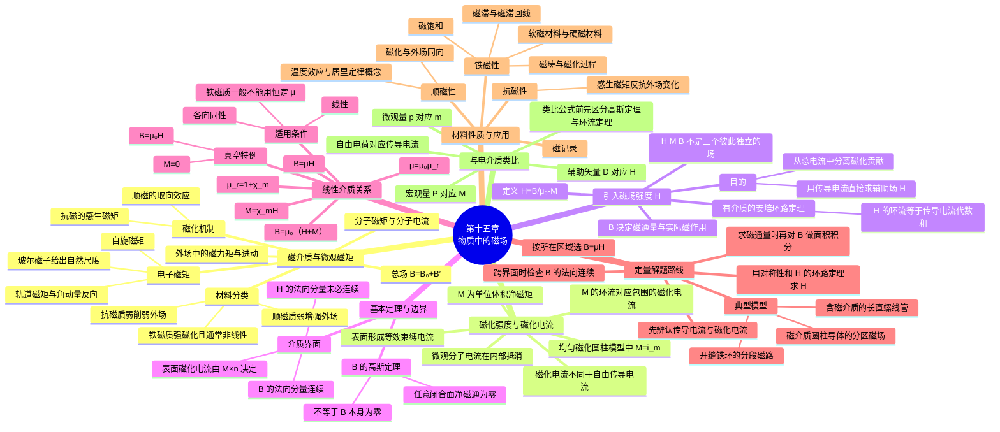

> [!abstract]+ 本章主线
> **外加磁场 → 磁介质磁化 → 磁化电流 → 引入磁场强度 $\vec H$ → 用传导电流求 $H$ → 由材料关系求磁感应强度 $\vec B$。**
>
> 本笔记以课程 PPT 为主线，按 Ch14 的整理方式保留掌握层级、公式适用条件和易错点；PPT 例题放在对应知识点后，并配有可折叠的原题与解答截图。

## 章节思维导图

## 目录
- [[#第十五章总览|第十五章总览]]
- [[#15.1 磁介质的磁化｜定量掌握|15.1 磁介质的磁化]]
- [[#15.2 磁场强度｜定量掌握|15.2 磁场强度]]
- [[#15.3 顺磁性与抗磁性｜一般了解|15.3 顺磁性与抗磁性]]
- [[#15.4 铁磁性｜一般了解|15.4 铁磁性]]
- [[#15.5 磁记录｜一般了解|15.5 磁记录]]
- [[#全章复习与自检|全章复习与自检]]

## 第十五章总览
> [!info]+ 本章学习要求（以课程 PPT 范围为准）
> **§15.1、§15.2：定量掌握。** 理解推导、公式意义及适用条件；完成 PPT 例题 2（圆柱导体）和例题 3（开缝铁环）。
>
> **§15.3、§15.4、§15.5：一般了解。** 理解基本概念与现象、能区分物理机制和材料特点；本轮不做计算题。
>
> **来源分工：** PPT 决定主线和 PPT 例题；教材用于同一知识点的补充及长直螺线管的标注练习；聊天用于解释我们曾经困惑的物理图像。
>
> **统一记号：** 磁矩 $\vec m$（小写），磁化强度 $\vec M$（大写）；玻尔磁子保留标准符号 $\mu_B$。

### 学习路线与课件对应位置

| 学习范围 | 掌握要求 | PPT位置 | 教材对照 | 本笔记内容 |
|---|---|---|---|---|
| §15.1 磁介质的磁化 | **定量掌握** | 第五周第2—9页 | §15.1；§15.3中的微观说明 | 磁介质分类、轨道/自旋磁矩、玻尔磁子、分子电流、电子进动、磁化机制 |
| §15.2 磁场强度 | **定量掌握** | 第五周第10—18、28—30页；第六周第33—39页 | §15.2 | 磁化强度与磁化电流、$H$、环流与高斯定理、本构关系、两道 PPT 例题及课件总结 |
| §15.3 顺磁性与抗磁性 | **一般了解** | 第六周课程范围指定 | §15.3，第375—377页 | 比较、温度效应、居里定律的概念 |
| §15.4 铁磁性 | **一般了解** | 第六周课程范围指定 | §15.4，第377—380页 | 磁畴、磁饱和、磁滞、软磁/硬磁 |
| §15.5 磁记录 | **一般了解** | 第六周课程范围指定 | §15.5，第380—382页 | 记录原理与技术名称 |

### 一条贯穿全章的理解线索
第十四章的载流线圈 $\to$ **磁矩 $\vec m$**（描述磁性）$\to$ **磁力矩 $\vec\tau$**（磁场的转动作用）$\to$ 电子轨道磁矩与进动 $\to$ 分子磁矩合成 $\to$ **磁化强度 $\vec M$**（单位体积净磁矩）$\to$ **磁化电流**（微观电流的宏观等效）$\to$ **磁场强度 $\vec H$**（便于处理传导电流）$\to$ **磁感应强度 $\vec B$ 与磁通量计算**。
三个一定要分清的层次：磁介质是宏观物质，不是单个分子；磁矩 $\vec m$ 和磁力矩 $\vec\tau$ 是不同的物理量；磁化电流是**等效的束缚电流**，不是磁化后突然产生的新自由电流。

---

## 15.1 磁介质的磁化｜定量掌握

> [!important] **定量掌握** · PPT 第2—9页 · 教材 §15.1
> 必须理解磁矩与角动量、轨道磁矩的推导、玻尔磁子、分子磁矩、进动与顺磁/抗磁机制；记住关键公式及方向。材料深层量子机制不是这一部分的计算要求。

### 1. 磁介质与分类（定量掌握：定义与判断）

磁介质放入外磁场后，介质会发生磁化。介质中的总磁感应强度可写为

$$
\boxed{\vec B=\vec B_0+\vec B'}
$$

其中 $\vec B_0$ 是原来外部电流产生的磁感应强度，$\vec B'$ 是磁介质磁化后产生的附加磁感应强度。

| 类型 | 宏观表现 | 磁化率的典型符号 |
|---|---|---|
| 顺磁质 Paramagnetic material（顺磁质） | 磁化效应通常增强外场 | $\chi_m>0$，通常较小 |
| 抗磁质 Diamagnetic material（抗磁质） | 磁化效应通常削弱外场 | $\chi_m<0$，绝对值通常较小 |
| 铁磁质 Ferromagnetic material（铁磁质） | 磁化效应很强，通常非线性 | $\chi_m$ 可很大，且一般不是常量 |

PPT 用 $B>B_0$、$B<B_0$、$B\gg B_0$ 描述三类材料的典型情况。严格使用时要注意这些是课程中的宏观分类描述，不应脱离题设任意比较矢量大小。

### 2. 电子轨道磁矩、角动量与玻尔磁子（定量掌握：推导与方向）

电子轨道磁矩（Orbital Magnetic Moment，轨道磁矩）可以由第十四章的电流环模型推导，而不是单独背一个新公式。下面按照我们聊天时的顺序重建推导。

#### 从等效电流环推导轨道磁矩（我们曾经专门追问过）

在 PPT 的经典圆轨道模型中，电子沿半径 $r$ 的轨道以速率 $v$ 运动：
第一步，绕行周期：

$$
T=\frac{2\pi r}{v}
$$

第二步，电子电荷量的绝对值为 $e$，等效电流大小：

$$
I_{\text{eq}}=\frac{e}{T}=\frac{ev}{2\pi r}
$$

第三步，结合圆电流线圈的磁矩公式：

$$
m_L=I_{\text{eq}}S=\frac{ev}{2\pi r}\cdot\pi r^2=\frac{evr}{2}
$$

第四步，电子轨道角动量大小 $L=m_evr$，所以：

$$
m_L=\frac{e}{2m_e}L
$$

**方向为什么反向？** $\vec L=m_e(\vec r\times\vec v)$ 的方向按电子速度的右手定则判断；但电子带负电，其等效**传统电流方向与电子运动方向相反**，由电流环右手定则，轨道磁矩与角动量反向。最终：

$$
\boxed{\vec m_L=-\frac{e}{2m_e}\vec L}
$$

#### 玻尔磁子：前面已经有磁矩公式，为什么还要引入它？

轨道磁矩公式描述的是**磁矩与角动量之间的关系**；量子理论给出角动量的基本尺度 $\hbar$，所以定义玻尔磁子 Bohr Magneton（玻尔磁子）：

$$
\boxed{\mu_B=\frac{e\hbar}{2m_e}\approx9.27\times10^{-24}\ \mathrm{A\cdot m^2}}
$$

它是电子磁矩的**自然尺度**，不是所有电子都固定具有大小为一个 $\mu_B$ 的磁矩。PPT 用“最小值”作简化表述；作严格理解时应注意量子数决定允许的磁矩值。

#### 电子自旋磁矩

PPT 还给出电子自旋磁矩与自旋角动量 $\vec S$ 的近似关系：

$$
\boxed{\vec m_s\approx-\frac{e}{m_e}\vec S}
$$

轨道角动量 $\vec L$ 与自旋角动量 $\vec S$ 不要混为一谈；两类磁矩一起决定物质的微观磁性。量子理论细节超出本课程这一节的计算要求。

### 3. 分子电流与分子磁矩（定量掌握：概念联系）

- **分子电流 Molecular current（分子电流）**：原子或分子内部电子的磁效应，可以等效为一个电流环来描述。
- **分子磁矩 Molecular magnetic moment（分子磁矩）**：与分子电流相对应的磁矩，记为小写 $\vec m$。
- “等效电流”是描述磁效应的模型，不表示电子真的像普通导线中的自由电荷那样沿经典圆轨道运动。

### 4. 磁力矩与电子进动（定量掌握：物理图像）

磁矩 $\vec m$（不是磁化强度 $\vec M$）置于磁感应强度 $\vec B$ 中，受到的磁力矩为

$$
\boxed{\vec\tau=\vec m\times\vec B},\qquad \tau=mB\sin\theta
$$

磁力矩会改变角动量的方向。由于在该模型中磁力矩与角动量垂直，力矩不直接改变角动量的大小，而使其方向发生变化，形成进动 Precession（进动）。

> [!important] 理解要点
> 进动不是“磁矩自动越转越朝向外磁场”。理想无耗散进动主要改变方向；顺磁质的宏观取向还涉及热运动、相互作用和统计平衡。

PPT 给出的结论：电子进动也可等效为一个附加圆电流，其附加磁矩 $\Delta\vec m$ 的方向与外磁场 $\vec B_0$ 相反。这是理解抗磁性的基础。

#### 为什么是“绕着磁场转圈”，不是直接朝磁场转过去？

这是我们在聊天中反复推导的一步。理想匀强恒定外磁场 $\vec B_0$ 作用于电子的轨道磁矩：

$$
\vec\tau=\vec m_L\times\vec B_0,\qquad
\vec\tau=\frac{d\vec L}{dt}
$$

由于 $\vec m_L=-e\vec L/(2m_e)$，有：

$$
\boxed{\frac{d\vec L}{dt}
=\frac{e}{2m_e}\vec B_0\times\vec L}
$$

**力矩给出的是角动量的变化方向**。右侧叉乘与 $\vec L$ 和 $\vec B_0$ 都垂直：

- 与 $\vec L$ 垂直，所以 $\vec L$ 的**大小不变**；
- 与 $\vec B_0$ 垂直，所以 $\vec L$ 沿磁场方向的分量**不变**；
- 两个条件合起来，$\vec L$ 与 $\vec B_0$ 的夹角不变，**但方位不断变化**。

因此，角动量矢量的端点绕磁场轴画圆，矢量扫出圆锥面——这就是**进动 Precession（进动）**。

> [!important] 我们纠正过的说法
> 这里“沿圆周运动”的是**角动量矢量端点**，不是说电子沿着进动所画的大圆绕核运动。纯粹理想进动也不等于固有磁矩在热平衡中逐渐沿磁场取向。

教材和 PPT 把电子附加运动的磁效应描述为附加圆电流，其磁矩 $\Delta\vec m$ 与 $\vec B_0$ **反向**；这属于抗磁性机制。不要仅凭进动图的几何方向就直接断言附加磁矩方向，还要结合电子电荷为负及附加运动的磁效应分析。

### 5. 抗磁质与顺磁质的磁化（定量掌握：机制与方向）

#### 抗磁质

- 在 PPT 采用的模型中，每个原子或分子的轨道磁矩与自旋磁矩矢量和为零，即固有分子磁矩为零。
- 加入外磁场后，电子进动产生附加磁矩 $\Delta\vec m$。
- 大量附加磁矩合成后与外磁场反向，产生抗磁性。

注意：固有净磁矩为零不等于内部电子没有磁矩。

#### 顺磁质

- 原子或分子具有非零的固有磁矩。
- 无外磁场时，热运动使大量磁矩取向杂乱，宏观矢量和可近似为零。
- 加入外磁场后，磁矩的统计取向更倾向于沿外场方向，产生顺磁性。
- 顺磁质中也可能有反向的抗磁贡献，但通常顺磁取向效应占主导。

---

## 15.2 磁场强度｜定量掌握

> [!important] **定量掌握** · PPT 第10—18、28—30、33—39页 · 教材 §15.2
> 学会从磁化强度和磁化电流过渡到 $H$，掌握三条基本关系、安培环路定理、高斯定理及线性介质本构关系；必须会做 PPT 的圆柱载流导体和铁环开缝例题。

### 1. 磁化强度 $\vec M$（定量掌握：定义与物理意义）

磁化强度 Magnetization（磁化强度）定义为单位体积内分子磁矩的矢量和：

$$
\boxed{\vec M=\frac{\sum_i\vec m_i}{\Delta V}}
$$

- $\Delta V$：宏观上足够小、但仍含大量分子的体积元。
- $\vec M$ 是矢量，单位为 $\mathrm{A/m}$。
- $\vec M=0$ 不一定意味着每个分子的磁矩都为零，也可能是大量磁矩相互抵消。
- 均匀磁化：$\vec M$ 在所研究区域内大小、方向均不随位置变化；非均匀磁化则随位置变化。

#### 从我们的聊天理解两个“零”的区别
我们之前问过：为什么顺磁质没有外磁场时 $M\approx0$，却说顺磁质的分子本身有磁矩？
答案是区分 **单个分子的磁矩是否为零** 和 **大量分子磁矩的矢量和是否为零**：

- 抗磁质的简单模型：每个原子/分子的**净固有磁矩**为零；外场作用后出现反向附加磁矩。
- 顺磁质：每个原子/分子**有固有磁矩**，但外场为零时取向杂乱，使宏观矢量和近似为零。

因此 $M\approx0$ 绝不等于“所有分子都没有磁矩”。磁化强度是单位体积内**矢量和**，而不是单个磁矩大小的总和。

### 2. 分子电流叠加与磁化电流（定量掌握：模型与环流）

磁介质磁化后，许多微观分子电流的宏观效果可以用等效磁化电流描述，也称束缚电流 Bound current（束缚电流）。

- 介质内部相邻分子电流的相邻部分可能相互抵消。
- 在介质边界处，没有外侧相邻电流继续抵消，因此可能留下宏观等效表面电流。
- 磁化电流不是新产生的自由电子流，不应与导线中的传导电流混为一谈。

PPT 第11—13页通过均匀磁化的圆柱体推导出磁化强度和表面磁化电流线密度之间的关系。下文按我们聊天时理解的几何顺序，先确认电流方向，再完整推导。

> 我们聊过：磁化后，是不是电子才开始产生电流？
> **不是。** 微观电子运动与磁矩原本就可以存在。以顺磁质为例，外磁场使原本杂乱的分子磁矩出现统计上的定向倾向，因此微观电流环的宏观等效效果不再完全抵消。
> 对于 PPT 的轴向均匀磁化圆柱体：
> - $\vec M$ **沿圆柱轴线**；
> - 等效表面磁化电流 **沿圆柱的侧面绕轴环流**；
> - 二者方向并不一样，而是遵循相应的右手螺旋关系。
> 所以不能说“磁化电流沿 $M$ 的方向流动”，更不能把磁化电流当成新出现的自由电子传导电流。
> 
#### PPT 为什么得出 $M=i_m$？
取均匀磁化圆柱的一段：横截面积 $S$，长度 $l$。
按磁化强度定义，总磁矩为：

$$
\left|\sum\vec m\right|=M(Sl)
$$

从等效表面环流角度，磁化电流线密度为 $i_m$，长度 $l$ 对应的总等效环流电流为 $I_m=i_ml$。其等效磁矩为：

$$
\left|\sum\vec m\right|=I_mS=i_mlS
$$

对照两种表示：

$$
MSl=i_mlS\quad\Rightarrow\quad\boxed{M=i_m}
$$

这个推导依赖于 PPT 所采用的均匀磁化与方向、几何条件，不能只因为 $M$ 和 $i_m$ 单位都是 A/m 就推断任意情况下相等。

#### 我们卡住过的地方：闭合回路的左边和右边到底在算什么？

在圆柱侧面附近取一个跨越介质内部与外部的矩形回路 ABCD。设 AB 长为 $l$，位于介质内并沿 $\vec M$；CD 位于介质外，另两段垂直于 $\vec M$。
**左侧积分：** 只需计算沿 AB 的分量：

$$
\oint_L\vec M\cdot d\vec l
=\int_{AB}M\,dl=Ml
$$

**右侧包围电流：** “包围”指的是**穿过 ABCD 回路围成的矩形曲面**，而不是沿 AB 流动。磁化电流绕着圆柱侧面流动，刚好穿过这块矩形曲面；交线长度是 $l$，所以

$$
I_m=i_ml=Ml
$$

因此，在相同绕行方向及带符号约定下：

$$
\boxed{\oint_L\vec M\cdot d\vec l=I_m}
$$

> [!tip] 解题时的几何判别
> 线积分 $\oint_L\vec M\cdot d\vec l$ 看的是 **$M$ 沿路径切线的分量**；环路包围的 $I_m$ 看的是 **电流穿过回路所围曲面的情况**。这两件事在几何上不同，不能认为电流沿 AB 流动。

---

>  教材联系：一般磁化电流的方向（概念补充，非新增计算题）
> 对于更一般的表面，可以用 $\vec K_m=\vec M\times\vec n$ 描述表面磁化电流密度的方向（$\vec n$ 为外法线）；如果磁化强度空间分布不均匀，介质内部还可能出现等效体磁化电流，写为 $\vec J_m=\nabla\times\vec M$。**这两式是帮助理解 PPT 的一般电磁学补充，本课程主要按课件中的均匀圆柱模型计算。**

### 3. 有磁介质时的安培环路定理（定量掌握：推导）

有磁介质时，总磁场由传导电流与磁化电流共同产生。因此对磁感应强度 $\vec B$：

$$
\boxed{\oint_L\vec B\cdot d\vec l=\mu_0\left(I_c+I_m\right)}
$$

其中 $I_c$ 是回路包围的传导电流代数和，$I_m$ 是磁化电流代数和。
根据磁化强度与磁化电流的关系，引入磁场强度 Magnetic field strength（磁场强度）：

$$
\boxed{\vec H=\frac{\vec B}{\mu_0}-\vec M}
$$

单位：

$$
\boxed{[H]=[M]=\mathrm{A/m}}
$$

于是有磁介质时的安培环路定理为

$$
\boxed{\oint_L\vec H\cdot d\vec l=I_c}
$$

**语言表述：** 磁场强度 $\vec H$ 沿任意闭合回路的环流，等于穿过该回路所围曲面的传导电流代数和；磁化电流不再显式出现在右侧。

> [!important] 易错点
> 磁化电流仍然会产生磁场，并不是被忽略了。它的影响通过 $\vec H=\vec B/\mu_0-\vec M$ 的定义纳入了磁场强度。

#### 从“两个电流”推到 $H$，为什么要多定义一个量？

我们之前反复提问“真空有 $B$ 就够了，为什么磁介质中还要 $H$？”
**不是磁化电流不起作用了，而是我们希望把它从右侧需要显式统计的电流项中分离出来。**
从含磁介质的安培环路定理：

$$
\oint_L\vec B\cdot d\vec l=\mu_0(I_c+I_m)
$$

用 $I_m=\oint_L\vec M\cdot d\vec l$ 代入：

$$
\oint_L\left(\frac{\vec B}{\mu_0}-\vec M\right)\cdot d\vec l=I_c
$$

于是定义

$$
\vec H=\frac{\vec B}{\mu_0}-\vec M
$$

立即得到：

$$
\boxed{\oint_L\vec H\cdot d\vec l=I_c}
$$

**$B$** 描述实际磁感应强度、决定磁通量与带电粒子的磁场作用；**$M$** 描述介质单位体积的净分子磁矩；**$H$** 作为辅助场量，让环流与传导电流直接对应。它们并非三个互相独立产生的新磁场。

### 4. 磁场高斯定理与界面条件（定量掌握：辨析）

不论真空还是普通磁介质，磁感应强度均满足

$$
\boxed{\oint_S\vec B\cdot d\vec S=0}
$$

含义：穿入任意闭合曲面的净磁通量与穿出部分相抵，净值为零；这不表示曲面内部没有磁场。
磁场高斯定理的微分形式为

$$
\boxed{\nabla\cdot\vec B=0}
$$

PPT 第16页还给出关系

$$
\boxed{\nabla\cdot\vec H=-\nabla\cdot\vec M}
$$

它表示：若磁化强度在空间中不均匀且其散度不为零，则 $\vec H$ 的场线描述中可以出现类似“源/汇”的数学表现；这不是磁单极子，而是因为 $\vec H$ 的定义扣除了磁化贡献。
由磁场高斯定理可得普通介质界面两侧磁感应强度的法向分量连续：

$$
\boxed{B_{1n}=B_{2n}}
$$

由 $\vec B=\mu_0(\vec H+\vec M)$ 可进一步得到

$$
\boxed{H_{2n}-H_{1n}=M_{1n}-M_{2n}}
$$

因此，$B_n$ 必须连续，但 $H_n$ 不一定连续；若两侧 $M_n$ 相等，则 $H_n$ 也相等。

> [!warning] PPT 第16页表述辨析
> PPT 提到表面磁化电流与 $H$ 法向分量不连续的关系时，不能把它理解成“有表面磁化电流就必然导致 $H_n$ 不连续”。法向边界关系应由 $B_n$ 连续和 $\vec B=\mu_0(\vec H+\vec M)$ 推出；表面磁化电流的方向由 $\vec K_m=\vec M\times\vec n$ 描述。

#### 我们追问过：“法向连续”到底是什么意思？

把两种材料的交界面想象成一张水平纸：

- **法向 Normal direction（法向）**：垂直于纸面；
- **切向 Tangential direction（切向）**：沿纸面。

**$B_n$ 连续**的意思不是“$B$ 的大小和方向都相同”，而是磁场垂直穿过界面的那一部分不在界面处突然中断：

$$
B_{1n}=B_{2n}
$$

当交界面两侧的 $M_n$ 不同时，由 $B_n=\mu_0(H_n+M_n)$：

$$
H_{2n}-H_{1n}=M_{1n}-M_{2n}
$$

所以 **$H_n$ 可以不同**。这正是你当时回答“$B_n$ 一定相等，$H_n$ 不一定相等”的依据。

> [!warning] 和 PPT 铁环开狭缝例题关联
> 开狭缝的磁路中，磁场近似沿狭缝法线穿过铁—空气界面，因此在忽略漏磁和边缘效应时 $B_{\rm 铁}\approx B_{\rm 缝}$，但 $H_{\rm 铁}=B/(\mu_0\mu_r)$、$H_{\rm 缝}=B/\mu_0$，并不相等。

### 5. $B、H、M$、磁化率和磁导率（定量掌握：公式及适用条件）

从磁场强度定义式移项：

$$
\boxed{\vec B=\mu_0(\vec H+\vec M)}
$$

这是 SI 制下的基本关系。
对于各向同性、线性磁介质，磁化强度与磁场强度成正比：

$$
\boxed{\vec M=\chi_m\vec H}
$$

其中 $\chi_m$ 为磁化率 Magnetic susceptibility（磁化率），无量纲。
代入得：

$$
\vec B=\mu_0(1+\chi_m)\vec H
$$

定义相对磁导率 Relative permeability（相对磁导率）：

$$
\boxed{\mu_r=1+\chi_m}
$$

定义磁导率 Permeability（磁导率）：

$$
\boxed{\mu=\mu_0\mu_r}
$$

因此在线性、各向同性介质中：

$$
\boxed{\vec B=\mu_0\mu_r\vec H=\mu\vec H}
$$

#### 参数与单位

| 物理量 | 符号 | 单位 / 性质 |
|---|---|---|
| 磁感应强度 | $B$ | T |
| 磁场强度 | $H$ | A/m |
| 磁化强度 | $M$ | A/m |
| 磁化率 | $\chi_m$ | 无量纲 |
| 相对磁导率 | $\mu_r$ | 无量纲 |
| 真空磁导率 | $\mu_0$ | 约 $1.26\times10^{-6}\ \mathrm{H/m}$ |
| 磁导率 | $\mu$ | $\mathrm{H/m}$ |

#### 真空是特殊情况
真空中 $M=0,\ \chi_m=0,\ \mu_r=1,\ \mu=\mu_0$，所以

$$
\boxed{\vec B=\mu_0\vec H}
$$

> [!warning] 适用条件
> $B=\mu H$ 和 $M=\chi_mH$ 是线性、各向同性介质的本构关系。铁磁质通常呈非线性，磁化率一般不是恒定常数，不可把线性关系无条件用于所有铁磁状态。

> [!note] PPT 第17—18页的归纳
> 课件以 $10^{-5}$ 数量级说明顺磁质、抗磁质的磁化率很小，并指出**铁磁质的磁化率通常很大且不是恒量**。这些数值只是课件中的典型量级提示，不是划分所有磁介质的严格阈值。对于各向同性线性介质，已知 $\mu$、$\mu_r$、$\chi_m$ 中任意一个，可由 $\mu=\mu_0\mu_r$ 和 $\mu_r=1+\chi_m$ 换算另外两个。

### 6. 解题时怎样选择公式（定量掌握：应用策略）
判断顺序比背公式更重要：
1. **题目要求什么？** 若求磁通量，最终用 $\Phi=\iint\vec B\cdot d\vec S$；若求 $B$，先判断能否利用对称性求 $H$。
2. **电流怎样分布？** 先区分传导电流与等效磁化电流；对 $\vec H$ 使用安培环路定理只计穿过所围曲面的**传导电流**。
3. **所在区域是什么材料？** 真空/空气近似 $B=\mu_0H$；已知是线性各向同性磁介质才用 $B=\mu_0\mu_rH$。
4. **是否跨过两种介质的边界？** 先分析 $B$ 的法向分量连续、哪些分量可能改变；不能把 $B_n$ 连续误写成整个 $\vec B$ 连续。
5. **有积分时先选几何微元。** 磁通量是对**面积**积分，安培环路是对**闭合曲线**积分；不能混淆 $d\vec S$ 与 $d\vec l$。
这五个问题正好对应下面的 PPT 例题：圆柱导体考查**包围电流与分段磁导率**，铁环开缝考查**界面条件与分段安培环路**。

> [!example]- PPT 例题 2｜无限长圆柱形载流导体
> #### 原题截图（PPT 第28页）
> ![[images/Ch15/Ch15-PPT例题2-第28页.png|720]]
> 题意：无限长圆柱形载流导体，半径 $R$，相对磁导率 $\mu_r$，总电流 $I$ 沿轴线方向均匀分布。求导体内、导体外的 $B$，以及通过长为 $l$ 的圆柱体纵截面一半的磁通量。
> #### PPT 解题过程（第29—30页）
> ![[images/Ch15/Ch15-PPT例题2-第29页.png|720]]
> ![[images/Ch15/Ch15-PPT例题2-第30页.png|720]]
> #### （1）导体内部 $r<R$
> 均匀电流密度：
> $$
> j=\frac{I}{\pi R^2}
> $$
> 半径为 $r$ 的安培环路所包围的传导电流：
> $$
> I_{\mathrm{in}}=j\pi r^2=I\frac{r^2}{R^2}
> $$
> 由有介质时的安培环路定理：
> $$
> \oint_L\vec H\cdot d\vec l=H(2\pi r)=I_{\mathrm{in}}
> $$
> 所以
> $$
> H=\frac{Ir}{2\pi R^2}
> $$
> 导体材料的相对磁导率为 $\mu_r$，因此
> $$
> \boxed{B(r)=\mu_0\mu_rH
> =\frac{\mu_0\mu_r Ir}{2\pi R^2},\quad r<R}
> $$
> #### （2）导体外部 $r>R$
> 安培环路包围全部传导电流 $I$：
> $$
> H(2\pi r)=I,\qquad H=\frac{I}{2\pi r}
> $$
> PPT 的模型中导体外部为真空，所以
> $$
> \boxed{B(r)=\mu_0H=\frac{\mu_0 I}{2\pi r},\quad r>R}
> $$
> 合并写为
> $$
> \boxed{
> B(r)=
> \begin{cases}
> \dfrac{\mu_0\mu_r Ir}{2\pi R^2},&r<R\\[6pt]
> \dfrac{\mu_0 I}{2\pi r},&r>R
> \end{cases}}
> $$
> #### （3）通过长度为 $l$ 的纵截面一半的磁通量
> 面积微元 $dS=dr\,dz$，该面位于导体内部，且磁场与面积法线平行：
> $$
> \Phi=\iint_S\vec B\cdot d\vec S
> =\int_0^l\int_0^R B(r)\,dr\,dz
> $$
> 代入内部磁场：
> $$
> \begin{aligned}
> \Phi
> &=\int_0^l\int_0^R
> \frac{\mu_0\mu_r Ir}{2\pi R^2}\,dr\,dz\\
> &=\frac{\mu_0\mu_r I}{2\pi R^2}\cdot l\cdot\frac{R^2}{2}
> \end{aligned}
> $$
> 最终：
> $$
> \boxed{\Phi=\frac{\mu_0\mu_r Il}{4\pi}}
> $$
> #### 例题 2 的方法总结
> 1. 根据圆柱对称性选半径为 $r$ 的圆形安培环路。
> 2. 区分环路在导体内还是导体外，正确计算所包围的传导电流。
> 3. 先用 $\oint \vec H\cdot d\vec l=I_c$ 求 $H$。
> 4. 再按所在区域的介质选择 $B=\mu H$ 或真空中的 $B=\mu_0H$。
> 5. 求磁通量时根据题设选取面积微元并积分。

> [!example]- PPT 例题 3｜铁环开狭缝
> #### 原题截图（PPT 第33页）
> ![[images/Ch15/Ch15-PPT例题3-第33页.png|720]]
> 题意：铁环外均匀绕有 $N$ 匝绝缘导线，导线中通以恒定电流 $I$。在铁环上开一条狭缝，求开缝前后铁环中的 $B、H、M$ 如何变化，以及缝隙中的 $B、H、M$。
> #### （1）开缝前
> ![[images/Ch15/Ch15-PPT例题3-第34页.png|720]]
> 铁环平均周长为 $l$。由含介质的安培环路定理：
> $$
> Hl=NI
> $$
> 所以
> $$
> \boxed{H_0=\frac{NI}{l}}
> $$
> 铁环材料满足 $B=\mu_0\mu_rH$，于是
> $$
> \boxed{B_0=\frac{\mu_0\mu_rNI}{l}}
> $$
> 在线性磁介质模型下：
> $$
> \boxed{M_0=\chi_mH_0=\chi_m\frac{NI}{l}}
> $$
> #### （2）开缝后
> ![[images/Ch15/Ch15-PPT例题3-第35页.png|720]]
> 由于磁感应强度的法向分量连续，且狭缝很窄，PPT 近似认为铁环与狭缝中的 $B$ 相等：
> $$
> \boxed{B_{\mathrm{铁}}=B_{\mathrm{缝}}=B}
> $$
> 但两区域的磁导率不同，所以 $H$ 不相等：
> $$
> H_{\mathrm{铁}}=\frac{B}{\mu_0\mu_r},
> \qquad
> H_{\mathrm{缝}}=\frac{B}{\mu_0}
> $$
> 对整条磁路使用安培环路定理。狭缝宽度为 $\Delta l$，且 $\Delta l\ll l$：
> $$
> H_{\mathrm{铁}}(l-\Delta l)+H_{\mathrm{缝}}\Delta l=NI
> $$
> 代入 $H_{\mathrm{铁}}$ 和 $H_{\mathrm{缝}}$，并按 PPT 的窄缝近似：
> $$
> \frac{B}{\mu_0\mu_r}l+\frac{B}{\mu_0}\Delta l\approx NI
> $$
> 整理得到：
> $$
> \boxed{B=\frac{\mu_0\mu_rNI}{l+\mu_r\Delta l}}
> $$
> 铁环内：
> $$
> \boxed{H_{\mathrm{铁}}=\frac{NI}{l+\mu_r\Delta l}}
> $$
> $$
> \boxed{M_{\mathrm{铁}}=\chi_mH_{\mathrm{铁}}
> =\frac{\chi_mNI}{l+\mu_r\Delta l}}
> $$
> #### （3）狭缝中的物理量
> ![[images/Ch15/Ch15-PPT例题3-第36页.png|720]]
> 狭缝中近似为空气：
> $$
> \boxed{B_{\mathrm{缝}}=B
> =\frac{\mu_0\mu_rNI}{l+\mu_r\Delta l}}
> $$
> $$
> \boxed{H_{\mathrm{缝}}=\frac{B}{\mu_0}
> =\frac{\mu_rNI}{l+\mu_r\Delta l}}
> $$
> $$
> \boxed{M_{\mathrm{缝}}\approx0}
> $$
> #### 结论与物理意义
> - 开缝前铁环中 $H_0=NI/l$。
> - 开缝后铁环中的 $B、H、M$ 均比开缝前减小。
> - 狭缝中 $B$ 与铁环中的 $B$ 近似相等，但 $H$ 不相等。
> - 因为空气的磁化强度近似为零，$M_{\mathrm{缝}}\approx0$。
> - 虽然 $\Delta l$ 很小，但铁环的 $\mu_r$ 通常较大，所以 $\mu_r\Delta l$ 可能不可忽略。

---

### 教材补充练习：长直螺线管中的磁介质｜定量掌握

教材第375页给出的例题：长直螺线管匝数 $N=800$，电流 $I=1\,\mathrm A$，长度 $l=0.5\,\mathrm m$，内部磁感应强度 $B=0.5\,\mathrm T$。求 $H、M、\chi_m、\mu_r$。
先由安培环路定理：

$$
H=\frac{NI}{l}=\frac{800\times1}{0.5}
=1600\ \mathrm{A/m}
$$

由 $B=\mu_0(H+M)$：

$$
M=\frac{B}{\mu_0}-H
$$

教材示例在计算中采用 $\mu_0\approx1.25\times10^{-6}\ \mathrm{H/m}$ 的粗略近似，因此：

$$
M=\frac{0.5}{1.25\times10^{-6}}-1600
=3.984\times10^5\ \mathrm{A/m}
$$

磁化率：

$$
\chi_m=\frac{M}{H}\approx249
$$

相对磁导率：

$$
\mu_r=1+\chi_m\approx250
$$

若改用更精确的 $\mu_0=4\pi\times10^{-7}\ \mathrm{H/m}$，数值末位会略有差异；复习时优先沿用教材给定的近似和结果。

---

### PPT 第37—39页归纳：磁介质与电介质的对照｜定量掌握

> [!important] **定量掌握** · 第六周 PPT 原表（三页）
> 这不是新学三套公式，而是把第13章已学电介质与本章磁介质**对应起来**；会辨认物理量、写出关系式，并说明两种定理的不同右侧来源。PPT 总结内容以这一个表格为准，后面的公式速查只做索引。

#### PPT 第37页：微观到宏观的对应

![[images/Ch15/Ch15-PPT总结-第37页.png|720]]

| 课件项目 | 电介质（第13章复习） | 磁介质（第15章） |
|---|---|---|
| 状态量 | 极化强度 Electric Polarization（电极化强度）$\vec P=\sum_i\vec p_i/\Delta V$ | 磁化强度 Magnetization（磁化强度）$\vec M=\sum_i\vec m_i/\Delta V$ |
| 微观量 | 电偶极矩 $\vec p$ | 磁矩 $\vec m$ |
| 宏观结果 | 介质表面出现极化电荷（束缚电荷） | 介质表面可出现磁化电流（束缚电流） |
| 描述场的基本矢量 | 电场强度 $\vec E$ | 磁感应强度 $\vec B$ |
| 介质引起的附加场 | $\vec E=\vec E_0+\vec E'$ | $\vec B=\vec B_0+\vec B'$ |

#### PPT 第38页：辅助矢量、基本定理和线性关系

![[images/Ch15/Ch15-PPT总结-第38页.png|720]]

| 课件项目 | 电介质 | 磁介质 |
|---|---|---|
| 辅助矢量 | $\boxed{\vec D=\varepsilon_0\vec E+\vec P}$ | $\boxed{\vec H=\vec B/\mu_0-\vec M}$ |
| 高斯定理 | $\displaystyle\oint_S\vec D\cdot d\vec S=Q_{\rm free}$（包围的自由电荷） | $\displaystyle\oint_S\vec B\cdot d\vec S=0$（没有磁单极子） |
| 静态/稳恒环流定理 | $\displaystyle\oint_L\vec E\cdot d\vec l=0$（静电场） | $\displaystyle\oint_L\vec H\cdot d\vec l=I_{\rm free}$（传导电流） |
| 各向同性线性介质的极化/磁化 | $\vec P=\varepsilon_0\chi_e\vec E$ | $\vec M=\chi_m\vec H$ |
| 各向同性线性本构关系 | $\vec D=\varepsilon\vec E=\varepsilon_0\varepsilon_r\vec E$ | $\vec B=\mu\vec H=\mu_0\mu_r\vec H$ |

**我们讨论过的关键差别：** 磁场高斯定理的右侧永远是零，不代表 $\vec B$ 本身为零；$\vec H$ 的环流右侧只显式计入传导电流。电介质的 $\vec D$ 是通过其高斯定理提取自由电荷，磁介质的 $\vec H$ 则是通过其环流定理提取传导电流。

#### PPT 第39页：常量和无量纲参数

![[images/Ch15/Ch15-PPT总结-第39页.png|720]]

| 参数 | 电介质 | 磁介质 |
|---|---|---|
| 真空常量 | $\varepsilon_0\approx8.85\times10^{-12}\ \mathrm{F/m}$ | $\mu_0\approx1.26\times10^{-6}\ \mathrm{H/m}$ |
| 响应系数 | 极化率 $\chi_e$ | 磁化率 $\chi_m$ |
| 相对常量 | 相对介电常量 $\varepsilon_r=1+\chi_e$ | 相对磁导率 $\mu_r=1+\chi_m$ |
| 介质常量 | $\varepsilon=\varepsilon_0\varepsilon_r$ | $\mu=\mu_0\mu_r$ |

> [!warning] 适用前提
> 最后一行的线性关系及 $\varepsilon_r=1+\chi_e$、$\mu_r=1+\chi_m$ 都依赖课程讨论的**线性、各向同性介质**。铁磁性材料一般不能简单当成固定 $\mu_r$ 的线性磁介质。

---

## 15.3 顺磁性与抗磁性｜一般了解

> [!note] **一般了解** · 教材第375—377页
> 本节是对 §15.1 已学微观机制的进一步理解。**不重复推导**电子轨道磁矩和进动，只补足教材提出的温度效应、居里定律含义及对比。

### 1. 抗磁性（一般了解）

微观起源和附加磁矩方向已在 §15.1 推导，这里新增教材关注的特征：抗磁磁化率通常较小而为负，温度对抗磁性的影响一般较弱。

### 2. 顺磁性与温度效应（一般了解）

在 §15.1 的固有磁矩取向效应基础上，教材进一步强调**热运动的竞争作用**：温度升高，磁矩更难保持定向排列，顺磁效应通常减弱。
**居里定律 Curie's Law（居里定律）**：在适用的弱场、高温近似下，顺磁质的磁化率随绝对温度升高而减小，常写为 $\chi_m=C/T$（$C$ 为材料常量）。本课程只了解其物理含义，**不要求代数计算或推导**。

| 对比 | 抗磁质 | 顺磁质 |
|---|---|---|
| 微观机制 | 诱导附加磁矩 | 固有磁矩取向 |
| 磁化方向 | 与外场反向 | 与外场同向 |
| $\chi_m$ | 负 | 正 |
| 相对磁导率 | 略小于 1 | 略大于 1 |

---

## 15.4 铁磁性｜一般了解

> [!note] **一般了解** · 教材第377—380页
> 认识磁畴、磁化曲线、磁饱和、磁滞回线、剩磁、矫顽力、软磁/硬磁材料与居里温度；只理解概念和物理图像，不安排铁磁材料的磁路计算。

### 1. 磁畴与磁化过程（一般了解）

**磁畴 Magnetic Domain（磁畴）**是铁磁体内部具有一定自发磁化、微观磁矩取向较一致的区域。不同磁畴可能指向不同方向，宏观总磁化因而可以较小。
**磁化曲线 Magnetization Curve（磁化曲线）**：施加外场后，有利取向的磁畴扩大、磁畴磁化方向发生转动；外磁场继续增强，材料逐渐趋向**磁饱和 Magnetic Saturation（磁饱和）**，即磁化强度继续增加得越来越慢。铁磁材料的磁化通常是**非线性**的，$\mu_r$ 不是固定常数。

### 2. 磁滞与磁滞回线（一般了解）

铁磁材料的磁化状态滞后于外磁场的变化，形成磁滞回线 Hysteresis loop（磁滞回线）。
需掌握的概念：

- **剩磁 Remanence（剩磁）**：外磁场降为零后，材料仍保留的磁化状态。
- **矫顽力 Coercivity（矫顽力）**：消除既有磁化状态所需反向磁场强度的特征量。
- **磁滞损耗 Hysteresis loss（磁滞损耗）**：磁化循环中损失的能量，通常转化为热。
- **居里温度 Curie temperature（居里温度）**：铁磁性消失、材料转为顺磁性时对应的特征温度。

### 3. 软磁材料与硬磁材料（一般了解）

| 软磁材料 | 硬磁材料 |
|---|---|
| 矫顽力较小 | 矫顽力较大 |
| 容易磁化和退磁 | 不易退磁，较能保持磁化 |
| 用于变压器磁芯、电磁铁等 | 用于永久磁铁等 |

---

## 15.5 磁记录｜一般了解

> [!note] **一般了解** · 教材第380—382页
> 认识磁记录的写入、存储和读取过程，理解剩磁的作用；纵向/垂直磁记录及 GMR、TMR 仅需知道基本含义和用途。

磁记录 Magnetic recording（磁记录）利用磁性介质不同位置的磁化状态来保存信息。

1. **写入**：磁头产生磁场，改变介质局部磁化状态。
2. **保存**：外场撤去后，介质借助剩磁保留记录。
3. **读取**：读出装置检测磁场或磁状态变化，并转换为电信号。

了解以下技术名词即可：

- **纵向磁记录**：磁化方向主要平行于记录介质表面。
- **垂直磁记录**：磁化方向主要垂直于记录介质表面。
- **GMR（巨磁电阻）与 TMR（隧道磁电阻）**：利用磁状态变化引起的电阻变化检测磁信号。

本节不要求计算，理解它们与铁磁材料、磁畴和剩磁的联系即可。

---

## 全章复习与自检

### 全章公式速查（复习索引，不重复推导）

| 内容 | 公式 | 适用条件 / 备注 |
|---|---|---|
| 总磁场 | $\vec B=\vec B_0+\vec B'$ | 磁介质中的场叠加 |
| 电子轨道磁矩 | $\vec m_L=-\dfrac{e}{2m_e}\vec L$ | 电子轨道运动 |
| 玻尔磁子 | $\mu_B=\dfrac{e\hbar}{2m_e}$ | 磁矩自然尺度 |
| 磁力矩 | $\vec\tau=\vec m\times\vec B$ | 磁偶极子受力矩 |
| 磁化强度 | $\vec M=\dfrac{\sum_i\vec m_i}{\Delta V}$ | 单位体积净磁矩 |
| 磁场强度定义 | $\vec H=\dfrac{\vec B}{\mu_0}-\vec M$ | SI 制 |
| 有介质的安培环路定理 | $\oint_L\vec H\cdot d\vec l=I_c$ | 只计传导电流代数和 |
| 磁场高斯定理 | $\oint_S\vec B\cdot d\vec S=0$ | 任意闭合曲面 |
| 磁感应强度关系 | $\vec B=\mu_0(\vec H+\vec M)$ | 基本关系 |
| 线性介质磁化率 | $\vec M=\chi_m\vec H$ | 线性、各向同性介质 |
| 相对磁导率 | $\mu_r=1+\chi_m$ | 线性、各向同性介质 |
| 磁导率 | $\mu=\mu_0\mu_r$ | 定义 |
| 线性介质本构关系 | $\vec B=\mu\vec H$ | 线性、各向同性介质 |
| 真空关系 | $\vec B=\mu_0\vec H$ | $M=0$ |
| 磁通量 | $\Phi=\iint_S\vec B\cdot d\vec S$ | 按磁场与面元夹角计算 |

### 易错点总清单

1. $\vec m$ 是单个分子/磁偶极子的磁矩，$\vec M$ 是单位体积的净磁矩，二者不能混用。
2. 磁矩与角动量是不同物理量；电子轨道磁矩方向与轨道角动量方向相反。
3. 磁化电流是微观分子电流的宏观等效描述，不等同于导线中的自由传导电流。
4. $M=i_m$ 只在 PPT 所推导的均匀磁化圆柱模型中直接使用。
5. $\oint\vec H\cdot d\vec l=I_c$ 的右侧只计传导电流；$\oint\vec B\cdot d\vec l$ 的电流来源还包括磁化电流。
6. 磁场高斯定理为 $\oint\vec B\cdot d\vec S=0$，不代表磁场本身为零。
7. 界面上 $B_n$ 连续，但 $H_n$ 不一定连续。
8. $B=\mu H$ 适用于线性、各向同性介质；对铁磁质不能无条件使用常数磁导率。
9. 求磁场先判断区域与包围电流，再使用安培环路定理；求磁通量必须按题目指定的面做面积积分。
10. PPT 例题 2 的导体外部按真空处理，使用 $B=\mu_0H$；例题 3 的狭缝也按空气近似，$M_{\rm 缝}\approx0$。

---

### 本章自检（先自己作答，再回对应章节核对）
1. **磁矩与磁力矩有什么区别？** 磁矩方向如何从传统电流方向确定？
2. **电子轨道磁矩为什么与角动量反向？** 能否从周期、等效电流和 $m=IS$ 自行推导？
3. **为什么引入玻尔磁子？** 它是“所有电子磁矩的固定值”吗？
4. **进动为何绕着磁场轴转圈？** 是电子在大圆上运动，还是角动量矢量端点运动？
5. **分子电流与磁化电流的差别是什么？** 磁化后是不是突然产生新的自由传导电流？
6. **为什么 $M=i_m$ 在 PPT 的模型下成立？** 为什么磁化电流不是沿 $M$ 方向流动？
7. **$\oint\vec M\cdot d\vec l$ 和“环路包围的电流”到底是沿线还是穿面？**
8. **为什么需要 $H$？** $B$ 与 $H$ 的安培环路定理右侧各计入什么电流？
9. **为什么 $B_n$ 连续、$H_n$ 却未必连续？** 能否联系铁环开狭缝例题解释？
10. **PPT 例题 2：** 为什么导体内包围电流为 $Ir^2/R^2$？为什么导体外不带 $\mu_r$？
11. **PPT 例题 3：** 为什么窄缝会显著减小铁环中的 $B$？狭缝内 $M$ 为什么近似为零？

> [!tip] 复习完成的判断标准
> 每个公式不只会写，还能说出**代表什么、从哪里来、什么时候能用、不能用时错在哪里**；两道 PPT 例题能先独立作答，再对照截图中的老师解题过程。

> [!note] 复习时的推荐顺序
> 首先按 §15.1、§15.2 读透公式与方向关系；随后遮住答案自己完成 PPT 例题 2 和 3；再通过第37—39页的总表检查 $D/E/P$ 与 $B/H/M$ 的对应。最后浏览 §15.3—§15.5 的概念即可。
