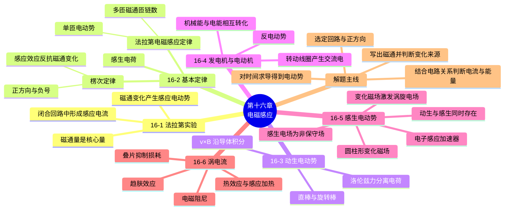

> [!info] 使用与整理说明
> - **PPT 主线**：《016 电磁感应 week6-2》第 1—47 页，覆盖 §16-1～§16-5。
> - **教材补充**：《工程物理学（第三版）》第十六章，第 386—400 页。
> - **§16-6 涡电流**：PPT 未展开，依据教材整理，按“一般了解”掌握。
> - **来源标记**：【PPT】表示课件内容；【教材补充】表示课件未单独展开；【PPT + 教材】表示两者共同涉及；【整理推导】表示依据已给公式补全的中间步骤。
> - **整理原则**：按“物理图像 → 适用条件 → 公式与方向 → 推导 → 例题 → 易错点”组织。

## 章节思维导图



## 目录

- [[#第十六章总览|第十六章总览]]
- [[#§16-1 法拉第实验【PPT 主线】|§16-1 法拉第实验]]
  - [[#4. 磁通量是贯穿本章的核心量【PPT + 教材】|磁通量]]
- [[#§16-2 法拉第电磁感应定律与楞次定律【PPT 主线】|§16-2 法拉第定律与楞次定律]]
  - [[#1. 法拉第电磁感应定律（Faraday’s Law）【PPT + 教材】|法拉第电磁感应定律]]
  - [[#2. 楞次定律（Lenz’s Law）【PPT + 教材】|楞次定律]]
  - [[#3. 感应电流与感生电荷【PPT】|感应电流与感生电荷]]
- [[#§16-3 动生电动势【PPT 主线】|§16-3 动生电动势]]
  - [[#3. 非静电场与动生电动势【PPT + 教材】|动生电动势的一般公式]]
  - [[#6. 洛伦兹力做功问题【PPT + 教材】|洛伦兹力做功问题]]
- [[#§16-4 发电机和电动机的原理【PPT 主线；电动机详解为教材补充】|§16-4 发电机和电动机]]
  - [[#1. 交流发电机（AC Generator）的基本原理【PPT + 教材】|交流发电机]]
  - [[#4. 电动机（Motor）的基本原理【教材补充】|电动机]]
- [[#§16-5 感生电动势【PPT 主线；教材补充见标记】|§16-5 感生电动势]]
  - [[#2. 感生电场的环路定律【PPT + 教材】|感生电场环路定律]]
  - [[#3. 静电场与感生电场的比较|静电场与感生电场比较]]
  - [[#4. 感生电动势的两种计算方法【PPT】|两种计算方法]]
  - [[#5. 动生电动势与感生电动势的划分并非绝对【教材补充】|参考系与两类电动势]]
  - [[#6. 感生电场为什么不能定义普通电势？【PPT + 教材】|感生电场与电势]]
  - [[#7. 电子感应加速器（Betatron）【PPT】|电子感应加速器]]
- [[#§16-6 涡电流（一般了解）【教材补充｜PPT 未展开】|§16-6 涡电流]]
- [[#本章核心公式总表|本章核心公式总表]]
- [[#常见易错点与解题判断【PPT + 教材归纳】|常见易错点与解题判断]]
- [[#整章自检|整章自检]]

---

# 第十六章总览

电磁感应研究的是：**当穿过回路的磁通量发生变化时，为什么会产生感应电动势，以及如何判断、计算感应电动势。**

本章的逻辑主线：

1. **§16-1 法拉第实验**：从实验现象归纳“磁通量变化”这一共同条件。
2. **§16-2 法拉第定律与楞次定律**：定量计算感应电动势，并判断方向。
3. **§16-3 动生电动势**：解释运动导体中洛伦兹力造成的电荷分离。
4. **§16-4 发电机和电动机**：理解机械能与电能的相互转化。
5. **§16-5 感生电动势**：研究变化磁场激发的感生电场及其计算。
6. **§16-6 涡电流**：理解大块导体内部的感应电流及其效应。

## 两类感应电动势

| 类型 | 产生原因 | 非静电力来源 | 典型情形 |
|---|---|---|---|
| 感生电动势（induced emf） | 磁场随时间变化 | 感生电场力 | 导体不动、磁场变化 |
| 动生电动势（motional emf） | 导体运动或回路形状、位置变化 | 洛伦兹力 | 导体切割磁感线 |

实际问题中，两种机制可以同时存在；最稳妥的统一入口仍是磁通量变化率。

---
# §16-1 法拉第实验【PPT 主线】

## 1. 电磁感应现象的发现【PPT + 教材】

奥斯特发现电流能够产生磁场后，法拉第开始研究磁场能否反过来产生电流。1831 年，他发现：**产生感应电流的关键不是磁场本身存在，而是穿过回路的磁通量发生变化。**

## 2. 法拉第实验：四种典型情形【PPT + 教材补充】

教材第387—388页把实验过程分为以下四类；PPT 则用其中最典型的三类作课堂展示。

1. **【PPT】磁铁与线圈相对运动**：将条形磁铁插入线圈，电流计偏转；保持相对静止时，指针不偏转；把磁铁抽出时，指针再次偏转，且方向相反。磁铁运动越快，指针偏转越明显。

2. **【教材补充】两个线圈相对运动**：用通电线圈代替条形磁铁，两个线圈相互靠近或远离时，另一线圈中产生感应电流；相对运动越快，感应电流越大。

3. **【PPT】两个线圈相对静止，其中一个线圈的电流变化**：在一个线圈的电路中接入开关，接通或断开瞬间，另一个线圈中的电流计发生短暂偏转；开关状态保持不变时，感应电流消失。

4. **【PPT】导线框在恒定均匀磁场中运动**：导线框的一条边在均匀、稳定的磁场中滑动，回路面积随之变化，仍会产生感应电流。这个实验说明，即使磁场本身不随时间变化，也可能发生电磁感应。

前面三类实验可通过改变磁场使回路磁通量变化；第四类则通过改变回路面积使磁通量变化。

## 3. 电磁感应现象的共同特征【PPT + 教材】

四类实验共同说明：

> 当穿过闭合导体回路的磁通量发生变化时，回路中就产生感应电流。

但更本质的物理量是**感应电动势**：

- **感应电动势（induced electromotive force）**：由磁通量变化引起的电动势。

- **感应电流（induced current）**：闭合回路中在感应电动势作用下形成的电流。

需要区分：

- 回路闭合且存在感应电动势时，才形成感应电流；

- **【教材补充】** 回路断开时，虽然没有感应电流，感应电动势仍然可以存在；

- **【教材补充】** 感应电流的大小会随回路电阻改变，而感应电动势的大小不由回路电阻决定。

因此，判断电磁感应是否发生，核心是判断穿过回路的磁通量是否变化，而不是只判断回路中有没有电流。

## 4. 磁通量是贯穿本章的核心量【PPT + 教材】

均匀磁场穿过平面面积 $S$，磁场与面积法线夹角为 $\theta$ 时：

$$
\boxed{\Phi_B=BS\cos\theta}
$$

一般情况下：

$$
\boxed{\Phi_B=\int_S\mathbf B\cdot\mathrm d\mathbf S}
$$

磁通量变化可能来自三个方面：

- 磁感应强度 $B$ 变化；

- 回路面积 $S$ 变化；

- 磁场方向与面积法线之间的夹角 $\theta$ 变化。

**判断是否发生电磁感应，先看穿过回路的磁通量是否变化，不要只盯着磁场本身是否存在。**

## 5. 磁共振成像中的感应电流【PPT】

PPT 用 MRI

梯度磁场切换作为应用背景：随时间和空间变化的磁场可能在人体或设备中的导电回路内产生感应电流，也可能带来噪声和发热。

这说明电磁感应不只发生在实验室线圈中；只要有变化磁场和合适的导电路径，就可能产生感应效应。

---

# §16-2 法拉第电磁感应定律与楞次定律【PPT 主线】

## 1. 法拉第电磁感应定律（Faraday's Law）【PPT + 教材】

法拉第定律给出了感应电动势与磁通量变化率之间的定量关系：

$$
\boxed{\mathcal E_i=-\frac{\mathrm d\Phi_B}{\mathrm dt}}
$$

其中：

- $\mathcal E_i$：感应电动势，单位 V；
- $\Phi_B$：穿过回路的磁通量，单位 Wb；
- 负号：体现感应电动势的方向遵循楞次定律。

> [!note] 公式推导｜平均感应电动势
> 若磁通量在时间间隔 $\Delta t$ 内均匀变化，把瞬时变化率改写为差商：
> $$
> \boxed{\overline{\mathcal E_i}=-\frac{\Delta\Phi_B}{\Delta t}}
> $$

### N 匝线圈：全磁通与磁通匝链数【PPT】

如果线圈有 $N$ 匝，且每匝磁通量相同：

$$
\Psi=N\Phi_B
$$

$\Psi$ 称为磁通匝链数（或全磁通）。于是：

$$
\boxed{\mathcal E_i=-\frac{\mathrm d\Psi}{\mathrm dt}
=-N\frac{\mathrm d\Phi_B}{\mathrm dt}}
$$

如果各匝所穿过的磁通量不相等，则应写成：

$$
\Psi=\sum_{j=1}^{N}\Phi_j,\qquad
\boxed{\mathcal E_i=-\frac{\mathrm d}{\mathrm dt}\sum_{j=1}^{N}\Phi_j}
$$

不能在各匝磁通量不相等时，直接把总磁通写成 $N\Phi$。

## 2. 楞次定律（Lenz's Law）【PPT + 教材】

**感应电流的方向，总是使它所激发的磁场阻碍引起感应电流的磁通量变化。**

注意关键词是"阻碍磁通量的变化"，不是简单地"阻碍原磁场"。

| 原磁通量的变化 | 感应磁场的作用 |
|---|---|
| 原磁通量增加 | 感应磁场反抗其增加 |
| 原磁通量减小 | 感应磁场试图补偿其减小 |

楞次定律是能量守恒定律的体现。例如磁铁靠近线圈时，感应电流产生的磁场会阻碍磁铁靠近。外力必须克服这种阻碍做功，外力所做的功转化为电能。

### 感应电动势正负号的判断步骤【PPT + 教材】

1. 先规定闭合回路的正绕行方向。

2. 用右手螺旋定则确定正面积法线方向。

3. 根据磁场方向确定磁通量 $\Phi_B$ 的正负。

4. 判断 $\mathrm d\Phi_B/\mathrm dt$ 的正负。

5. 使用 $\mathcal E_i=-\mathrm d\Phi_B/\mathrm dt$ 判断电动势正负。

若 $\mathcal E_i>0$，实际方向与规定的正绕行方向相同；若

$\mathcal E_i<0$，实际方向相反。

**【教材补充｜适用范围】** 楞次定律直接用于判断闭合回路中感应电流的方向。若回路不闭合，可假想补成闭合回路，先判断假想感应电流方向，再据此确定原导体段上感应电动势的方向。

## 3. 感应电流与感生电荷【PPT】

对于电阻为 $R$ 的闭合回路：

$$
I=\frac{\mathcal E_i}{R}
$$

通过回路的感生电荷：

$$
q=\int I\,\mathrm dt
=\frac{1}{R}\int\mathcal E_i\,\mathrm dt
$$

若 $R$ 不变，且为单匝回路：

$$
q=-\frac{1}{R}\int\frac{\mathrm d\Phi_B}{\mathrm dt}\,\mathrm dt
$$

因此：

$$
\boxed{q=-\frac{\Delta\Phi_B}{R}}
$$

对于 $N$ 匝且各匝磁通量相同的线圈：

$$
\boxed{q=-\frac{N\Delta\Phi_B}{R}}
$$

这说明：在电阻不变的条件下，通过回路的感生电荷与磁通量的总变化量有关，而不取决于磁通量变化得快还是慢。

> [!example]- 教材例 1：圆形线圈中的感应电动势
>
> 【教材补充｜例1】圆形线圈半径为 $R=0.1\,\mathrm m$，线圈内均匀磁场垂直纸面向里，磁感应强度大小为：
>
> $$
> B=6-1.5t\qquad(\mathrm{SI})
> $$
>
> 求线圈中的感应电动势。
>
> 磁通量：
>
> $$
> \Phi_B=B\pi R^2=(6-1.5t)\pi R^2
> $$
>
> 法拉第定律：
>
> $$
> \mathcal E_i=-\frac{\mathrm d\Phi_B}{\mathrm dt}
> =1.5\pi R^2
> $$
>
> 代入 $R=0.1\,\mathrm m$：
>
> $$
> \boxed{\mathcal E_i=4.7\times10^{-2}\,\mathrm V}
> $$
>
> 由于垂直纸面向里的磁通量正在减小，感应磁场应维持原来的向里磁通量，因此感应电流方向为**顺时针**。

> [!example]- 教材例 2：多匝线圈的正弦感应电动势
>
> 【教材补充｜例2】铁芯上绕有 $N=50$ 匝线圈，每匝线圈中的磁通量为：
>
> $$
> \Phi_B=4\times10^{-5}\cos(100\pi t)\quad(\mathrm{Wb})
> $$
>
> 总感应电动势：
>
> $$
> \mathcal E_i=-N\frac{\mathrm d\Phi_B}{\mathrm dt}
> $$
>
> $$
> =50\times4\times10^{-5}\times100\pi
> \sin(100\pi t)
> $$
>
> 因此：
>
> $$
> \boxed{\mathcal E_i=0.2\pi\sin(100\pi t)\,\mathrm V}
> $$
>
> 可见，感应电动势的大小和方向都随时间按正弦规律变化。

> [!example]- PPT 例题 1：磁场按指数规律衰减
>
> 长直螺线管中放置一个同轴小线圈，已知：
>
> - 小线圈面积 $S=6\,\mathrm{cm^2}=6\times10^{-4}\,\mathrm{m^2}$；
> - 匝数 $N=10$；
> - 总电阻 $R=2\,\Omega$；
> - 初始磁场 $B_0=0.05\,\mathrm T$；
> - 磁场衰减规律 $B=B_0e^{-t/\tau}$，$\tau=0.01\,\mathrm s$。
>
> 每匝磁通量：
>
> $$
> \Phi_B=SB_0e^{-t/\tau}
> $$
>
> 总感应电动势：
>
> $$
> \mathcal E_i=-N\frac{\mathrm d\Phi_B}{\mathrm dt}
> =\frac{NSB_0}{\tau}e^{-t/\tau}
> $$
>
> 在 $t=0$ 时最大：
>
> $$
> \boxed{\mathcal E_{\max}=\frac{NSB_0}{\tau}=0.03\,\mathrm V}
> $$
>
> 从 $0$ 到 $\infty$ 的感生电荷大小：
>
> $$
> q=\frac{N SB_0}{R}
> $$
>
> $$
> \boxed{q=1.5\times10^{-4}\,\mathrm C}
> $$
>
> **理解重点：**
>
> 最大电动势取决于初始变化率；总感生电荷取决于总磁通量变化。

> [!example]- PPT 例题 2：长直导线旁的矩形线圈
>
> 长直导线中通有交变电流：
>
> $$
> I=I_0\sin\omega t
> $$
>
> 导线旁放置矩形线圈，线圈长度为 $l$，近边距导线为 $d$，宽度为 $b$。
>
> 距长直导线 $x$ 处的磁感应强度：
>
> $$
> B(x)=\frac{\mu_0 I}{2\pi x}
> $$
>
> 取面积微元 $\mathrm dS=l\,\mathrm dx$，则磁通量：
>
> $$
> \Phi_B=\int_d^{d+b}B(x)l\,\mathrm dx
> $$
>
> $$
> \Phi_B=\frac{\mu_0 lI}{2\pi}
> \ln\frac{d+b}{d}
> $$
>
> 代入 $I=I_0\sin\omega t$，得到：
>
> $$
> \boxed{
> \mathcal E_i
> =-\frac{\mu_0 lI_0\omega}{2\pi}
> \ln\frac{d+b}{d}\cos\omega t
> }
> $$
>
> 具体正负号取决于规定的回路绕行方向。
>
> **本题方法：**
>
> 先写出导线产生的非均匀磁场，再对整个线圈面积积分求磁通量，最后对时间求导。不能把矩形线圈内的磁场当成处处相同。
>
> ---

# §16-3 动生电动势【PPT 主线】

## 1. 感应电动势的两种来源【PPT + 教材】

由磁通量变化产生的感应电动势，可按产生原因分为：

- **感生电动势**：由磁感应强度随时间变化引起。

- **动生电动势**：由导体在磁场中运动，或回路的形状、位置发生变化引起。

本节重点是动生电动势。

## 2. 导体棒运动时，为什么会产生电动势？【PPT + 教材】

设导体棒在磁场中运动，棒内自由电子随棒一起运动。电子受到洛伦兹力：

$$
\mathbf F_L=q\mathbf v\times\mathbf B
$$

由于电子带负电，受力方向与 $\mathbf v\times\mathbf B$

相反。电子向棒的一端聚集，造成棒两端电荷分离，形成电场。

随着电荷分离，静电场力逐渐增大。当静电场力与洛伦兹力平衡时，电荷不再继续发生宏观定向移动。

因此，运动导体棒相当于一个电源。

## 3. 非静电场与动生电动势【PPT + 教材】

电动势的本质是单位正电荷所受非静电力沿路径所做的功。对运动导体，非静电力来自洛伦兹力，因此可定义非静电场：

$$
\boxed{\mathbf E_K=\mathbf v\times\mathbf B}
$$

这里 $\mathbf v$ 是导体线元的速度，$\mathbf B$ 是该处磁场。

对导体棒上一小段线元：

$$
\boxed{\mathrm d\mathcal E_i
=(\mathbf v\times\mathbf B)\cdot\mathrm d\mathbf l}
$$

整根运动导体棒上的动生电动势：

$$
\boxed{
\mathcal E_i=\int_a^b(\mathbf v\times\mathbf B)\cdot\mathrm d\mathbf l
}
$$

若整个闭合回路都在运动：

$$
\boxed{
\mathcal E_i=\oint_L(\mathbf v\times\mathbf B)\cdot\mathrm d\mathbf l
}
$$

**教材补充：动生电动势只存在于运动的导线段上。** 静止导线段上的动生电动势为零，它们只是提供电流流动的通路。即使只有一段导线在磁场中运动、没有闭合回路，该段导线仍可能存在动生电动势，只是不会形成感应电流。是否产生动生电动势，关键还要看导线相对于磁场的运动方式，不能认为只要导线在磁场中运动就一定有电动势。

### 特殊情况：直导体棒垂直切割匀强磁场【PPT + 教材】

当棒长为 $l$，棒的速度 $v$ 与磁场 $B$ 垂直，且

$\mathbf v\times\mathbf B$ 与棒方向平行时：

$$
\boxed{\mathcal E_i=Blv}
$$

若速度、磁场和导体棒方向不满足上述特殊关系，不能直接套用

$Blv$，应使用线积分公式。

## 4. 动生电动势的方向判断【PPT】

计算前先沿导体棒假设一个正方向：

1. 沿运动导线假定电动势方向。

2. 按假定方向选取线元 $\mathrm d\mathbf l$。

3. 根据右手螺旋定则求 $\mathbf v\times\mathbf B$。

4. 计算 $(\mathbf v\times\mathbf B)\cdot\mathrm d\mathbf l$。

5. 沿导体棒积分。

6. 若结果为正，实际方向与假定方向一致；若结果为负，实际方向相反。

## 5. 动生电动势也可以用法拉第定律计算【PPT】

对于闭合回路，若回路运动导致所围面积或位置变化，可以通过磁通量变化率计算：

$$
\mathcal E_i=-\frac{\mathrm d\Phi_B}{\mathrm dt}
$$

但若题目只给出一根不闭合导体棒，不能直接对它使用闭合回路的磁通量公式。可以在适当情况下添加辅助线，构成假想闭合回路。

## 6. 洛伦兹力做功问题【PPT + 教材】

容易产生的疑问：洛伦兹力始终与电荷运动方向垂直，为什么它又能产生动生电动势？

PPT 的解释是：把电子相对于导体的运动与导体整体运动分开考虑。洛伦兹力的不同分量分别表现为：

- 一个分量对电子做正功，使外界提供的机械能转化为电能；
- 另一个分量对电子做负功，阻碍导体运动；为了维持导体运动，外界必须提供机械功。

因此：

- 洛伦兹力对电荷的总功为零；

- 动生电动势所对应的电能来自外界对导体所做的机械功；

- 动生电动势体现了机械能向电能的转化。

> [!example]- PPT 例题 3：匀强磁场中的旋转铜棒
>
> 已知：
>
> - 铜棒长度 $l_0=0.5\,\mathrm m$；
> - 匀强磁场 $B=1.0\times10^{-2}\,\mathrm T$；
> - 铜棒绕 $O$ 轴转动，转速 $f=50\,\mathrm{r/s}$。
>
> 角速度：
>
> $$
> \omega=2\pi f=100\pi\,\mathrm{rad/s}
> $$
>
> 距转轴 $l$ 处的线速度：
>
> $$
> v=\omega l
> $$
>
> 取沿铜棒方向的线元 $\mathrm dl$，有：
>
> $$
> \mathrm d\mathcal E=Bv\,\mathrm dl
> =B\omega l\,\mathrm dl
> $$
>
> 从转轴积分到棒端：
>
> $$
> \mathcal E=\int_0^{l_0}B\omega l\,\mathrm dl
> $$
>
> 所以：
>
> $$
> \boxed{\mathcal E=\frac12B\omega l_0^2}
> $$
>
> 代入数值：
>
> $$
> \boxed{\mathcal E\approx0.3927\,\mathrm V}
> $$
>
> PPT 中取电动势方向 $O\to A$，计算结果为正，故实际方向为
>
> $O\to A$。断路时，电源两端的电势差等于电动势。
>
> **易错点：**
>
> 旋转铜棒上各点线速度不同，不能直接使用棒端速度乘以整根棒长；必须对线元积分。

> [!example]- 教材例 4：转动三角形金属框的各边电动势
>
> 教材第393页给出一个容易忽略的例题：三角形金属框 $ABC$ 放在匀强磁场中，磁场方向平行于转轴 $AC$。金属框绕 $AC$ 轴以角速度 $\omega$ 转动，求各边的感应电动势和回路总电动势。
>
> 设 $AB=a$、$BC=b$，且 $BC$ 与转轴 $AC$ 的夹角为 $\alpha$，因此：
>
> $$
> a=b\sin\alpha
> $$
>
> **（1）边 $AB$ 上的电动势**
>
> 距转轴为 $l$ 的线元速度为 $v=\omega l$，并且与磁场垂直：
>
> $$
> \mathcal E_{AB}
> =\int_A^B(\mathbf v\times\mathbf B)\cdot\mathrm d\mathbf l
> =\int_0^a \omega lB\,\mathrm dl
> $$
>
> $$
> \boxed{\mathcal E_{AB}=\frac12\omega Ba^2}
> $$
>
> **（2）边 $BC$ 上的电动势**
>
> 沿 $BC$ 取线元，只有 $\mathbf v\times\mathbf B$ 在导线方向上的分量贡献电动势：
>
> $$
> \mathcal E_{CB}
> =\int_0^b\omega B\sin^2\alpha\,l\,\mathrm dl
> =\frac12\omega B b^2\sin^2\alpha
> $$
>
> 利用 $a=b\sin\alpha$：
>
> $$
> \boxed{\mathcal E_{CB}=\frac12\omega Ba^2}
> $$
>
> **（3）边 $AC$ 上的电动势**
>
> $AC$ 是转轴，轴上各点速度为零：
>
> $$
> \boxed{\mathcal E_{AC}=0}
> $$
>
> **（4）回路总电动势**
>
> 沿闭合回路方向进行代数相加时，$AB$ 与 $BC$ 两段的电动势方向相反，且大小相等：
>
> $$
> \mathcal E_{\mathrm{总}}
> =\mathcal E_{AB}-\mathcal E_{CB}-\mathcal E_{AC}
> $$
>
> $$
> \boxed{\mathcal E_{\mathrm{总}}=0}
> $$
>
> **本题关键：** 各段导线上的动生电动势不一定为零，但闭合回路总电动势是各段电动势的代数和。必须先确定每段的方向，不能把各段电动势的大小直接相加。
>
> ---

# §16-4 发电机和电动机的原理【PPT 主线；电动机详解为教材补充】

## 1. 交流发电机（AC Generator）的基本原理【PPT + 教材】

发电机利用电磁感应原理，把机械能转化为电能。

典型模型：矩形线圈在匀强磁场中绕固定轴转动。

设：

- 线圈面积为 $S$；
- 磁感应强度为 $B$；
- 线圈角速度为 $\omega$；
- 线圈平面法线与磁场的夹角为 $\theta=\omega t$。

线圈磁通量：

$$
\Phi_B=BS\cos\theta=BS\cos\omega t
$$

根据法拉第定律：

$$
\mathcal E=-\frac{\mathrm d\Phi_B}{\mathrm dt}
$$

得到：

$$
\boxed{\mathcal E=BS\omega\sin\omega t}
$$

定义最大感应电动势：

$$
\mathcal E_0=BS\omega
$$

所以：

$$
\boxed{\mathcal E=\mathcal E_0\sin\omega t}
$$

若线圈有 $N$ 匝且各匝磁通量相同：

$$
\boxed{\mathcal E= NBS\omega\sin\omega t}
$$

这说明线圈匀速转动时，感应电动势随时间按正弦规律变化，称为交流电动势。

周期与频率：

$$
\boxed{T=\frac{2\pi}{\omega}=\frac1f}
$$

## 2. 用动生电动势计算发电机电动势【PPT + 教材】

> [!note] 公式推导｜从动生电动势得到发电机公式
>
> 教材还从线圈边切割磁感线的角度推导同一结果。
>
> 设矩形线圈边长为 $l_1,l_2$，面积：
>
> $$
> S=l_1l_2
> $$
>
> 在某一时刻，线圈平面法线与磁场夹角为 $\theta$，线圈转动角速度为
>
> $\omega$。
>
> 线圈两条有效边的线速度大小：
>
> $$
> v=\frac{l_2\omega}{2}
> $$
>
> 每条有效边产生的动生电动势：
>
> $$
> \mathcal E_{ab}=vBl_1\sin\theta
> $$
>
> $$
> \mathcal E_{cd}=vBl_1\sin\theta
> $$
>
> 两条有效边产生的电动势方向相同，另外两边不产生沿边方向的电动势。因此：
>
> $$
> \mathcal E=2vBl_1\sin\theta
> $$
>
> 代入 $v=l_2\omega/2$：
>
> $$
> \mathcal E=Bl_1l_2\omega\sin\theta
> $$
>
> 由于 $S=l_1l_2$、$\theta=\omega t$：
>
> $$
> \boxed{\mathcal E=BS\omega\sin\omega t}
> $$
>
> 与使用法拉第定律得到的结果一致。

### 实际交流发电机的结构【教材补充】

教材图16-9介绍了基本交流发电机：矩形线圈在均匀磁场中绕固定轴转动，线圈两端通过随线圈转动的铜环（滑环）和弹性金属触头（电刷）与外电路连接。线圈的两条有效边切割磁感线，产生方向相同的电动势。

实际工程中的交流发电机通常采用**线圈固定作为定子、磁场旋转作为转子**的结构。教材还介绍了双水内冷发电机：用冷水通过线圈导线内部散热，以应对大电流造成的焦耳热。

## 3. 发电机的能量转化【PPT + 教材】

当线圈接入外电路并产生感应电流时，线圈在磁场中受到磁力矩，其方向阻碍线圈转动。

因此，为了让发电机持续转动，需要外部动力机提供机械功。机械能最终转化为电能。

## 4. 电动机（Motor）的基本原理【教材补充】

PPT 第30页仅列出“电动机”主题，没有像发电机部分一样展开原理推导；下面内容依据教材第395页补充。

电动机与发电机的能量转化方向相反：

- 发电机：机械能 $\rightarrow$ 电能；

- 电动机：电能 $\rightarrow$ 机械能。

当线圈通入电流并放在磁场中时，线圈受到磁力矩：

$$
\boxed{\mathbf M=\mathbf p_m\times\mathbf B}
$$

其中 $\mathbf p_m$ 为线圈磁矩，方向由右手螺旋定则确定。沿用前面载流线圈的磁矩定义，对 $N$ 匝线圈：

$$
\mathbf p_m=NIS\mathbf n
$$

线圈在磁力矩作用下转动。

线圈转动时，穿过线圈的磁通量发生变化，又会产生一个与原来电流方向相反的感应电动势（反电动势）。因此，电动机运行时既有电流产生的驱动力矩，也有感应电动势对电流的反作用。

**发电机和电动机结构可以相似，区别主要在于能量转换方向和使用目的。**

---

# §16-5 感生电动势【PPT 主线；教材补充见标记】

## 1. 麦克斯韦关于感生电场的假设【PPT + 教材】

前面学习动生电动势时，导体必须在磁场中运动。但如果导体静止，只要磁场发生变化，回路中仍然可能产生感应电动势。

麦克斯韦提出：

> 不论空间中有无导体存在，变化的磁场总会在周围激发一种电场。这种电场具有涡旋性，称为感生电场（induced electric field）或涡旋电场（vortex electric field）。

因此：

- 感生电场由变化的磁场激发；
- 它可以在没有导体的空间中存在；
- 有导体时，感生电场会驱动自由电荷，形成感应电流。

## 2. 感生电场的环路定律【PPT + 教材】

感生电场的闭合线积分满足：

$$
\boxed{
\oint_L\mathbf E_K\cdot\mathrm d\mathbf l
=-\frac{\mathrm d\Phi_B}{\mathrm dt}
}
$$

它是法拉第电磁感应定律的场论表达。**【教材补充】** 按照教材中的麦克斯韦观点，这一定律可推广到空间中任意假想的闭合回路，不要求回路中一定存在导体。

这条公式说明：感生电场沿闭合回路的环量，与穿过该回路的磁通量变化率有关。

感生电场是有旋场，电力线为闭合曲线；PPT 指出，感生电场的环绕方向与

$\mathrm d\mathbf B/\mathrm dt$ 的方向满足左手螺旋关系。

## 3. 静电场与感生电场的比较

| 比较项目 | 静电场 $\mathbf E$ | 感生电场 $\mathbf E_K$ |
|---|---|---|
| 起源 | 静止电荷 | 变化的磁场 |
| 是否需要导体 | 不需要 | 不需要 |
| 场的性质 | 保守场、无旋场 | 非保守场、有旋场 |
| 电力线 | 非闭合曲线 | 闭合曲线 |
| 闭合路径线积分 | $\oint\mathbf E\cdot\mathrm d\mathbf l=0$ | $\oint\mathbf E_K\cdot\mathrm d\mathbf l=-\mathrm d\Phi_B/\mathrm dt$ |
| 能否引入单值电势 | 可以 | 不能像静电场那样定义全局单值电势 |
| 场源性质 | 有源场 | PPT 将感生电场标为无源场 |

两种电场都能对电荷施加作用力，但场的来源和性质不同。

## 4. 感生电动势的两种计算方法【PPT】

### 方法一：直接使用法拉第定律【PPT】

对于闭合回路：

$$
\boxed{\mathcal E_i=-\frac{\mathrm d\Phi_B}{\mathrm dt}}
$$

先求磁通量，再对时间求导。

### 方法二：先求感生电场，再沿导体积分【PPT】

如果磁场具有对称性，可以先通过：

$$
\oint_L\mathbf E_K\cdot\mathrm d\mathbf l
=-\frac{\mathrm d\Phi_B}{\mathrm dt}
$$

求出感生电场，再计算导体段 $ab$ 上的感生电动势：

$$
\boxed{\mathcal E_{ab}=\int_a^b\mathbf E_K\cdot\mathrm d\mathbf l}
$$

这种方法适合计算一段不闭合导体上的感生电动势。

> [!example]- PPT 例题 5：圆柱形变化磁场中的感生电场
>
> 半径为 $R$
>
> 的圆柱形区域内存在均匀磁场，磁场随时间变化。利用轴对称性，感生电场沿以圆柱轴线为中心的同心圆切线方向。
>
> 取半径为 $r$ 的圆形积分回路，则：
>
> $$
> \oint_L\mathbf E_K\cdot\mathrm d\mathbf l
> =E_K(2\pi r)
> $$
>
> ### 情况一：$r<R$，积分回路在磁场内部【PPT + 教材】
>
> 磁通量面积为 $\pi r^2$：
>
> $$
> \Phi_B=B\pi r^2
> $$
>
> 代入法拉第定律：
>
> $$
> E_K(2\pi r)=-\pi r^2\frac{\mathrm dB}{\mathrm dt}
> $$
>
> 所以，沿规定正绕行方向的带符号切向分量为：
>
> $$
> \boxed{E_K=-\frac r2\frac{\mathrm dB}{\mathrm dt}}
> $$
>
> 大小为：
>
> $$
> \boxed{|E_K|=\frac r2\lvert\frac{\mathrm dB}{\mathrm dt}\rvert}
> $$
>
> ### 情况二：$r>R$，积分回路在磁场区域外部【PPT + 教材】
>
> 磁场只存在于半径 $R$ 的圆柱形区域内，因此磁通量面积是 $\pi R^2$，不是
>
> $\pi r^2$：
>
> $$
> \Phi_B=B\pi R^2
> $$
>
> 代入：
>
> $$
> E_K(2\pi r)=-\pi R^2\frac{\mathrm dB}{\mathrm dt}
> $$
>
> 得到：
>
> $$
> \boxed{E_K=-\frac{R^2}{2r}\frac{\mathrm dB}{\mathrm dt}}
> $$
>
> 大小为：
>
> $$
> \boxed{|E_K|=\frac{R^2}{2r}\lvert\frac{\mathrm dB}{\mathrm dt}\rvert}
> $$
>
> ### 两种情况汇总【PPT + 教材】
>
> $$
> \boxed{
> |E_K(r)|=
> \begin{cases}
> \dfrac r2\lvert\dfrac{\mathrm dB}{\mathrm dt}\rvert,&r<R\\[6pt]
> \dfrac{R^2}{2r}\lvert\dfrac{\mathrm dB}{\mathrm dt}\rvert,&r>R
> \end{cases}
> }
> $$
>
> 规律：
>
> - 磁场内部：$E_K\propto r$，离中心越远，场强越大；
> - 磁场外部：$E_K\propto 1/r$，离中心越远，场强越小；
> - 在 $r=R$ 处，内外两侧结果连续，场强达到最大值。
>
> ### 教材例5的数值核对【教材补充】
>
> 教材取：
>
> $$
> R=0.10\,\mathrm m,\qquad
> \frac{\mathrm dB}{\mathrm dt}=0.10\,\mathrm{T/s}
> $$
>
> - 当 $r=0.05\,\mathrm m<R$ 时：
>
> $$
> E_K=\frac12r\frac{\mathrm dB}{\mathrm dt}
> =\frac12\times0.05\times0.10
> =\boxed{2.5\times10^{-3}\,\mathrm{V/m}}
> $$
>
> - 当 $r=0.15\,\mathrm m>R$ 时：
>
> $$
> E_K=\frac12\frac{R^2}{r}\frac{\mathrm dB}{\mathrm dt}
> =\frac12\frac{(0.10)^2}{0.15}\times0.10
> =\boxed{3.3\times10^{-3}\,\mathrm{V/m}}
> $$
>
> 【教材补充｜教材图16-11】教材图16-11显示，$E_K$ 在 $r<R$ 区域随 $r$ 线性增大，在 $r>R$ 区域随 $1/r$ 减小，在 $r=R$ 处达到最大值。磁场垂直纸面向里且正在增强时，感生电场沿逆时针方向。还要注意：感生电场的大小取决于 $\mathrm dB/\mathrm dt$，而不是磁场 $B$ 本身的大小。
>
> **重要理解：**
>
> 某处磁场为零，不代表该处感生电场也为零。圆柱形磁场外部虽然没有磁场，但围绕它的闭合回路仍包围着变化的磁通量，所以外部仍可能存在感生电场。

> [!example]- PPT 例题 6：变化磁场中的直导体棒
>
> 在上述圆柱形变化磁场中放置一根长度为 $l$
>
> 的直导体棒，导体棒所在直线与圆心的垂直距离为 $h$。按照 PPT 的推导，棒上各点均取在磁场区域内（即使用 $r<R$ 的感生电场表达式），求棒上的感生电动势。
>
> 几何关系可简化为：
>
> ``` text
>
>              b
>
>              |
>              |  P（棒上任意一点）
>              |  dy
>              |
>
> O------------H
>
>        h
>
> OP = r，HP = y，OH = h
>
> r² = h² + y²
>
> ```
>
> 由于感生电场沿同心圆切线方向，与半径 $OP$
>
> 垂直；棒沿竖直方向。因此感生电场在棒方向上的投影需要乘以几何因子：
>
> $$
> \cos\alpha=\frac hr
> $$
>
> 棒上微元的感生电动势：
>
> $$
> \mathrm d\mathcal E=E_K\cos\alpha\,\mathrm dy
> $$
>
> 在磁场内部：
>
> $$
> E_K=\frac r2\lvert\frac{\mathrm dB}{\mathrm dt}\rvert
> $$
>
> 于是：
>
> $$
> \mathrm d\mathcal E
> =\frac r2\lvert\frac{\mathrm dB}{\mathrm dt}\rvert
> \frac hr\,\mathrm dy
> $$
>
> 约去 $r$：
>
> $$
> \mathrm d\mathcal E
> =\frac h2\lvert\frac{\mathrm dB}{\mathrm dt}\rvert\mathrm dy
> $$
>
> 沿整根棒积分：
>
> $$
> \boxed{
> |\mathcal E_{ab}|=
> \frac{hl}{2}\lvert\frac{\mathrm dB}{\mathrm dt}\rvert
> }
> $$
>
> PPT 图示给出的方向为 $a\to b$。
>
> ### 辅助闭合回路法【PPT】
>
> 也可以添加径向辅助线 $Oa$、$Ob$，构成三角形闭合回路。
>
> 由于感生电场沿圆周切线方向，而 $Oa$、$Ob$ 沿径向，所以：
>
> $$
> \mathbf E_K\perp\mathrm d\mathbf l
> $$
>
> 辅助线上的线积分为零，闭合回路的总感生电动势就等于导体棒上的感生电动势。
>
> 三角形面积：
>
> $$
> S_{\triangle Oab}=\frac12hl
> $$
>
> 因此：
>
> $$
> |\mathcal E_{ab}|=
> \lvert\frac{\mathrm d(BS)}{\mathrm dt}\rvert
> =\frac{hl}{2}\lvert\frac{\mathrm dB}{\mathrm dt}\rvert
> $$
>
> **使用辅助回路法的前提：**
>
> 必须先证明辅助线上的感生电场线积分为零，不能任意补线后直接忽略辅助段。

> [!example]- 教材例 6：等腰梯形导线框
>
> 教材第 398 页还给出一个磁场区域为圆形、导线框为等腰梯形的例题。
>
> 已知：
>
> - 圆柱形磁场区域半径 $R=0.10\,\mathrm m$；
> - 磁场垂直纸面向里，且 $\mathrm dB/\mathrm dt=1.0\,\mathrm{T/s}$；
> - $\theta=\pi/3$；
> - $|Oa|=|Ob|=0.04\,\mathrm m$。
>
> 由 $|Oa|=|Ob|=0.04\,\mathrm m$、夹角 $\theta=\pi/3$，弦长为：
>
> $$
> |ab|=2|Oa|\sin\frac{\theta}{2}
> =2\times0.04\times\sin\frac{\pi}{6}
> =0.04\,\mathrm m
> $$
>
> 导线框内部真正处于磁场区域的面积为“扇形 $Oab$ 面积减去三角形 $Oab$ 面积”：
>
> $$
> S=\frac12R^2\theta-\frac12|ab|^2\sin\frac{\pi}{3}
> $$
>
> 感生电动势：
>
> $$
> \mathcal E=-\frac{\mathrm d\Phi_B}{\mathrm dt}
> =-S\frac{\mathrm dB}{\mathrm dt}
> $$
>
> 教材计算结果：
>
> $$
> \boxed{\mathcal E=-4.54\times10^{-3}\,\mathrm V}
> $$
>
> 负号表示实际方向与规定绕行方向相反，实际方向为：
>
> $$
> \boxed{c\to b\to a\to d}
> $$
>
> **本题提醒：**
>
> 求磁通量时，必须求出导线框中真正处于磁场区域内的面积，不能直接使用整个导线框的面积。

## 5. 动生电动势与感生电动势的划分并非绝对【教材补充】

教材第398页指出，动生电动势和感生电动势的划分与参考系有关。

例如，同一个电磁感应过程：

- 在导线静止的参考系中，可以描述为磁场不变、线圈运动，因此表现为动生电动势；

- 在线圈静止的参考系中，可以描述为线圈不动、磁场发生变化，因此表现为感生电动势。

这说明两种电动势的分类是根据所选参考系中的物理描述作出的，并不是完全独立、绝对的两类现象。

## 6. 感生电场为什么不能定义普通电势？【PPT + 教材】

教材强调：感生电场是非保守场，电场线是闭合曲线。沿闭合路径的线积分一般不为零，因此不能像静电场那样用两个端点的电势差唯一描述任意路径上的做功。

同一对端点之间，如果选择不同路径，感生电场的线积分可能不同。

因此，计算感生电动势时必须明确积分路径。

### 图16-12：相同面积、不同位置的闭合回路【教材补充】

教材用四个形状和面积相同、但位置不同的闭合回路说明：

- 回路1和回路2都处在变化磁场区域内，所包围的变化磁通量相同，因此感生电动势相同；

- 两个回路周围的感生电场分布可以不同，不能由“电动势相同”推出“电场处处相同”；

- 回路3只有部分区域处在变化磁场中，所包围的变化磁通量较小，因此感生电动势较小；

- 回路4没有包围变化磁通量，因此感生电动势为零。

这说明感生电动势由闭合回路所包围的磁通量变化率决定，而局部感生电场的分布还与空间位置有关。

> [!example]- PPT 例题 7：动生电动势与感生电动势同时存在
>
> 在均匀磁场中有金属框架 $OabO$，边 $ab$ 以速度 $v$ 平行于 $x$
>
> 轴匀速运动，$\angle aOb=\theta$，且 $ab\perp Ox$。磁场随时间变化：
>
> $$
> B=\frac{t^2}{2}
> $$
>
> 求任意时刻的总感应电动势。
>
> ### 第一步：几何关系【PPT】
>
> 假设初始时 $x=0$，则：
>
> $$
> x=vt
> $$
>
> 由几何关系：
>
> $$
> l=x\tan\theta=vt\tan\theta
> $$
>
> 三角形面积：
>
> $$
> S=\frac12xl
> =\frac12v^2t^2\tan\theta
> $$
>
> ### 第二步：直接使用法拉第定律【PPT】
>
> 取 PPT 规定的绕行方向 $O\to a\to b\to O$，磁场与正法线方向同向：
>
> $$
> \Phi_B=BS
> $$
>
> $$
> \mathcal E=-\frac{\mathrm d(BS)}{\mathrm dt}
> $$
>
> 对乘积求导：
>
> $$
> \mathcal E=-B\frac{\mathrm dS}{\mathrm dt}
> -S\frac{\mathrm dB}{\mathrm dt}
> $$
>
> 代入：
>
> $$
> B=\frac{t^2}{2},\quad
> \frac{\mathrm dB}{\mathrm dt}=t
> $$
>
> $$
> S=\frac12v^2t^2\tan\theta,\quad
> \frac{\mathrm dS}{\mathrm dt}=v^2t\tan\theta
> $$
>
> 得到：
>
> $$
> \mathcal E
> =-\frac12v^2t^3\tan\theta
> -\frac12v^2t^3\tan\theta
> $$
>
> 所以：
>
> $$
> \boxed{\mathcal E=-v^2t^3\tan\theta}
> $$
>
> 大小：
>
> $$
> \boxed{|\mathcal E|=v^2t^3\tan\theta}
> $$
>
> 负号表示实际方向与规定绕行方向相反；在滑动棒 $ab$ 上，方向为 $b\to a$。
>
> ### 第三步：分解成两种电动势【PPT】
>
> 动生电动势：
>
> $$
> \boxed{
> \mathcal E_{\mathrm{动}}
> =-B\frac{\mathrm dS}{\mathrm dt}
> =-\frac12v^2t^3\tan\theta
> }
> $$
>
> 感生电动势：
>
> $$
> \boxed{
> \mathcal E_{\mathrm{感}}
> =-S\frac{\mathrm dB}{\mathrm dt}
> =-\frac12v^2t^3\tan\theta
> }
> $$
>
> 总电动势：
>
> $$
> \boxed{
> \mathcal E=\mathcal E_{\mathrm{动}}+\mathcal E_{\mathrm{感}}
> }
> $$
>
> **解题提醒：**
>
> 两种电动势必须先统一参考方向，再进行代数相加，不能不判断方向就直接相加大小。

## 7. 电子感应加速器（Betatron）【PPT】

### 基本结构与原理【PPT】

电子感应加速器由以下部分组成：

- 圆柱形电磁铁；
- 环形真空室；
- 电子枪。

低频交变电流激发变化磁场，变化磁场产生涡旋电场。电子沿切线方向进入真空室后，受到感生电场力而加速；同时，磁场对电子的洛伦兹力提供向心力，使电子沿环形轨道运动。

两个作用要区分：

- 感生电场：改变电子速度大小，负责加速；
- 磁场的洛伦兹力：改变速度方向，负责维持圆周运动。

### 固定轨道半径的条件【PPT】

> [!note] 公式推导｜电子保持固定轨道半径的条件
>
> 设：
>
> - 电子轨道半径为 $R$；
> - 轨道处磁感应强度为 $B_R$；
> - 轨道所围面积内的平均磁感应强度为 $\bar B$。
>
> 轨道处感生电场满足：
>
> $$
> 2\pi R E_K
> =\pi R^2\frac{\mathrm d\bar B}{\mathrm dt}
> $$
>
> 取大小：
>
> $$
> \boxed{E_K=\frac R2\frac{\mathrm d\bar B}{\mathrm dt}}
> $$
>
> 电子在磁场中做圆周运动：
>
> $$
> evB_R=\frac{mv^2}{R}
> $$
>
> 整理：
>
> $$
> mv=eRB_R
> $$
>
> 电子在感生电场作用下切向加速：
>
> $$
> \frac{\mathrm d(mv)}{\mathrm dt}=eE_K
> $$
>
> 代入：
>
> $$
> \frac{\mathrm d(mv)}{\mathrm dt}
> =\frac{eR}{2}\frac{\mathrm d\bar B}{\mathrm dt}
> $$
>
> 另一方面，对 $mv=eRB_R$ 求导：
>
> $$
> \frac{\mathrm d(mv)}{\mathrm dt}
> =eR\frac{\mathrm dB_R}{\mathrm dt}
> $$
>
> 比较两式：
>
> $$
> \frac{\mathrm dB_R}{\mathrm dt}
> =\frac12\frac{\mathrm d\bar B}{\mathrm dt}
> $$
>
> 在磁场从零建立的条件下：
>
> $$
> \boxed{B_R=\frac12\bar B}
> $$
>
> 这就是电子感应加速器中电子保持固定半径并持续加速的条件。
>
> **特别注意：** $B_R$ 是轨道处的磁场，$\bar B$ 是轨道所围面积内的平均磁场，二者不能混为一谈。

### 为什么只在第一个四分之一周期内加速？【PPT】

对于正弦交变磁场，PPT

指出第一和第四个四分之一周期内，感生电场的方向都可能使电子加速。

但第四个四分之一周期中，磁场方向已经反转，洛伦兹力不能再提供原轨道所需的向心力。因此，只有第一个四分之一周期内，电子才能沿原来的固定轨道加速。

PPT 的结论是：虽然可用于加速的时间只有一个四分之一周期，但电子仍能在这段时间内沿环形轨道运动几十万圈，最终使速度接近光速。**PPT 没有给出用于重新计算圈数的完整数值条件，因此这里保留课堂结论，不额外假设轨道周长或交流频率。**

---

# §16-6 涡电流（一般了解）【教材补充｜PPT 未展开】

**【教材补充】资料说明：** 本节不在本次 PPT 的主要讲授范围内，依据教材第 399—400 页整理。以理解概念、产生原因和应用为主，不要求复杂计算。

## 1. 涡电流的定义【教材补充】

当大块导体处于变化磁场中，或导体在磁场中运动导致穿过导体内部回路的磁通量发生变化时，导体内部会产生闭合的感应电流。由于大块金属的电阻通常很小，涡电流可能很大。

这种在大块导体内部形成的闭合感应电流称为：

$$
\boxed{\text{涡电流（eddy current）}}
$$

涡电流不需要外接导线形成普通电路。大块导体内部本身就可以形成许多闭合电流回路。

其方向仍遵循楞次定律：涡电流产生的磁场阻碍引起涡电流的磁通量变化。

## 2. 涡电流的热效应【教材补充】

涡电流在有电阻的金属内部流动，会产生焦耳热：

$$
Q=I^2Rt,\qquad P=I^2R
$$

### 有利应用：高频感应电炉【教材补充】

1. 线圈通入高频交变电流；

2. 线圈产生高频交变磁场；

3. 金属内部产生涡电流；

4. 涡电流产生焦耳热，使金属升温甚至熔化。

这种方法可用于金属冶炼、加热和某些真空处理工艺。教材还举例说明，可隔着玻璃加热真空器件中的金属电极，使其释放吸附气体，再将气体抽出。金属不必直接接触电源，也可以在自身内部产生热量。

### 有害影响：变压器和电机铁芯损耗【教材补充】

铁芯处于交变磁场中，会产生涡电流，引起发热和电能损耗；温度过高还可能损坏绝缘材料。

**减小涡电流的方法：将整块铁芯改成许多相互绝缘的薄硅钢片叠合而成，并使硅钢片平面与磁感线平行。**

原因：

- 绝缘层限制涡电流跨越薄片流动；
- 大的闭合电流回路被分割、限制；
- 回路电阻增大，涡电流减小；
- 铁芯中的电能损耗随之减小。

## 3. 涡电流的机械效应：电磁阻尼【教材补充】

教材图 16-17 用一块扇形铝板悬挂在磁铁两极间摆动的装置说明电磁阻尼。

- 铝板进入磁场区域时，穿过铝板的磁通量发生变化；

- 铝板内部产生涡电流；

- 涡电流的磁场根据楞次定律阻碍铝板的运动；

- 铝板受到阻尼，摆动逐渐减弱。

当铝板停止运动且外部磁场不变时，穿过它的磁通量不再变化，涡电流及其阻尼作用也随之消失。

**应用：**

电磁仪表中，指针转轴可连接铝片。指针摆动时铝片中产生涡电流，电磁阻尼使指针迅速稳定在平衡位置。

## 4. 趋肤效应（skin effect）【教材补充】

在直流电路中，均匀导线横截面上的电流密度近似均匀。

在交流电路中，随着频率增加，导线横截面上的电流越来越集中在导线表面附近，这种现象称为趋肤效应。

产生原因：

1. 交变电流产生变化磁场；
2. 变化磁场在导线内部激发感生电场并形成涡电流；
3. 涡电流削弱导线内部的电流、增强靠近表面的电流；
4. 使交流电流分布向表面集中。

影响：

- 有效导电截面积减小；
- 等效电阻增大；
- 高频电路中的电阻损耗增加。

减小趋肤效应的方法：

- 在频率不太高时，可将相互绝缘的细导线编织成束，代替同截面积的实心导线；
- 在高频电路中，可采用管状导线，因为电流主要分布在表面附近，导线内部材料利用率较低。

应用：

- 高频感应加热；
- 金属表面淬火：利用高频电流使金属表面迅速升温，再快速冷却，使表面变硬而内部仍保持一定韧性。

---

# 本章核心公式总表

> [!summary] 公式速查
>
> **来源标记：** 本表按公式在资料中的出现情况标注；【PPT + 教材】表示两份资料均出现或相互补足。
>
> ## 1. 磁通量与法拉第定律
>
> | 内容 | 公式 | 来源 |
> |---|---|---|
> | 均匀磁场中的磁通量 | $\Phi_B=BS\cos\theta$ | 【PPT + 教材】 |
> | 一般磁通量 | $\displaystyle\Phi_B=\int_S\mathbf B\cdot\mathrm d\mathbf S$ | 【PPT + 教材】 |
> | 单匝感应电动势 | $\displaystyle\mathcal E_i=-\frac{\mathrm d\Phi_B}{\mathrm dt}$ | 【PPT + 教材】 |
> | N 匝、各匝磁通相同 | $\displaystyle\mathcal E_i=-N\frac{\mathrm d\Phi_B}{\mathrm dt}$ | 【PPT】 |
> | 全磁通 | $\displaystyle\Psi=\sum_{j=1}^N\Phi_j$ | 【PPT】 |
> | 感应电流 | $\displaystyle I=\mathcal E_i/R$ | 【PPT】 |
> | 感生电荷 | $\displaystyle q=-\Delta\Psi/R$ | 【PPT】 |
>
> ## 2. 动生电动势
>
> | 内容 | 公式 | 来源 |
> |---|---|---|
> | 洛伦兹力 | $\mathbf F_L=q\mathbf v\times\mathbf B$ | 【PPT + 教材】 |
> | 非静电场 | $\mathbf E_K=\mathbf v\times\mathbf B$ | 【PPT + 教材】 |
> | 微元动生电动势 | $\mathrm d\mathcal E=(\mathbf v\times\mathbf B)\cdot\mathrm d\mathbf l$ | 【PPT】 |
> | 一般导体棒 | $\displaystyle\mathcal E=\int_a^b(\mathbf v\times\mathbf B)\cdot\mathrm d\mathbf l$ | 【PPT + 教材】 |
> | 特殊情形 | $\mathcal E=Blv$ | 【PPT + 教材】 |
> | 旋转铜棒 | $\displaystyle\mathcal E=\frac12B\omega l_0^2$ | 【PPT + 教材】 |
>
> ## 3. 发电机
>
> | 内容 | 公式 | 来源 |
> |---|---|---|
> | 转动线圈磁通量 | $\Phi_B=BS\cos\omega t$ | 【PPT + 教材】 |
> | 单匝交流电动势 | $\mathcal E=BS\omega\sin\omega t$ | 【PPT + 教材】 |
> | N 匝线圈 | $\mathcal E=NBS\omega\sin\omega t$ | 【整理推导】 |
> | 最大电动势 | $\mathcal E_0=NBS\omega$ | 【PPT + 教材】 |
> | 周期与频率 | $T=2\pi/\omega=1/f$ | 【PPT + 教材】 |
>
> ## 4. 感生电场
>
> | 内容 | 公式 | 来源 |
> |---|---|---|
> | 感生电场环路定律 | $\displaystyle\oint_L\mathbf E_K\cdot\mathrm d\mathbf l=-\frac{\mathrm d\Phi_B}{\mathrm dt}$ | 【PPT + 教材】 |
> | 感生电动势 | $\displaystyle\mathcal E_{ab}=\int_a^b\mathbf E_K\cdot\mathrm d\mathbf l$ | 【PPT】 |
> | 圆柱磁场内 $r<R$ | $\displaystyle \lvert E_K\rvert=\frac r2\lvert\frac{\mathrm dB}{\mathrm dt}\rvert$ | 【PPT + 教材】 |
> | 圆柱磁场外 $r>R$ | $\displaystyle \lvert E_K\rvert=\frac{R^2}{2r}\lvert\frac{\mathrm dB}{\mathrm dt}\rvert$ | 【PPT + 教材】 |
> | 变化磁场中的直棒 | $\displaystyle\lvert\mathcal E\rvert=\frac{hl}{2}\lvert\frac{\mathrm dB}{\mathrm dt}\rvert$ | 【PPT】 |
> | 动生与感生同时存在 | $\displaystyle\mathcal E=-\frac{\mathrm d(BS)}{\mathrm dt}=-B\frac{\mathrm dS}{\mathrm dt}-S\frac{\mathrm dB}{\mathrm dt}$ | 【PPT】 |
>
> ## 5. 电子感应加速器
>
> | 内容 | 公式 | 来源 |
> |---|---|---|
> | 轨道处感生电场 | $\displaystyle E_K=\frac R2\frac{\mathrm d\bar B}{\mathrm dt}$ | 【PPT】 |
> | 电子圆周运动 | $\displaystyle evB_R=\frac{mv^2}{R}$ | 【PPT】 |
> | 电子动量关系 | $mv=eRB_R$ | 【整理推导】 |
> | 固定轨道条件 | $\displaystyle B_R=\frac12\bar B$ | 【PPT】 |

# 常见易错点与解题判断【PPT + 教材归纳】

**来源：** 本节为 PPT 与教材内容的归纳整理；其中涡电流部分对应教材补充。

## 1. 磁通量变化的判断

不要只看 $B$ 是否变化。即使 $B$ 不变，只要面积或夹角变化，磁通量也可能变化。

$$
\Phi_B=BS\cos\theta
$$

## 2. 感应电动势方向

先规定正绕行方向，再用右手螺旋定则确定法线方向，最后结合磁通量变化率和法拉第定律判断符号。不要直接凭感觉判断电流方向。

## 3. 动生电动势与感生电动势

- 磁场随时间变化：感生电动势；

- 导体运动或回路形状、位置变化：动生电动势；

- 两种情况同时出现：两种电动势可以同时存在。

## 4. $Blv$ 不能随便套用

只有在磁场均匀、棒长和运动方向等满足相应垂直关系时，才能直接使用：

$$
\mathcal E=Blv
$$

一般情况使用：

$$
\mathcal E=\int(\mathbf v\times\mathbf B)\cdot\mathrm d\mathbf l
$$

## 5. 感生电场的积分路径

感生电场是非保守场，线积分与路径有关。不能像静电场一样只根据起点、终点的电势差求任意路径上的做功。

## 6. 圆柱形变化磁场的内外区域

- $r<R$：磁通量面积是 $\pi r^2$；

- $r>R$：磁通量面积是 $\pi R^2$。

外部没有磁场，不代表外部没有感生电场。

## 7. 电子感应加速器

必须区分：

- $B_R$：轨道处的磁感应强度；
- $\bar B$：轨道所围面积内的平均磁感应强度。

固定轨道条件：

$$
B_R=\frac12\bar B
$$

## 8. 涡电流

- 涡电流是大块导体内部形成的闭合感应电流；

- 叠片绝缘铁芯用于减小涡流损耗；

- 电磁阻尼总是阻碍导体运动；

- 趋肤效应使交流电流集中在导线表面，频率越高越明显。

---

# 整章自检

> [!question]- 点击展开自检题与答案
>
> ## 自检题
>
> 1. 发生电磁感应的核心条件是什么？闭合回路与感应电流是什么关系？
> 2. 写出磁通量的一般式与匀强磁场中的简化式，并说明夹角 $\theta$ 的含义。
> 3. 写出单匝与 $N$ 匝线圈的法拉第电磁感应定律。
> 4. 用楞次定律判断方向时，应按什么顺序操作？
> 5. 总电阻为 $R$ 的闭合线圈中，磁通匝链数改变 $\Delta\Psi$ 时，通过导线截面的感生电荷是多少？
> 6. 写出动生电动势的一般积分式。公式 $\mathcal E=Blv$ 需要哪些条件？
> 7. 洛伦兹力对电荷的总功为零，动生电动势输出的电能来自哪里？
> 8. 写出 $N$ 匝线圈匀速转动时的交流电动势及最大值。
> 9. 写出感生电场的环路定律，并指出感生电场与静电场的本质差别。
> 10. 半径为 $R$ 的圆柱形区域内有均匀变化磁场，分别写出 $r<R$ 与 $r>R$ 处感生电场大小。
> 11. 回路既运动、磁场又变化时，如何拆分总电动势？
> 12. 电子感应加速器中，感生电场与磁场分别起什么作用？固定轨道条件是什么？
> 13. 什么是涡电流？各举一个有利应用和一种减小损耗的方法。
>
> ## 答案要点
>
> 1. 穿过回路的磁通量发生变化就会产生感应电动势；回路闭合且具有导电性时才形成持续的感应电流。
> 2. $\Phi_B=\int_S\mathbf B\cdot\mathrm d\mathbf S$；匀强磁场且平面面积为 $S$ 时，$\Phi_B=BS\cos\theta$，$\theta$ 是 $\mathbf B$ 与面积法向的夹角。
> 3. $\mathcal E=-\mathrm d\Phi_B/\mathrm dt$；各匝磁通相同时，$\mathcal E=-N\,\mathrm d\Phi_B/\mathrm dt=-\mathrm d\Psi/\mathrm dt$。
> 4. 先定回路正绕行方向，再用右手定则确定面积法向，判断磁通正负及其增减，最后由法拉第定律的负号确定电动势方向。
> 5. $q=-\Delta\Psi/R$；只问大小时取 $|q|=|\Delta\Psi|/R$。
> 6. $\mathcal E=\int_a^b(\mathbf v\times\mathbf B)\cdot\mathrm d\mathbf l$。$Blv$ 只适用于匀强磁场、直棒整体同速运动，且 $\mathbf v\perp\mathbf B$、棒方向平行于 $\mathbf v\times\mathbf B$ 的情形。
> 7. 来自维持导体运动的外力所做的机械功，即机械能转化为电能。
> 8. $\mathcal E=NBS\omega\sin\omega t$，$\mathcal E_0=NBS\omega$。
> 9. $\oint_L\mathbf E_K\cdot\mathrm d\mathbf l=-\mathrm d\Phi_B/\mathrm dt$。感生电场是非保守的涡旋场，闭合线积分一般不为零，不能定义单值的普通电势。
> 10. $r<R$ 时，$|E_K|=\frac r2|\mathrm dB/\mathrm dt|$；$r>R$ 时，$|E_K|=\frac{R^2}{2r}|\mathrm dB/\mathrm dt|$。
> 11. $\mathcal E=-\mathrm d(BS)/\mathrm dt=-B\,\mathrm dS/\mathrm dt-S\,\mathrm dB/\mathrm dt$；两项分别对应动生与感生贡献。
> 12. 感生电场沿切向加速电子，磁场提供向心力；固定轨道条件为 $B_R=\bar B/2$。
> 13. 涡电流是大块导体内部形成的闭合感应电流。有利应用如高频感应加热；用相互绝缘的薄硅钢片叠成铁芯可减小涡流损耗。

---
