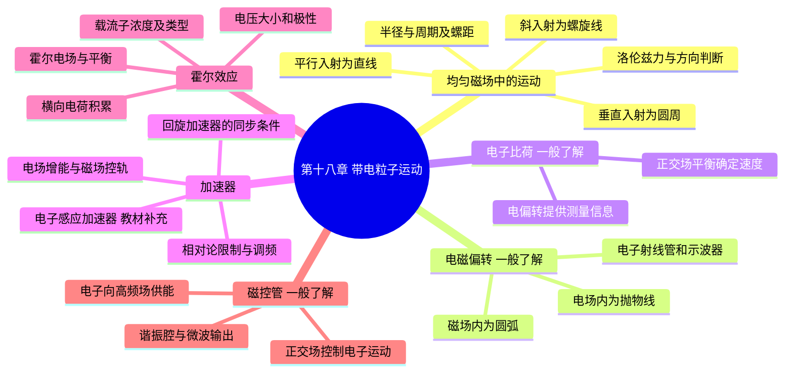

> [!info] 复习范围与符号约定
> - **重点掌握**：§18-1、§18-4 中课件展开的回旋加速器与同步回旋加速器、§18-5。保留受力分析、关键公式及推导。
> - **一般了解，定性理解**：§18-2、§18-3、§18-6。能解释现象、装置作用和物理过程即可，本笔记不列偏转量、比荷测量、磁控管运动方程等计算推导。
> - **电子感应加速器**：属于 §18-4 的教材补充，课件未展开；以原理为主，另列轨道条件供查阅，不据此推定额外考试要求。
> - $q$ 表示带符号的电荷量，$e>0$ 是元电荷，电子带电量为 $-e$；$m$ 在非相对论公式中表示不变的粒子质量，$m_0$ 表示静止质量；$B$ 默认表示磁感应强度的大小。
> - 下文“课件页码”指幻灯片上印出的编号；“教材页码”指书内印刷页码，与 PDF 页序不同。章节编号统一采用教材编号。

## 章节思维导图

## 目录

- [[#本章主线]]
- [[#§18-1 带电粒子在均匀磁场中的运动]]
- [[#§18-2 电场和磁场中的偏转（一般了解）]]
- [[#§18-3 电子比荷的测定（一般了解）]]
- [[#§18-4 带电粒子加速器]]
- [[#§18-5 霍尔效应]]
- [[#§18-6 磁控管（一般了解）]]
- [[#核心公式速查（重点部分）]]
- [[#易错点与解题顺序]]
- [[#整章自检]]
- [[#资料依据与页码对照]]

## 本章主线

**先判断受力，再判断能量是否改变，最后确定轨迹。**

- 电场力可以做功，能够改变动能，也可能改变运动方向。
- 磁场力始终垂直于粒子的瞬时速度，本身不做功。只有磁场力作用时，粒子的速率和动能不变。
- 加速器和磁控管中的能量来自电场；磁场控制轨迹。变化磁场还能产生感生电场，但对粒子做功的仍是电场。

本章采用理想粒子模型，通常忽略重力、碰撞、辐射损失和场区边缘效应；电子感应加速器的能量限制另作定性说明。

# §18-1 带电粒子在均匀磁场中的运动

来源：课件第 91—93 页；教材第 437—439 页（本节例题延续至第 439 页）。

### 1. 受力、方向与运动方程

电场力与磁场力分别为

$$
\mathbf F_E=q\mathbf E,\qquad
\mathbf F_B=q\mathbf v\times\mathbf B.
$$

因此，非相对论运动方程为

$$
\boxed{m\frac{\mathrm d\mathbf v}{\mathrm dt}
=q(\mathbf E+\mathbf v\times\mathbf B)}.
$$

“洛伦兹力”有时专指磁场力，有时指上式中的总电磁力，使用时应看清语境。磁场力大小为

$$
\boxed{F_B=\lvert q\rvert vB\sin\theta},
$$

其中 $\theta$ 是 $\mathbf v$ 与 $\mathbf B$ 的夹角。

**方向判断**：先按右手定则确定 $\mathbf v\times\mathbf B$；正电荷受力同向，负电荷受力反向。磁场垂直纸面向里通常记为 $\otimes$，向外记为 $\odot$。

磁力不做功可以直接由功率判断：

$$
P_B=\mathbf F_B\cdot\mathbf v
=q(\mathbf v\times\mathbf B)\cdot\mathbf v=0.
$$

> [!note] 高速粒子的运动方程
> 课件第 91 页同时给出相对论形式。用动量表示最清楚：
>
> $$
> \frac{\mathrm d\mathbf p}{\mathrm dt}
> =q(\mathbf E+\mathbf v\times\mathbf B),\qquad
> \mathbf p=\gamma m_0\mathbf v,\qquad
> \gamma=\frac1{\sqrt{1-v^2/c^2}}.
> $$
>
> 教材和课件中的“相对论质量”对应 $m_{\mathrm{rel}}=\gamma m_0$；静止质量 $m_0$ 不随速率变化。高速情况下不能把总运动方程简单写成 $\gamma m_0\mathbf a=\mathbf F$。

### 2. 平行入射与静止情形

当初速度与磁场平行或反平行时，叉积为零，粒子沿原方向做匀速直线运动。若粒子原来静止，单独的磁场不能使它开始运动。

### 3. 垂直入射：匀速圆周运动

当 $\mathbf v\perp\mathbf B$，磁场力始终垂直于速度且大小不变，提供向心力。圆周轨道位于垂直于磁场的平面内。

> [!note] 推导：半径、周期与频率
> 由向心力方程
>
> $$
> \lvert q\rvert vB=\frac{mv^2}{R}
> \quad\Longrightarrow\quad
> \boxed{R=\frac{mv}{\lvert q\rvert B}}.
> $$
>
> 再由一周的路程除以速率，得到
>
> $$
> T=\frac{2\pi R}{v}
> =\boxed{\frac{2\pi m}{\lvert q\rvert B}}.
> $$
>
> 因而回旋频率与角频率分别为
>
> $$
> \boxed{\nu=\frac{\lvert q\rvert B}{2\pi m}},\qquad
> \boxed{\omega_c=\frac{\lvert q\rvert B}{m}}.
> $$

**关键结论**：在非相对论、匀强磁场条件下，周期和频率与速率及轨道半径无关。这是普通回旋加速器保持同步的基础。

荷质比（比荷）是 $q/m$，可以带符号；比较偏转强弱时通常使用其大小 $\lvert q\rvert/m$。同样的 $v$ 和 $B$ 下，荷质比的绝对值越大，轨道半径越小。

给定同一速度方向和磁场方向，电荷符号相反时偏转方向相反；只有在 $\lvert q\rvert/m$ 也相同时，半径和周期才相同。

### 4. 斜入射：等螺距螺旋运动

取沿 $\mathbf B$ 的方向为轴向正方向，将初速度分解为

$$
v_\parallel=v_0\cos\theta,\qquad
v_\perp=v_0\sin\theta,\qquad 0\leq\theta\leq\pi.
$$

- 平行分量不受磁力影响，保持不变。
- 垂直分量在垂直于磁场的平面内做匀速圆周运动。
- 两种运动叠加，得到轴线平行于磁场的等螺距螺旋线。

回旋半径由**垂直分量**决定：

$$
\boxed{R=\frac{mv_\perp}{\lvert q\rvert B}
=\frac{mv_0\sin\theta}{\lvert q\rvert B}}.
$$

周期仍为 $T=2\pi m/(\lvert q\rvert B)$。一周内的轴向位移与螺距应区分：

$$
\Delta s_\parallel=v_\parallel T,\qquad
\boxed{h=\lvert v_\parallel\rvert T
=\frac{2\pi mv_0\lvert\cos\theta\rvert}{\lvert q\rvert B}}.
$$

这里 $h$ 表示相邻两圈的轴向**距离**，应非负；$\Delta s_\parallel$ 可以为负，表示沿磁场反方向前进。课件的 $h=v_0\cos\theta\,T$ 对应图中沿磁场前进的情形，或把 $h$ 当作有向位移。

| 初始条件 | 运动轨迹 | 需要注意 |
|---|---|---|
| $v_0=0$ | 保持静止 | 磁场不能把静止电荷加速 |
| $\theta=0$ 或 $\pi$ | 匀速直线 | 不存在实际回旋运动 |
| $\theta=\pi/2$ | 匀速圆周 | 轴向速度为零，$h=0$ |
| 其余夹角 | 等螺距螺旋线 | $v_\perp$ 决定半径，$v_\parallel$ 决定轴向运动 |

### 5. 计算题常用连接

以下关系是由上述定律直接得到的解题工具，不是另立的新定律。

- 粒子从静止经过加速电压 $U_a>0$，若电场做正功，则 $K=\lvert q\rvert U_a$。在非相对论条件下再垂直进入磁场：

$$
v=\sqrt{\frac{2\lvert q\rvert U_a}{m}},\qquad
R=\frac1B\sqrt{\frac{2mU_a}{\lvert q\rvert}}.
$$

- 若只在磁场中走过一段圆弧，先由几何关系求实际转过的圆心角 $\varphi$，再求运动时间：

$$
\boxed{t=\frac{\varphi}{\omega_c}=\frac{\varphi}{2\pi}T}
\qquad(\varphi\text{ 用弧度}).
$$

- 离开场区且不受其他力后，粒子沿出口处的切线做匀速直线运动。

# §18-2 电场和磁场中的偏转（一般了解）

来源：教材第 439—441 页。理解轨迹与装置作用，不要求在本笔记中记忆偏转量公式。

### 1. 电偏转与磁偏转

设电子束以初速度垂直进入均匀电场或均匀磁场，按非相对论模型分析：

| 比较内容 | 电场偏转 | 磁场偏转 |
|---|---|---|
| 受力方向 | 电子受力与电场反向，方向固定 | 电子受力与 $\mathbf v\times\mathbf B$ 反向，随速度方向改变 |
| 场内运动 | 原入射方向匀速，横向匀加速，轨迹为抛物线 | 速率不变，轨迹为圆弧 |
| 能量变化 | 本情形中电场做正功，速率增大 | 磁场力不做功，速率不变 |
| 离开场区后 | 沿出口切线匀速运动 | 沿出口切线匀速运动 |

在其他条件不变时，场越强，偏转通常越明显；入射速度越大，偏转通常越小。教材把磁偏转近似为固定方向的横向加速，只适用于**偏转角很小**的情况；准确轨迹仍是圆弧。

### 2. 电子射线管、示波器与显像管

电子射线管由电子枪、偏转系统和荧光屏等组成。电子枪发射、加速并形成细电子束；偏转系统改变落点；荧光屏把电子束的落点显示为光点。

传统电子射线示波器用两组相互垂直的偏转板控制光点：

- 水平方向施加扫描电压，使光点在有效扫描期间随时间近似匀速移动。
- 竖直方向施加待测电压，使竖直位移反映该电压的大小和正负。
- 两者结合，屏上显示电压随时间变化的曲线；扫描随后快速回扫并重复。

教材还介绍了用外部线圈产生磁场、控制电子束的显像管。**电偏转用偏转板，磁偏转用线圈**；改变板间电压或线圈电流，都能改变屏上的光点位置。这里描述的是传统电子射线管装置的原理。

# §18-3 电子比荷的测定（一般了解）

来源：教材第 441—442 页。重点是实验怎样把未知速度与未知比荷区分开。

### 1. 测的是什么

电子比荷是电子电荷量与质量之比。电子带负电，所以有符号的比荷为负；其静止质量对应的比荷约为 $-1.76\times10^{11}\ \mathrm{C/kg}$，知道数量级即可。

测出比荷，并不等于分别测出了电子电荷量和质量。汤姆孙实验为认识电子提供了重要实验依据。

### 2. 汤姆孙实验的思路

电子枪在真空中产生电子束，荧光屏显示它的落点。电场、磁场与入射速度互相垂直，并安排电场力与磁场力方向相反。

按照教材的实验顺序：

1. **两场都关闭**：记录电子束无偏转时的基准落点。
2. **只加电场**：观察并测量电子束的偏转。偏转程度同时受电子速度与比荷影响，单靠这一步不能把两者分开。
3. **保持电场，再加磁场**：调节磁场，直到光点回到基准位置。此时两种力抵消，由已知场强确定电子速度。
4. **结合前面的电偏转测量**：速度已知后，就能求出电子比荷。

不偏转的物理条件是电场力和磁场力**大小相等、方向相反**。在上述互相垂直的几何条件下，它对应常见的速度选择关系 $v=E/B$；此处理解“用力的抵消确定速度”即可。

### 3. 高速电子的补充说明

高速电子需要用相对论动量分析。教材所说的“比荷绝对值随速度增大而减小”，采用的是电荷与**相对论质量**之比；电子的电荷和静止质量并没有因此改变。不要把它理解成电子固有的电荷或静止质量随速度变化。

# §18-4 带电粒子加速器

来源：课件第 97—101 页；教材第 443—446 页。

### 1. 回旋加速器的结构与过程

两个 D 形金属盒放在真空室内，匀强磁场垂直于盒所在平面；两盒之间接高频交变电压。盒内因电屏蔽近似没有电场，狭缝内存在加速电场，中心附近放置粒子源。

粒子经历的过程为：

1. 通过狭缝时受到电场加速，动能增大。
2. 进入 D 形盒后，磁力提供向心力，粒子以当前速率走半圆。
3. 再次到达狭缝时电场恰好反向，继续对粒子做正功。
4. 速率不断增加，后续半圆的半径不断增大，最后从边缘引出。

**电场增能，磁场控轨。** 各段半圆的半径不同，整条轨迹向外展开；不要把它与匀强磁场中半径恒定的空间螺旋线混淆。教材主要以质子、氘核等离子为例。

### 2. 为什么能连续加速：同步条件

> [!note] 推导：半圈时间与电压频率
> D 形盒内的轨道半径为 $R=mv/(\lvert q\rvert B)$，走过半圈的时间为
>
> $$
> t_{\mathrm{half}}=\frac{\pi R}{v}
> =\frac{\pi m}{\lvert q\rvert B}=\frac T2.
> $$
>
> 在非相对论条件下，这个时间不随速率增加而改变。按照课件的基本同步方式，电压也在这段时间内经历半个周期，恰好反向：
>
> $$
> \boxed{T_{\mathrm{RF}}=T},\qquad
> \boxed{\nu_{\mathrm{RF}}=\nu_c=\frac{\lvert q\rvert B}{2\pi m}}.
> $$

忽略过缝时间时，一周通过狭缝两次，获得两次加速；**相邻两次加速相隔半个周期**。

若每次过缝时的有效加速电压大小均为 $U_a$，则

$$
\Delta K_{\text{每次}}=\lvert q\rvert U_a,\qquad
\Delta K_{\text{每周}}=2\lvert q\rvert U_a.
$$

这里 $U_a$ 是粒子实际过缝时所经历的加速电压，只有在合适相位过缝时才可取电压峰值。

### 3. 最大速率与最大动能

> [!note] 推导：由引出半径求最大动能
> 设最大有效轨道半径为 $R_{\max}$，由半径公式得到
>
> $$
> \boxed{v_{\max}=\frac{\lvert q\rvert BR_{\max}}m}.
> $$
>
> 在非相对论条件下，
>
> $$
> K_{\max}=\frac12mv_{\max}^2
> =\boxed{\frac{q^2B^2R_{\max}^2}{2m}}.
> $$

给定粒子后，理想模型中的最大动能由 $B$ 与 $R_{\max}$ 决定。加速电压主要影响每次增能和达到引出能量所需的圈数，并不直接出现在上述最大动能公式中。

**适用边界**：不能把“增大半径就能提高动能”无限外推。粒子进入相对论速度范围后，普通回旋加速器会失去同步，上述非相对论动能公式也不再适用。

### 4. 同步回旋加速器：随粒子状态调频

在速率较高时，粒子动量为 $p=\gamma m_0v$。每段磁场内的圆周运动满足

$$
R=\frac p{\lvert q\rvert B},\qquad
T=\frac{2\pi R}{v}
=\frac{2\pi\gamma m_0}{\lvert q\rvert B}.
$$

磁场保持不变时，速率增加使 $\gamma$ 增大，因此回旋周期变长、回旋频率降低。固定频率的加速电压不再能保证粒子每次过缝都获得加速。

保持同步的方法是相应**降低高频电压频率**：

$$
\boxed{\nu_{\mathrm{RF}}=
\frac{\lvert q\rvert B}{2\pi\gamma m_0}}.
$$

课件第 100 页称其为“同步回旋加速器”，第 101 页简称“同步加速器”。本节具体指**固定磁场、调整高频电压频率**的方案，不要把所有名称中带“同步”的加速器都当作相同装置。

### 5. 电子感应加速器（教材补充）

教材第 444—446 页介绍电子感应加速器（Betatron）。它利用变化磁通量产生的环形感生电场，对电子持续做功；轨道处的磁场提供向心力。

需要理解的三点：

- **加速来自感生电场**：不是磁场力直接对电子做功，也不依赖反复穿过 D 形盒狭缝。
- **轨道可以保持固定半径**：随着电子动量增大，轨道处的磁场也相应增强，从而继续把电子约束在同一圆形轨道上。
- **以脉冲方式工作**：教材图示的交流磁场中，只有部分时段同时满足电场加速方向与磁力指向圆心的条件。辐射损失和电磁铁尺寸又限制了可获得的能量；可用于产生硬 X 射线等。

供查阅的固定轨道条件为

$$
\boxed{\overline B=2B_R}.
$$

$B_R$ 是电子轨道处的磁感应强度，$\overline B$ 是轨道所围圆面积内的平均磁感应强度。两者不是同一个量；为满足这个条件，磁场需有合适的径向分布。

> [!note] 轨道条件的适用说明
> 固定半径要求动量与轨道处磁场同步增长。教材从加速开始时动量和磁通量均为零的理想条件出发，得到上式；若只由变化率关系积分，不能无条件丢掉积分常数。这里保留物理含义与结论，不展开教材补充推导。

| 装置 | 提供能量的电场 | 需要把握的区别 |
|---|---|---|
| 普通回旋加速器 | 狭缝中的固定频率交变电场 | 非相对论回旋周期不变，轨道向外扩展 |
| 同步回旋加速器 | 狭缝中的调频交变电场 | 固定磁场时随 $\gamma$ 增大降低电压频率 |
| 电子感应加速器 | 变化磁通量产生的感生电场 | 磁场按要求变化，可保持固定轨道半径 |

# §18-5 霍尔效应

来源：课件第 103—106 页；教材第 446—448 页。

### 1. 定义与几何关系

载流导体或半导体薄板置于磁场中，当磁场垂直于电流时，在**同时垂直于电流和磁场的横向两侧**出现电势差，这就是霍尔效应。

为使正负号明确，本笔记采用与课件正负关系一致的一组坐标约定：

- 电流沿 $+x$ 方向，$I>0$。
- 磁场沿 $+z$ 方向，$B>0$。
- 薄板横向宽度为 $b$，沿 $y$ 方向；沿磁场方向的厚度为 $d$。
- 规定霍尔电压为 $U_H=V(y=0)-V(y=b)$。

**$b$ 是两霍尔电极的间距，$d$ 是沿磁场方向的厚度。** 两者不能混淆。

### 2. 霍尔电场怎样形成

1. 电流存在时，载流子具有平均定向运动速度 $\mathbf v_d$。
2. 磁场使载流子受横向洛伦兹力，向薄板一侧偏移。
3. 两侧出现异号电荷积累，形成横向霍尔电场 $\mathbf E_H$。
4. 电场力逐渐抵消磁场力，直到横向达到稳态，不再有持续的净横向电流。

横向平衡条件为

$$
q(\mathbf E_H+\mathbf v_d\times\mathbf B)=0
\quad\Longrightarrow\quad
\boxed{\mathbf E_H=-\mathbf v_d\times\mathbf B}.
$$

在漂移速度垂直于磁场时，大小关系为 $E_H=v_dB$。达到平衡并不表示纵向电流消失，也不表示电子停止热运动。

### 3. 霍尔电压大小的推导

> [!note] 推导：从漂移速度到电流
> 先只计算大小。设单一类型载流子的数密度为 $n$，其电荷量大小为 $\lvert q\rvert$，则
>
> $$
> \lvert U_H\rvert=E_Hb=v_dBb.
> $$
>
> 电流通过的横截面积为 $bd$，所以
>
> $$
> I=n\lvert q\rvert v_dbd
> \quad\Longrightarrow\quad
> v_d=\frac I{n\lvert q\rvert bd}.
> $$
>
> 代入得到
>
> $$
> \boxed{\lvert U_H\rvert=\frac{IB}{n\lvert q\rvert d}}.
> $$

因此，固定材料及几何条件时，霍尔电压大小与 $I$、$B$ 成正比，与 $d$ 成反比。宽度 $b$ 在代入电流关系后消去；**在电流 $I$ 固定时**，霍尔电压大小不直接依赖 $b$。

### 4. 电压正负与霍尔系数

按照前述坐标及电压约定，$j_x=nqv_{d,x}$，并且

$$
E_{H,y}=v_{d,x}B=\frac{j_xB}{nq}.
$$

由 $U_H=V(0)-V(b)=E_{H,y}b$，得到

$$
\boxed{U_H=R_H\frac{IB}{d}},\qquad
\boxed{R_H=\frac1{nq}}.
$$

这里 $q$ **必须带符号**，$R_H$ 的 SI 单位为 $\mathrm{m^3/C}$。

| 载流子 | 漂移方向与电流的关系 | 霍尔系数 | 本文约定下的电压 |
|---|---|---|---|
| 电子，$q=-e$ | 相反 | $R_H=-1/(ne)$ | $U_H<0$ |
| 空穴，等效电荷 $q=+e$ | 相同 | $R_H=+1/(ne)$ | $U_H>0$ |

在本文几何约定下，两种载流子的磁力都指向 $-y$，但该侧积累的电荷符号不同，所以霍尔电场和霍尔电压极性相反。

> [!tip] 判断极性的可靠顺序
> 电流方向 → 载流子漂移方向 → $q\mathbf v_d\times\mathbf B$ 的方向 → 哪侧积累正／负电荷 → 哪侧电势高 → 按规定次序作电势差。
>
> 交换电压表两端，读数会反号；只反转电流或只反转磁场，霍尔电压也反号；同时反转电流与磁场则保持原符号。不要只凭电压表上的一个正负号判断导电类型。

### 5. 物理意义、应用与模型边界

单一载流子模型下，载流子电荷量确定时，

$$
\lvert R_H\rvert=\frac1{n\lvert q\rvert},\qquad
\boxed{n=\frac1{e\lvert R_H\rvert}}
\quad(q=\pm e).
$$

- **测浓度**：由霍尔系数大小反求载流子浓度。
- **判类型**：在单一类型载流子占主导的半导体中，负霍尔系数对应电子导电（n 型），正霍尔系数对应空穴导电（p 型）。
- **测磁场等**：霍尔元件可用于磁场、电流、位置和转速检测。
- **为什么常用半导体**：其载流子浓度通常比金属低，霍尔系数绝对值更大，在同样的 $I$、$B$、$d$ 下更容易得到明显的霍尔电压。

上述 $R_H=1/(nq)$ 是简单单一载流子模型的结果。教材提醒，有些材料不能用这种简单模型解释；多种载流子或复杂材料的结果不能直接按该式反推浓度和类型。

# §18-6 磁控管（一般了解）

来源：教材第 448—451 页。理解结构、轨迹变化、能量流向与电子聚集，不记运动参数方程、临界磁场公式或谐振频率计算式。

### 1. 装置与用途

磁控管是一种产生微波的自激振荡器，把直流电能转化为高频电磁能。可用于雷达、微波加热等。

教材所说的约 $300\ \mathrm{MHz}$ 至 $300\ \mathrm{GHz}$、波长约 $1\ \mathrm m$ 至 $1\ \mathrm{mm}$，是**微波的一般范围**，不是单个磁控管能够覆盖的全部工作频率。

主要结构及作用：

| 部分        | 作用                    |
| --------- | --------------------- |
| 中心阴极      | 发射电子                  |
| 外围阳极及直流电压 | 建立径向电场，为电子提供能量        |
| 轴向磁场      | 与径向电场正交，使电子轨迹弯曲       |
| 阳极上的谐振腔   | 类似电感、电容储能系统，选择并支持高频振荡 |
| 输出耦合结构    | 把高频电磁能量引出             |

阳极电势高于阴极，静电场从外侧阳极指向中心阴极；电子带负电，受到的静电力指向阳极。

### 2. 正交场怎样控制电子

先不考虑高频场：电子离开阴极后，电场使它获得动能，磁场使其运动方向改变。

- 磁场较弱时，电子能够到达阳极，形成阳极电流。
- 磁场增强时，电子轨迹弯曲得更明显；超过相应临界条件后，电子可能无法到达阳极，出现磁截止。
- 教材把很窄的阴、阳极间隙近似为平行板，在均匀正交静电场和静磁场中，从静止出发的电子呈摆线（旋轮线）轨迹。这是特定近似模型，不能说实际磁控管中的所有电子轨迹都是摆线。

这一过程中电子的动能可以变化，因为电场在做功；磁场力仍然不做功。加入高频场后，电子轨迹和是否能到达阳极还会改变。

### 3. 电子怎样把能量交给微波

谐振腔中存在高频场后，电子与它交换能量：

- 高频电场对电子做正功时，电子吸收高频场能量，振荡受到削弱。
- 高频电场对电子做负功时，电子把能量交给高频场，振荡得到增强。

选择合适的电压、磁场与运行相位，使参与有效作用的电子总体持续向高频场供能，才能维持振荡。教材讨论相邻腔高频场相位相反的 $\pi$ 模式；电子到达下一腔时，场也适时反向，使其继续向高频场交能。

高频场还会使电子逐渐聚集成旋转的“辐条”，有利于持续、协调地向振荡供能。教材的八腔 $\pi$ 模式示例形成四条电子辐条，这只是定性示例，不需要推导其转速。

能量传递顺序为：**直流电源 → 电子 → 谐振腔中的高频场 → 输出微波**。谐振腔负责储能和选择振荡频率，维持输出所需的能量来自直流电源。

## 核心公式速查（重点部分）

下表以非相对论、理想粒子模型为默认条件；相对论公式单独标出。一般了解部分的定量公式不混入本表。

| 内容 | 公式 | 条件或提醒 |
|---|---|---|
| 总电磁力 | $\mathbf F=q(\mathbf E+\mathbf v\times\mathbf B)$ | $q$ 带符号 |
| 磁场力大小 | $F_B=\lvert q\rvert vB\sin\theta$ | 静止或平行入射时为零 |
| 回旋半径 | $R=mv_\perp/(\lvert q\rvert B)$ | 用垂直速度分量 |
| 回旋周期 | $T=2\pi m/(\lvert q\rvert B)$ | 与速率无关仅限非相对论 |
| 回旋频率 | $\nu=\lvert q\rvert B/(2\pi m)$ | 注意与角频率的区别 |
| 回旋角频率 | $\omega_c=\lvert q\rvert B/m$ | $\omega_c=2\pi\nu$ |
| 螺距 | $h=\lvert v_\parallel\rvert T$ | 距离非负；轴向位移可带符号 |
| 圆弧运动时间 | $t=\varphi T/(2\pi)$ | 实际转角 $\varphi$ 用弧度 |
| 普通回旋加速器同步 | $\nu_{\mathrm{RF}}=\nu_c$ | 相邻两次过缝相隔 $T/2$ |
| 每次过缝增能 | $\Delta K=\lvert q\rvert U_a$ | $U_a$ 是有效加速电压 |
| 最大引出速率 | $v_{\max}=\lvert q\rvert BR_{\max}/m$ | 普通回旋加速器理想模型 |
| 最大引出动能 | $K_{\max}=q^2B^2R_{\max}^2/(2m)$ | 非相对论 |
| 相对论回旋周期 | $T=2\pi\gamma m_0/(\lvert q\rvert B)$ | $\gamma=(1-v^2/c^2)^{-1/2}$ |
| 同步回旋加速器调频 | $\nu_{\mathrm{RF}}=\lvert q\rvert B/(2\pi\gamma m_0)$ | 固定 $B$ 时随 $\gamma$ 增大而降低 |
| 霍尔横向平衡 | $\mathbf E_H=-\mathbf v_d\times\mathbf B$ | 横向稳态 |
| 电流大小 | $I=n\lvert q\rvert v_dbd$ | 单一载流子，横截面为 $bd$ |
| 霍尔电压大小 | $\lvert U_H\rvert=IB/(n\lvert q\rvert d)$ | $d$ 沿磁场方向 |
| 有符号霍尔电压 | $U_H=R_HIB/d$ | 使用正文的电流、磁场及测量方向约定 |
| 霍尔系数 | $R_H=1/(nq)$ | 简单单一载流子模型 |
| 载流子浓度 | $n=1/(e\lvert R_H\rvert)$ | 载流子电荷为 $\pm e$ |

教材补充的 Betatron 条件另记为 $\overline B=2B_R$，其物理含义及理想初始条件见 [[#5. 电子感应加速器（教材补充）]]。

## 易错点与解题顺序

### 易错点

1. **磁力不做功不等于粒子永远不加速**：圆周运动有向心加速度，只是速率不变；同时存在电场时，速率也可以改变。
2. **速度分量不可混用**：回旋半径用 $v_\perp$，螺距用 $\lvert v_\parallel\rvert$。
3. **符号与大小分开**：方向判断用带符号的 $q$；半径、周期和电压大小用绝对值。
4. **相对论条件不可遗漏**：高速粒子仍有磁力不做功的结论，但回旋周期不再与速率无关。
5. **正交场不一定平衡**：只有电、磁力方向相反且大小相等时，才有不偏转；$v=E/B$ 还依赖规定的入射方向。
6. **回旋加速器的半周期容易弄错**：半圈后电压反向，一整圈加速两次。
7. **霍尔厚度不能取成宽度**：分母中的 $d$ 沿磁场方向，$b$ 沿霍尔电压方向。
8. **霍尔系数不是任意材料都等于 $1/(nq)$**：判断浓度和类型时需满足模型条件。
9. **不要把微波范围当作器件调频范围**，也不要把磁控管的平行板近似轨迹当作所有工作状态下的精确轨迹。

### 解题顺序

1. 画出电场、磁场、初速度方向，标明电荷正负。
2. 判断哪些力做功，能否使用动能关系。
3. 纯磁场运动先分解速度，再写半径、周期和螺距。
4. 有限场区结合圆弧几何求出口位置、方向及转角。
5. 加速器核对过缝次数与同步条件；霍尔题先标清 $I$、$B$、$b$、$d$ 及电压方向。
6. 最后检查单位、符号、数量级和公式适用条件。

## 整章自检

> [!question]- 自检题与答案（点击展开）
>
> 1. **为什么磁场力不改变速率，却能产生加速度？** 受力垂直于瞬时速度，功率为零；速度方向仍可改变，因此有加速度。
> 2. **粒子平行、垂直、斜向进入匀强磁场时分别怎样运动？** 非零速度下分别为直线、圆周和螺旋线；静止粒子保持静止。
> 3. **螺旋半径与螺距分别取哪个速度分量？** $R=mv_\perp/(\lvert q\rvert B)$，$h=\lvert v_\parallel\rvert T$。
> 4. **正负电荷的轨道一定一样大吗？** 不一定。只有速率、入射角、磁场以及 $\lvert q\rvert/m$ 相同时，半径与周期才相同；偏转方向相反。
> 5. **电偏转与磁偏转有什么关键区别？** 在本节的垂直入射模型中，电场内为抛物线且速率增加；磁场内为圆弧且速率不变。离场后均沿切线运动。
> 6. **汤姆孙实验为什么还需要磁场？** 仅由电偏转不能分开速度和比荷；调磁场使两力抵消，就能先确定速度，再结合电偏转求比荷。
> 7. **回旋加速器中半圈需要多久？一周加速几次？** 半圈为 $T/2=\pi m/(\lvert q\rvert B)$；忽略过缝时间时一周加速两次。
> 8. **理想回旋加速器的最大动能由什么决定？** 给定粒子后，由 $B$ 和 $R_{\max}$ 决定：$K_{\max}=q^2B^2R_{\max}^2/(2m)$；加速电压影响每次增能和圈数。
> 9. **同步回旋加速器为什么降低电压频率？** 固定磁场下，$\gamma$ 增大使回旋周期变长，必须降低频率才能保持同步。
> 10. **电子感应加速器中的磁场直接给电子能量吗？** 不直接给。变化磁通量产生的感生电场做功，磁力控制轨迹。
> 11. **霍尔电压怎样建立？** 磁力横向偏转载流子，边缘电荷积累形成霍尔电场，最终电场力与磁场力在横向平衡。
> 12. **霍尔电压反号一定表示换了载流子吗？** 不一定，反转电流、磁场或电压测量方向也会反号。
> 13. **单一载流子模型下，怎样由霍尔系数求浓度？** 当 $q=\pm e$，有 $n=1/(e\lvert R_H\rvert)$；$n$ 的单位为 $\mathrm{m^{-3}}$。
> 14. **磁控管的高频场怎样得到能量？** 电子从直流电场获得能量，再在适当相位向高频场交能；谐振腔支持振荡，耦合结构输出微波。

## 资料依据与页码对照

| 资料 | 对应位置 | 用途 |
|---|---|---|
| `014稳恒磁场-week5.pdf` | PDF 第 1 页，幻灯片第 71 页 | 课程范围；§18.2、§18.3、§18.6 标为一般了解 |
| 同上 | PDF 第 4 页，幻灯片第 91—93 页 | 均匀磁场中的粒子运动 |
| 同上 | PDF 第 4—5 页，幻灯片第 97—101 页 | 回旋加速器与同步回旋加速器 |
| 同上 | PDF 第 5—6 页，幻灯片第 103—106 页 | 霍尔效应、系数、意义与应用 |
| `工程物理学(第三版) 440-477.pdf` | PDF 第 20—35 页，书内第 437—452 页 | 第十八章正文与摘要；扫描文件名不代表书内印刷页码 |
| `015物质中磁场-week5.pdf` | 第十五章磁介质内容 | 已核查；不属于本章遗漏内容，不混入第十八章 |
